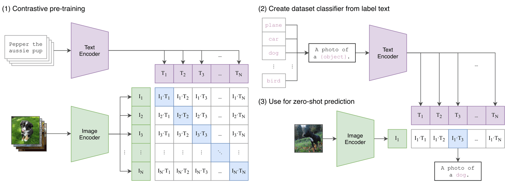

## 📝 多模态基石：CLIP 算法深度学习笔记

> **前言**：多模态（Multimodal）是当前大语言模型（LLM）与通用人工智能（AGI）的核心演进方向。而 OpenAI 在 2021 年提出的 **CLIP（Contrastive Language–Image Pretraining）** 算法，则是连接视觉与语言两大模态的开山之作。“不理解 CLIP，就无法深入理解多模态。”

## 1. 什么是多模态？

在现实世界中，信息是多维度的（图像、文本、语音、视频等）。多模态 AI 的核心目的在于**打破不同模态之间的壁垒，建立跨模态的统一语义表达**。

常见的多模态任务场景包括：

- **图生文（Image-to-Text）**：如视觉问答（VQA）、图像描述（Image Captioning）。
    
- **文生图（Text-to-Image）**：如 Stable Diffusion、Midjourney（CLIP 在其中承担文本与图像对齐的引导作用）。
    

CLIP 正是解决这些跨模态任务的最底层通用基础架构。

## 2. CLIP 算法的诞生与核心思想

- **提出者**：OpenAI（2021 年论文 _Learning Transferable Visual Models From Natural Language Supervision_）
    
- **核心一句话总结**：CLIP 通过**对比学习（Contrastive Learning）**，将图像特征向量与文本特征向量映射到同一个统一的**高维语义空间**中，使得互为描述的图文向量在空间中的距离尽可能近，无关的图文向量距离尽可能远。
    

## 3. 经典案例：如何用文本检索图像？

**场景**：假设有 10 张乱码命名的图片，输入查询语句 `"a dog on the grass"`，如何找到目标图片？

```
  [文本描述 T] ──> [Text Encoder]  ──> 文本向量 T (d维)
                                            │
                                    计算余弦相似度 (cos θ)
                                            │
  [图像 I1~I10] ─> [Image Encoder] ──> 图像向量 I1~I10 (d维)
```

1. **特征提取**：
    
    - 文本经过 **Text Encoder**（如 Transformer/BERT）转化为特征向量 $T$。
        
    - 10 张图片经过 **Image Encoder**（如 ResNet 或 ViT）转化为特征向量 $I_1, I_2, \dots, I_{10}$。
        
2. **空间映射**：通过线性投影（Projection）将 $T$ 和 $I_1 \sim I_{10}$ 映射到**相同维度 $d$ 的联合嵌入空间**（Joint Embedding Space）。
    
3. **相似度计算与排序**：
    
    - 利用**余弦相似度**（Cosine Similarity）计算 $T$ 与每个 $I_k$ 的点积：$\text{Similarity} = \frac{T \cdot I_k}{\Vert{}T\Vert{} \Vert{}I_k\Vert{}}$。
        
    - 相似度最高且超过指定阈值的图像即为检索结果（例如 $T \cdot I_3$ 相似度最高，则输出第 3 张图片）。
        

## 4. CLIP 架构图详解


下图展示了 CLIP 论文中的核心训练与计算流程：

```
 (1) 对比预训练 (Contrastive Pre-training)
  Image Encoder ──> [I1, I2, ... IN] ┐
                                     ├─> N×N 相似度矩阵 (对角线为正样本)
  Text Encoder  ──> [T1, T2, ... TN] ┘

 (2) 零样本推理 (Zero-Shot Prediction)
  Text Prompts  ──> Text Encoder  ──> [T1, T2, ... TK] ┐
                                                        ├─> 匹配最大值 ──> 预测类别
  Test Image    ──> Image Encoder ──> [I1]             ┘
```

1. **输入数据**：配对的 $N$ 个图文对 $(I_1, T_1), (I_2, T_2), \dots, (I_N, T_N)$。
    
2. **双编码器（Dual-Encoder）架构**：
    
    - **Text Encoder**：提取文本的高维特征。
        
    - **Image Encoder**：提取图像的高维特征（如 ViT-B/32 或 ResNet-50）。
        
3. **$N \times N$ 相似度矩阵**：
    
    - 行代表图像，列代表文本。
        
    - 矩阵元素 $S_{i,j} = I_i \cdot T_j$ 代表第 $i$ 张图片与第 $j$ 段文本的匹配程度。
        
    - **主对角线** $S_{i,i}$（如 $I_1 \cdot T_1$）为**正样本对**；**非对角线** $S_{i,j} (i \neq j)$ 为**负样本对**。
        
### 嵌入补充部分：CLIP 的网络模型结构细节

## 1. 图像编码器（Image Encoder）

CLIP 论文中探索了两种不同路线的图像编码器架构：

#### (1) 基于 ResNet 的改进架构

- **基础骨干**：以 ResNet-50 为基础，融合了 **ResNet-D** 的改进（优化了 Downsampling 卷积路径）以及**抗锯齿矩形模糊池化（Anti-aliased Rect-2 Pooling）**。
    
- **注意力池化（Attention Pooling）**：去掉了传统 ResNet 最后的全局平均池化层（Global Average Pooling），替换为**单层 Transformer 式的多头 QKV 注意力池化**。
    
    - **Query**：基于全图的全局平均池化特征。
        
    - **Key / Value**：来自于卷积特征图（Feature Map）的各个空间位置。
        
    - **目的**：让模型能够根据全图语义动态关注图像中更关键的视觉区域，从而提取出更强的全局特征。
        

#### (2) 基于 Vision Transformer (ViT) 的架构

- **基本流程**：
    
    1. **图片分块（Patchifying）**：将输入图像切分为 $P \times P$ 的图像块（Patches）。
        
    2. **位置编码（Position Embeddings）**：将图像块展开为序列后，加上位置编码信息。
        
    3. **Transformer 提取**：输入到 Transformer Encoder 中，利用自注意力机制（Self-Attention）计算不同图像块之间的关联度。
        
- **CLIP 对 ViT 的小修改**：
    
    - 在 Transformer 层之前，对 Patch 与 Position Embeddings 的组合特征添加了**额外的层归一化（Layer Normalization）**。
        
    - 使用了微调后的初始化方案（Initialization Scheme），以保证多模态对比训练时的收敛稳定性。
        

## 2. 文本编码器（Text Encoder）

CLIP 的文本编码器是一个标准的 **Decoder-only / Encoder Transformer 架构**（根据 Radford 等人的 GPT 系列改进）：

- **模型规模**：基础版本（Base）采用 **12 层、512 隐层宽度、8 个注意力头** 的 Transformer 结构。
    
- **分词器（Tokenizer）**：使用**小写字节对编码（BPE, Byte Pair Encoding）**，词表大小约为 49,152。
    
- **文本标记与特征提取**：
    
    - 输入文本序列前后分别用 `[SOS]`（Start of Sequence）和 `[EOS]`（End of Sequence）标记包裹。
        
    - **特征向量来源**：提取 Transformer 最高层在 **`[EOS]` 标记处** 的激活特征（经过 Layer Normalization 后），再通过一个**线性投影层（Linear Projection）**，将其映射到与图像特征维度一致的多模态嵌入空间中。
        
- **掩码自注意力（Masked Self-Attention）**：文本编码器采用了隐藏的自注意力（Causal Masking），保留了未来引入语言模型（LM）作为辅助训练目标的可能性。
    

## 3. 核心数学机制：缩放点积注意力（Scaled Dot-Product Attention）

不论是 ViT 还是 Text Encoder，其核心计算单元均基于 Transformer 的**缩放点积注意力机制**：

给定输入通过线性变换得到的查询矩阵 $\mathbf{Q}$、键矩阵 $\mathbf{K}$、值矩阵 $\mathbf{V}$，计算公式如下：

$$\text{Attention}(\mathbf{Q}, \mathbf{K}, \mathbf{V}) = \text{softmax}\left(\frac{\mathbf{Q}\mathbf{K}^T}{\sqrt{d_K}}\right)\mathbf{V}$$

- **$\sqrt{d_K}$ 缩放因子**：除以键维度 $d_K$ 的平方根，防止当维度 $d_K$ 较大时，点积结果过大而导致 Softmax 函数进入梯度极小的饱和区。
    
- **多头注意力（Multi-Head Attention）**：将特征投影到 $h$ 个不同的子空间并行计算注意力，其中 $d_K = d_V = d_{model} / h$，最后拼接所有头的输出，极大丰富了模型表达不同语义特征的能力。
## 5. 使用 CLIP 进行 Zero-Shot（零样本分类）

传统分类模型只能预测固定类别（如 ImageNet 的 1000 类），而 CLIP 在推理时**无需重新训练或微调**，即可直接预测任意新类别。

### 零样本分类步骤：

1. **构造 Prompt 文本**：把类别标签（如 `dog`, `cat`, `plane`）套入固定的文本模板，组成完整的句子：
    
    - `"A photo of a dog."` $\rightarrow T_1$
        
    - `"A photo of a cat."` $\rightarrow T_2$
        
    - `"A photo of a plane."` $\rightarrow T_3$
        
2. **提取文本向量库**：将这 $K$ 个句子输入 Text Encoder，得到 $K$ 个文本向量 $T_1, T_2, \dots, T_K$（相当于动态构建了一个分类头）。
    
3. **提取图像特征**：将待分类的测试图片输入 Image Encoder，得到图像向量 $I$。
    
4. **计算 Softmax 概率**：计算 $I$ 与所有 $T_k$ 的相似度，取得分最高的类别作为分类结果：
    
    $$\text{Prediction} = \arg\max_k \left( \text{Softmax}(I \cdot T_k) \right)$$
    

> 💡 **补充细节：Prompt Engineering & Ensemble**
> 
> - 直接使用单词 `"dog"` 提取的特征容易存在词义歧义（例如是动物狗还是热狗？）。
>     
> - 使用模板 `"A photo of a {class}."` 明确了语境，性能会显著提升。
>     
> - **Prompt 集成（Ensemble）**：使用多个模板（如 `"A photo of a small {class}"`、`"A photo of a big {class}"`）提取特征后求平均，可使 Zero-Shot 准确率再提升 1%~2%。
>     

那么，这个特征向量是怎么做到“将未见过的概念进行语义关联”的呢？

#### 1. 语义空间的“空间相对位置”

文本编码器和图像编码器，作用就是把复杂的文字和像素，映射到一个高维的几何空间（比如 512 维）里。在这个空间中：

- **语义越接近的东西，它们的向量方向就越平行（夹角越小，余弦相似度越接近 1）。**
    
- **语义无关的东西，它们的向量方向就接近垂直（余弦相似度接近 0）。**
    

#### 2. “没见过”不代表“无法定位”

假设模型在预训练阶段看过了海量的图文对，它已经在高维空间里建立了一套极其丰富且连续的“概念坐标系”：

- 它知道“猫”和“狗”的向量靠得很近（因为都是四脚宠物）；
    
- 它知道“翅膀”、“羽毛”、“飞”这些词对应的向量方向；
    
- 它知道“袋鼠”和“考拉”都和“澳大利亚”、“有袋类动物”放在同一块区域。
    

当你给它一个全新的词汇（比如从未作为分类标签出现过的“袋鼠”）：

1. **Text Encoder（文本编码器）** 会根据语境和文本特征，把 `"a photo of a kangaroo"` 映射到高维空间中的坐标点 $T_{\text{kangaroo}}$。
    
2. **Image Encoder（图像编码器）** 拿到一张袋鼠照片，根据其视觉特征（有袋子、站立姿势、大尾巴），把图像映射到坐标点 $I_{\text{image}}$。
    
3. 因为模型在预训练时学会了**将视觉特征（有袋子、大尾巴）与文本概念（“kangaroo”、“pouch”）重合在同一个空间区域**，所以 $T_{\text{kangaroo}}$ 和 $I_{\text{image}}$ 会自然而然地落在大致相同的坐标位置。
    

计算它们点积（余弦相似度）时，结果就会非常高。这就是所谓的“零样本语义关联”——**它靠的是高维连续空间中的相对位置与语义映射，而不是硬记分类头。**
## 6. CLIP 的训练思路与损失函数（深度补充）

### 6.1 对比学习（Contrastive Learning）机制

CLIP 的训练本质是一个**双向分类问题**：

- 预训练使用了 OpenAI 收集的 **4 亿对互联网海量图文数据集（WIT-400M）**。
    
- 在每一个 Batch 中，包含 $N$ 个图文对，产生 $N \times N$ 的矩阵。
    
- **目标**：通过梯度下降，拉近对角线上 $N$ 个正样本对的距离（使其点积趋近于 1），推开非对角线上 $N^2 - N$ 个负样本对的距离（使其点积趋近于 0）。
    

### 6.2 损失函数：对称交叉熵（Symmetric Cross-Entropy Loss）

为了在数学上实现这一目标，CLIP 在相似度矩阵上沿着**行**与**列**分别计算 Softmax 交叉熵：

```
                列方向：图像到文本 (Image-to-Text)
                 T1     T2     T3  ...  TN
              ┌──────┬──────┬──────┬───┬──────┐
          I1  │  ★   │  ×   │  ×   │   │  ×   │
行方向：   I2  │  ×   │  ★   │  ×   │   │  ×   │
文本到图像 I3  │  ×   │  ×   │  ★   │   │  ×   │  (★ 为正样本，× 为负样本)
(Text-to- │  :   │  :   │  :   │   │  :   │
 Image)   IN  │  ×   │  ×   │  ×   │   │  ★   │
              └──────┴──────┴──────┴───┴──────┘
```

1. **图像到文本 Loss ($\mathcal{L}_{I \to T}$)**：对于每张图片 $I_i$，预测其对应的文本（按行计算 Softmax）：
    
    $$\mathcal{L}_{I \to T} = -\frac{1}{N} \sum_{i=1}^{N} \log \frac{\exp(I_i \cdot T_i / \tau)}{\sum_{j=1}^{N} \exp(I_i \cdot T_j / \tau)}$$
    
2. **文本到图像 Loss ($\mathcal{L}_{T \to I}$)**：对于每段文本 $T_j$，预测其对应的图片（按列计算 Softmax）：
    
    $$\mathcal{L}_{T \to I} = -\frac{1}{N} \sum_{j=1}^{N} \log \frac{\exp(I_j \cdot T_j / \tau)}{\sum_{i=1}^{N} \exp(I_i \cdot T_j / \tau)}$$
    
3. **最终总 Loss**：两者的平均值：
    
    $$\mathcal{L}_{total} = \frac{\mathcal{L}_{I \to T} + \mathcal{L}_{T \to I}}{2}$$
    

> **关键参数 $\tau$（Temperature 缩放因子）**：
> 
> 在计算点积后，CLIP 会乘上一个**可学习的温度参数 $\tau$**（Log-parameterized Temperature）。它可以控制概率分布的尖锐程度，防止梯度消失或爆炸，极大地提升训练稳定性。

## 7. 总结与延伸思考

### 7.1 CLIP 的核心优势

1. **强悍的 Zero-Shot 泛化能力**：不需要为新数据集重新训练模型。
    
2. **对比学习高效收敛**：相比传统“预测下一个词/生成图像”的生成式任务，对比任务学习难度低，训练效率提升了 4 倍以上。
    
3. **统一语义空间**：为后续大模型的视觉与语言融合（如 LLaVA、GPT-4V、Diffusion 模型）奠定了表征基础。
    

### 7.2 CLIP 的局限性

1. **细粒度识别较差**：对于极其相近的物种、复杂数学图形、数数（Counting）或空间相对位置判断（如“左边”与“右边”）表现一般。
    
2. **硬件要求极高**：为保证负样本数量足够多，CLIP 采用了超大的 Batch Size（通常为 $N=32768$），极度依赖海量算力。
    
3. **缺乏密集的局部特征**：CLIP 输出的是图像的全局特征向量，无法直接用于目标检测（Bounding Box）和语义分割（Pixel-level Segment）。
    

### 💡 延伸思考：CLIP 之后的演进脉络

- **开源替代**：OpenCLIP、BLIP。
    
- **提示词优化**：CoOp / CoCoOp（将文本 Prompt 变为可学习的连续向量，无需人工设计模板）。
    
- **下游任务迁移**：LSeg（语义分割）、GLIP（目标检测）、Stable Diffusion（作为文本 Encoder 指引图像生成）。

