## 水冷
**画出水冷板，用ANSYS仿真**
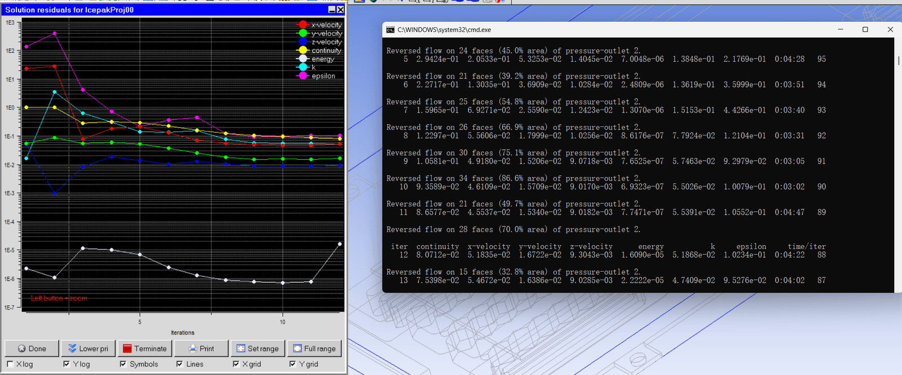
*ansys水冷仿真收敛*

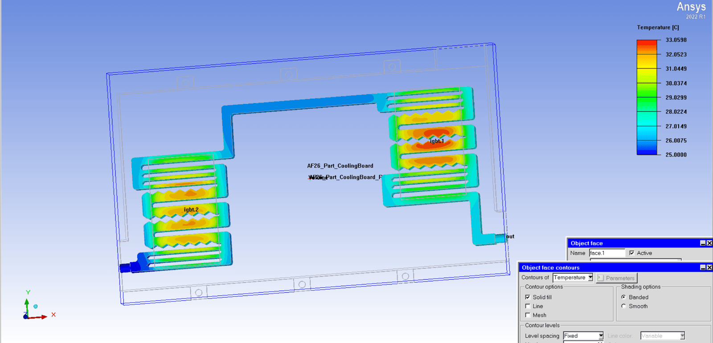
*ansys水冷水道散热图*

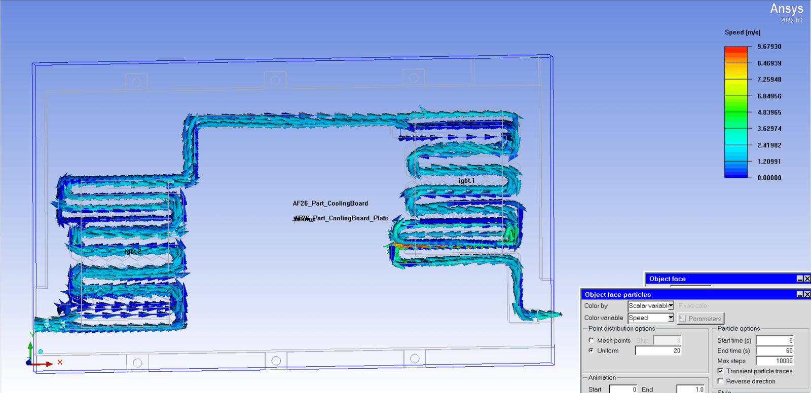
*ansys水冷水道流速图*

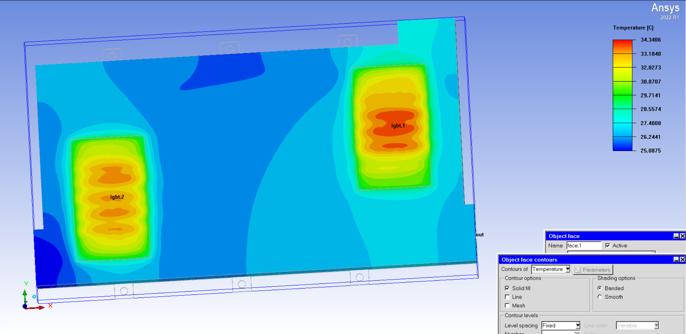
*ansys水冷外壳散热图*

**再设计散热流道**
散热器出口➔ 水泵中心进水口➔ 水泵切向出水口➔水冷板进水口 ➔ 流经内部流道（中央直肋冲刷/两侧波浪扰流） ➔ 水冷板出水口➔ 散热器进口 ➔ 双风扇强制抽风对流散热 ➔ 返回散热器出口（闭合循环）。

## 流场
**先干出整车建模，再划分网格，以及一堆参数设置。**
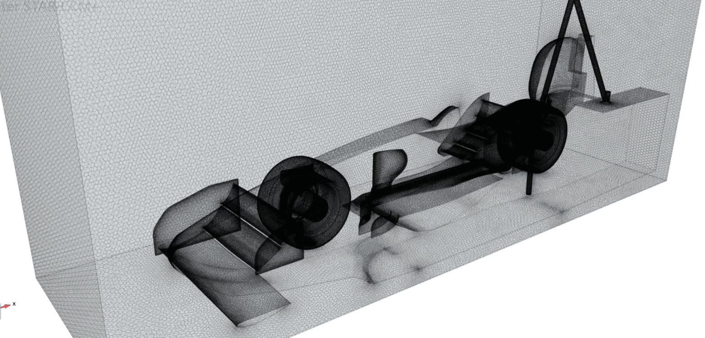
*star-ccm+网格划分*

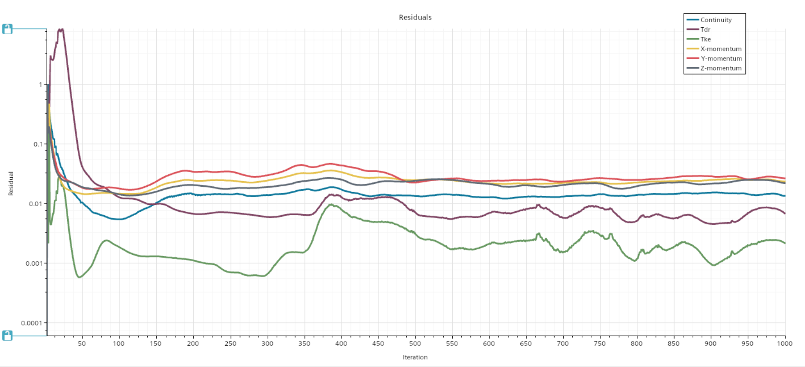
*star-ccm+仿真收敛*

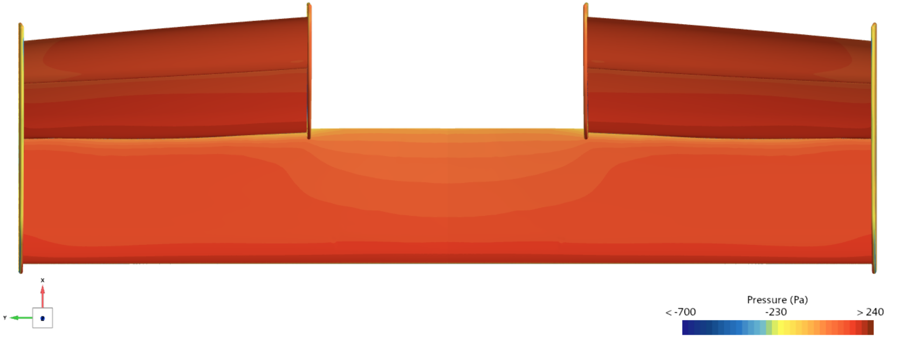
*star-ccm+前翼顶面压力*

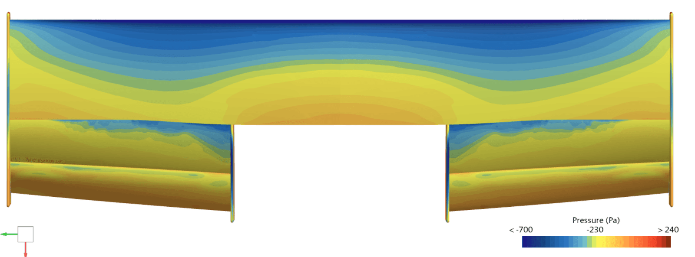
*star-ccm+前翼底面压力*

**外侧的负压突然掉了，是因为翼尖涡带来的上洗减小了等效攻角，所以一般会加一个涡管。一定程度上困住内洗流，并且进一步阻挡内洗，形成所谓的“保压”效果。涡管本身也能利用涡本身产生下压力。**

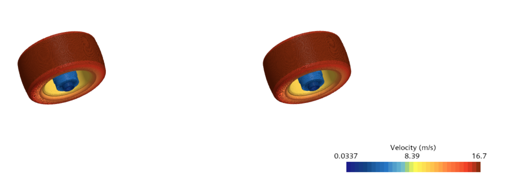
*star-ccm+轮速*

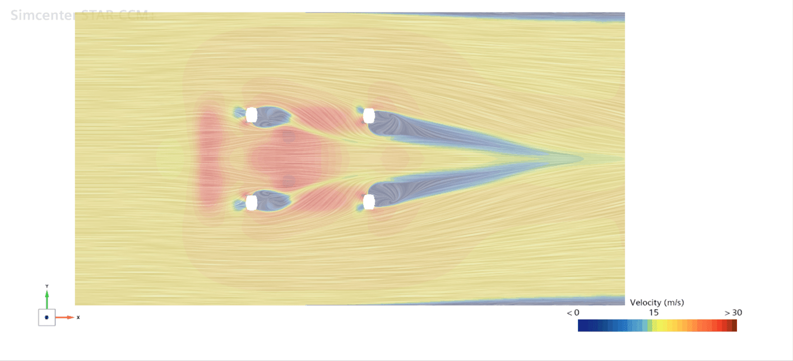
*star-ccm+近地面流速*

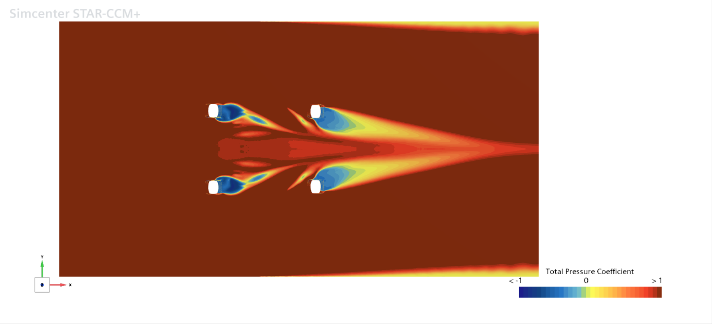
*star-ccm+近地面总压系数*

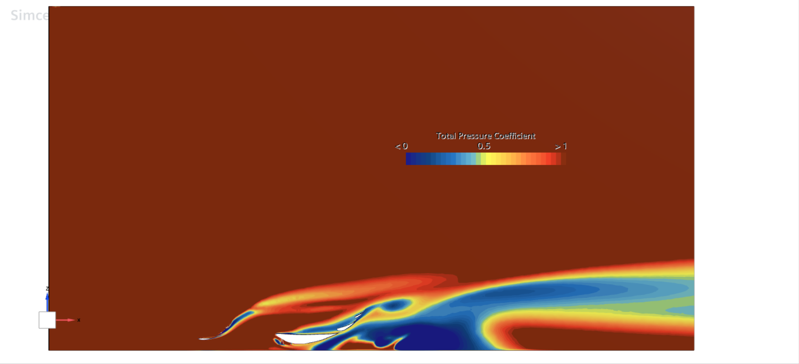
*star-ccm+中心面等距总压系数*

>**总体评价：组合翼基本结构合理，但设计比较保守，有点过于简单；内到外的组合翼都有小分离，但总体而言对下游破坏效果还算能接受**
