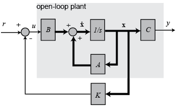
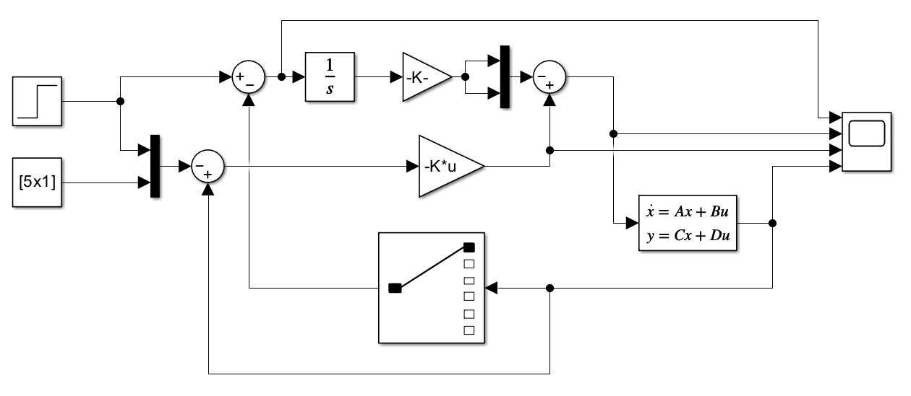
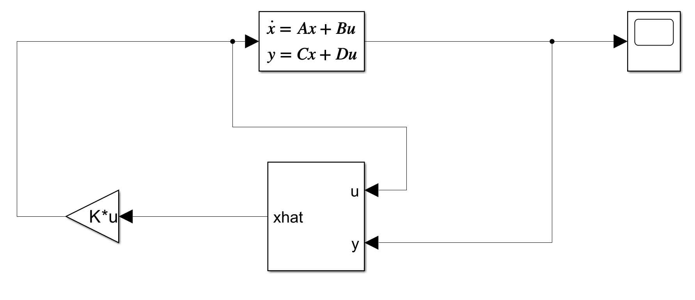
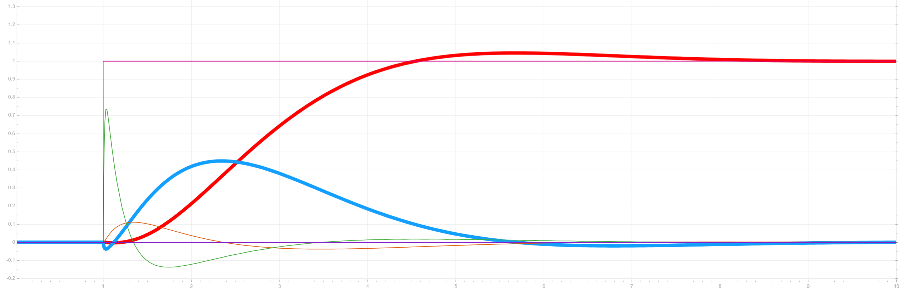
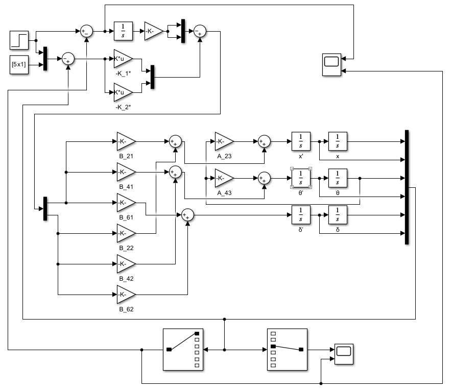

## 一：LQR 理论求解的具体步骤
LQR（线性二次型调节器）的核心目标是：**在保证系统稳定的前提下，用最小的控制能量（省电、省电机性能）最快地把系统状态调回 0。**
对于一个线性时不变系统：
$$\dot{x} = Ax + Bu$$
### 求解 ：
1. **设定目标函数（Cost Function $J$）**
    设计一个评价指标 $J$，表示系统的“总代价”：
    $$J = \int_{0}^{\infty} \left( x^T Q x + u^T R u \right) dt$$
    - $Q$：**状态权重矩阵**，惩罚状态偏差（$x$ 偏离 0 越大，$J$ 越大）。
    - $R$：**控制权重矩阵**，惩罚控制能量（电机出力 $u$ 越大，$J$ 越大）。
	- **$x^T Q x$**：代表小车的**状态误差成本**。
	- **$u^T R u$**：代表小车的**电机用力成本**。
2. **选取权重矩阵 $Q$ 与 $R$**
    根据工程经验预设 $Q$（半正定矩阵，对角阵，维度与状态向量一致）和 $R$（正定矩阵，维度与输入向量一致）。
3. **求解代数里Riccati 方程**
    算法会求解一个对称正定矩阵 $P$：
    $$A^T P + P A - P B R^{-1} B^T P + Q = 0$$
4. **计算最优状态反馈增益矩阵 $K$**
    得到 $P$ 后，即可直接算出最优反馈系数 $K$：
    $$K = R^{-1} B^T P$$
    最终的控制律就是简短的全状态反馈：
    $$u = -Kx$$
**原理简要分析：**

对于开环系统（即图中灰色区域）：
$$\begin{cases} \dot{x} = Ax + Bu & \text{—— 状态方程（State Equation）} \\ y = Cx + Du & \text{—— 输出方程（Output Equation）} \end{cases}$$
由现代控制理论我们知道开环传递函数的极点就是系统矩阵A的特征值。先经过了第一个式子的x的微分方程，可以由u（控制函数）求解x，再经过第二个式子得到对应的y，这个中间控制量x与K的乘积可以反求u。得到状态反馈控制。如此形成闭环形式，状态变换矩阵A变成了(A-BK)。$$\dot{x} = Ax + Bu = (A - BK)x$$因此通过配置反馈矩阵K，可以使得闭环系统的极点达到我们期望的状态。注意，这种控制器的设计与输出矩阵C,D没有关系。但是一般来说由于x以及其对应的变量无法直接求出所以引入，通过求y和u的变换得到x此时在增益矩阵K前面加入观测器（一般Kerman），输入是y、u求得x再输入K。***注意一般的物理系统没有前馈，即无法直接由u影响y，所以D=0。***

*全状态反馈控制与积分系统*

此时可以得到**基于全状态观测器的反馈控制系统**：


接下来就是求解最小的代价函数就可以得到合适的K了。而我们的小车可以先从简单的来，不考虑观测器，直接差分法，即微分，来求。虽然有较多的噪音。

>当然求解$Q$ 和 $R$ 的对角线参数都是靠“试”出来的,核心原则：Bryson 规则法（初次量化）

*PS:* 在控制理论中，**能控性**的定义是：在有限的时间内，是否总能找到一个控制输入 $u$，把小车从**任意**初始状态拉回到**任意**目标状态。
**能控性矩阵** $M_c$：

$$M_c = \begin{bmatrix} B & AB & A^2B & \dots & A^{n-1}B \end{bmatrix}$$

其中 $n$ 是系统的阶数（状态变量的个数）。例如二阶小车，能控性矩阵就是 $M_c = \begin{bmatrix} B & AB \end{bmatrix}$。
当能控性矩阵满秩，小车能达到的状态，就是、向量的**线性组合**，意味着你的控制信号可以控制到小车的“每一个维度”。
## 二：物理状态方程的推导与 $A, B$ 矩阵提取
以**平衡小车**最经典的一维简化模型为例。
### 一、 状态变量与控制输入的定义
首先，系统完整的 **6个状态变量** 构成的向量 x 定义如下（严格对应代码和仿真中的 6 个通道）：

$$x = \begin{bmatrix} x \\ \dot{x} \\ \theta_p \\ \dot{\theta}_p \\ \delta \\ \dot{\delta} \end{bmatrix} \begin{aligned} &\leftarrow \text{小车位移 (Displacement)} \\ &\leftarrow \text{前进速度 (Velocity)} \\ &\leftarrow \text{车体倾角 (Pitch Angle)} \\ &\leftarrow \text{车体角速度 (Pitch Rate)} \\ &\leftarrow \text{转向角/偏航角 (Yaw Angle)} \\ &\leftarrow \text{转向角速度 (Yaw Rate)} \end{aligned}$$

系统的 **2个控制输入** 构成的向量 u 定义如下：

$$u = \begin{bmatrix} \dot v_{L0} \\ \dot v_{R0} \end{bmatrix} \begin{aligned} &\leftarrow \text{左轮无摩擦时理想线加速度} \\ &\leftarrow \text{右轮无摩擦时理想线加速度} \end{aligned}$$

(注：由于电机转矩不好直接控制，教程中已通过刚体定轴转动定律将其等效转化为了速度/加速度控制量)。
## 二、车轮动力学分析（获得车轮方程）

首先对小车的**右轮**进行受力分析（左轮同理）：
1. **水平平动（牛顿第二定律）**：
    $$m\ddot{x}_R = H_{fR} - H_R \quad \text{--- (1)}$$
2. **绕轴转动（刚体定轴转动定律）**：
    $$I\dot{\omega}_R = T_R - H_{fR}r \quad \text{--- (2)}$$
在车轮**纯滚动不打滑**的假设下，车轮线速度与角速度满足 $\omega_R = \frac{\dot{x}_R}{r}$，两边求导得 $\dot{\omega}_R = \frac{\ddot{x}_R}{r}$。 将该关系代入公式 (2) 消除 $\dot{\omega}_R$，再与公式 (1) 联立**消去地面摩擦力 $H_{fR}$**，可以得到车轮轴心受到的水平力 $H_R$：
$$\left(m + \frac{I}{r^2}\right)\ddot{x}_R = \frac{T_R}{r} - H_R \quad \text{--- (3)}$$
同理，对**左轮**进行相同的分析：

$$\left(m + \frac{I}{r^2}\right)\ddot{x}_L = \frac{T_L}{r} - H_L \quad \text{--- (4)}$$

## 三、车体正向运动分析（前进与直立）
小车底盘中心位置定义为左右轮的平均位移：$x = \frac{x_L + x_R}{2}$。将公式 (3) 和 (4) 相加除以 2，得到整个底盘的平动方程：

$$\left(m + \frac{I}{r^2}\right)\ddot{x} = \frac{T_L + T_R}{2r} - \frac{H_L + H_R}{2} \quad \text{--- (5)}$$
接下来分析**整个车体（看作倒立摆）**。车体质量为 $M$，质心到地面的距离为 $l$，倾角为 $\theta_p$。
1. **车体水平方向运动（牛顿第二定律）**： 根据运动合成，车体质心的水平位置为 $x_G = x + l\sin\theta_p$。对其求二次导数：
    $$M\ddot{x}_G = M\frac{d^2}{dt^2}(x + l\sin\theta_p) = H_L + H_R$$
    展开并进行**小角度线性化**（因为LQR是处理线性系统的）（当 $\theta_p \to 0$ 时，$\sin\theta_p \approx \theta_p$，$\cos\theta_p \approx 1$，$\dot{\theta}_p^2 \approx 0$）：
    $$M\ddot{x} + Ml\ddot{\theta}_p = H_L + H_R \quad \text{--- (6)}$$
    
2. **将车体方程 (6) 代入底盘方程 (5)，消去未知的内部作用力 $(H_L + H_R)$**：
    $$\left(M + 2m + \frac{2I}{r^2}\right)\ddot{x} + Ml\ddot{\theta}_p = \frac{T_L + T_R}{r} \quad \text{--- (7)}$$
3. **车体绕质心的转动方程（刚体转动定律）**： 考虑重力矩、摆动惯性力矩以及电机的反作用力矩，线性化后的转动方程为：
    $$Ml\ddot{x} + (J_p + Ml^2)\ddot{\theta}_p = Mlg\theta_p - (T_L + T_R) \quad \text{--- (8)}$$
### 核心解耦：求出 $\ddot{x}$ 和 $\ddot{\theta}_p$
方程 (7) 和 (8) 是关于 $\ddot{x}$ 和 $\ddot{\theta}_p$ 的二元一次方程组组。 定义总惯性分母：$Q_{eq} = J_pM + (J_p + Ml^2)(2m + \frac{2I}{r^2})$。 通过克拉默法则或代入消元法，解出这两个最高阶导数：
$$\ddot{x} = \underbrace{-\frac{M^2l^2g}{Q_{eq}}}_{A_{23}}\theta_p + \underbrace{\frac{J_p + Ml^2 + Mlr}{Q_{eq}r}}_{B_{21}}(T_L + T_R) \quad \text{--- (9)}$$

$$\ddot{\theta}_p = \underbrace{\frac{Mlg(M+2m+\frac{2I}{r^2})}{Q_{eq}}}_{A_{43}}\theta_p \underbrace{-\frac{\frac{Ml}{r} + M + 2m + \frac{2I}{r^2}}{Q_{eq}}}_{B_{41}}(T_L + T_R) \quad \text{--- (10)}$$
## 四、车体转向运动分析（偏航 Yaw）
转向是由左右轮摩擦力不等引起的。令轮距为 $d$，绕竖直 $Y$ 轴的转动惯量为 $J_\delta$，偏航角为 $\delta$。
1. **车体绕 $Y$ 轴转动方程**：
    $$J_\delta\ddot{\delta} = \frac{d}{2}(H_L - H_R) \quad \text{--- (11)}$$
2. 将左轮方程 (4) 减去右轮方程 (3)，并利用几何关系 $\dot{x}_L - \dot{x}_R = d\dot{\delta}$ 代入消元，可以解出转向角速度的导数 $\ddot{\delta}$：
    $$\ddot{\delta} = \underbrace{\frac{1}{r(md + \frac{Id}{r^2} + \frac{2J_\delta}{d})}}_{B'_{61}}(T_L - T_R) \quad \text{--- (12)}$$
## 五、输入量转换与构建完整的 A、B 矩阵

由于**电机的输出转矩 $T$ 无法在单片机里直接极其精准地控制，需要转换为理想控制速度 $u = [\dot v_{L0}, \dot v_{R0}]^T$**。 根据转动定律，转矩与无摩擦理想加速度速度的关系：$T = \frac{I}{r}u$。

这意味着，我们在步骤二和步骤三中得到的关于 $T$ 的系数（$B'$），在写进标准状态空间时，全部需要**乘以 $\frac{I}{r}$ 的系数修正**。

现在，我们令状态向量 $x = [x, \dot{x}, \theta_p, \dot{\theta}_p, \delta, \dot{\delta}]^T$，控制输入$u = [\dot v_{L0}, \dot v_{R0}]^T$，严格根据一阶微分关系排列矩阵：
### 空间状态方程
$$\begin{bmatrix} \dot{x} \\ \ddot{x} \\ \dot{\theta}_p \\ \ddot{\theta}_p \\ \dot{\delta} \\ \ddot{\delta} \end{bmatrix} = \begin{bmatrix} 0 & 1 & 0 & 0 & 0 & 0 \\ 0 & 0 & A_{23} & 0 & 0 & 0 \\ 0 & 0 & 0 & 1 & 0 & 0 \\ 0 & 0 & A_{43} & 0 & 0 & 0 \\ 0 & 0 & 0 & 0 & 0 & 1 \\ 0 & 0 & 0 & 0 & 0 & 0 \end{bmatrix} \begin{bmatrix} x \\ \dot{x} \\ \theta_p \\ \dot{\theta}_p \\ \delta \\ \dot{\delta} \end{bmatrix} + B \begin{bmatrix} \dot v_{L0} \\ \dot v_{R0} \end{bmatrix}$$
###  $A$ 矩阵

$$A = \begin{bmatrix} 0 & 1 & 0 & 0 & 0 & 0 \\ 0 & 0 & A_{23} & 0 & 0 & 0 \\ 0 & 0 & 0 & 1 & 0 & 0 \\ 0 & 0 & A_{43} & 0 & 0 & 0 \\ 0 & 0 & 0 & 0 & 0 & 1 \\ 0 & 0 & 0 & 0 & 0 & 0 \end{bmatrix} $$

其中：

- $A_{23} = -\frac{M^2l^2g}{Q_{eq}}$
    
- $A_{43} = \frac{Mlg(M+2m+\frac{2I}{r^2})}{Q_{eq}}$
### $B$ 矩阵

$$B = \frac{I}{r} \begin{bmatrix} 0 & 0 \\ B_{21} & B_{22} \\ 0 & 0 \\ B_{41} & B_{42} \\ 0 & 0 \\ B_{61} & B_{62} \end{bmatrix}$$

其中：

- $B_{21} = B_{22} = \frac{J_p + Ml^2 + Mlr}{Q_{eq}r}$
    
- $B_{41} = B_{42} = -\frac{\frac{Ml}{r} + M + 2m + \frac{2I}{r^2}}{Q_{eq}}$
    
- $B_{61} = -B_{62} = \frac{1}{r(md + \frac{Id}{r^2} + \frac{2J_\delta}{d})}$
### 共同的分母常数 $Q_{eq}$
$$Q_{eq} = J_pM + (J_p + Ml^2)\left(2m + \frac{2I}{r^2}\right)$$
## 三：MATLAB 代码实现

在 MATLAB 中，只需要直接定义物理参数、构建矩阵并调用 `lqr()` 函数即可：
``` matlab
clc
m = 0.035;%车轮的质量
r = 0.0672/2;%车轮的半径
i = 0.5*m*r^2;%车轮的转动惯量
m2 = 0.757;%整车的质量
M = m2-2*m;%车体的质量
H = 0.0903;%车体高度
L = 0.0530;%车体长度 平行轮子
W = 0.0930;%车体宽度 垂直轮子
d = 0.1612;%轮距
l = 0.5*H;%质心距底盘中心的距离
J_p = (1/12)*M*(H^2+L^2);%车体绕质心转动时的转动惯量
J_delta = (1/12)*M*(W^2+L^2);%车体绕 y 轴转动时的转动惯量
g = 9.8;%重力加速度
Q_eq = J_p*M+(J_p+M*L^2)*(2*m+2*i/r^2);
A_23 = -(M^2*L^2*g)/Q_eq;
A_43 = M*L*g*(M+2*m+2*i/r^2)/Q_eq;
B_21 = (J_p+M*L^2+M*L*r)/(Q_eq*r);
B_22 = B_21;
B_41 = -(M*L/r+M+2*m+2*i/r^2)/Q_eq;
B_42 = B_41;
B_61 = 1/(r*(m*d+i*d/r^2+2*J_delta/d));
B_62 = -B_61;
A = [0 1 0 0 0 0; 0 0 A_23 0 0 0; 0 0 0 1 0 0; 0 0 A_43 0 0 0; 0 0 0 0 0 1; 0 0 0 0 0 0];
B = (i/r)*[0 0; B_21 B_22; 0 0; B_41 B_42; 0 0; B_61 B_62];
C = eye(6);
D = zeros(6,2);
Tc = ctrb(A,B);
if (rank(Tc)==6)
	fprintf('此系统是可控的！\n');
	Q = diag([ ...
		12000, ... % Q(1,1)
		15000, ... % Q(2,2)
		900, ... % Q(3,3)
		850, ... % Q(4,4)
		1000, ... % Q(5,5)
		1000 ... % Q(6,6)
	]);
	R = [1 0;
		0 1]; % 控制量 (左右电机 PWM/加速度) 的权重
	K = lqr(A,B,Q,R);
	disp('计算出的 LQR 反馈矩阵 K 为：');
	disp(K);
end
```

## 四：Simulink 的连接与配置
在 Simulink 中搭建全状态反馈闭环系统的步骤如下：
### 1. 模块准备与拉取
在 Simulink Library 中依次找到并拖入以下模块：
- **`State-Space`（状态空间模块）**：用来代表你的物理对象（Plant）。
- **`Gain`（增益模块）**：用来作为增益矩阵 $K$。
- **`Sum`（加减法/求和模块）**：用于计算 $u = u_{\text{target}} - Kx$。
- **`Constant`（常数模块）**：设置期望的目标状态（通常全为 0）。
- **`Scope`（示波器模块）**：观察 $x, \theta$ 等状态随时间的变化曲线。
- **`Mux` / `Demux`（信号总线模块）**：用于打包或拆分 4 维状态信号。
- **`Selector`（选择器）**：根据索引选择输出通道。
### 2. 模块参数配置
- **双击 `State-Space` 模块**：
    - $A$ 填入 `A`
    - $B$ 填入 `B`
    - $C$ 填入 `eye(4)`
    - $D$ 填入 `zeros(4,1)`
    - Initial conditions（初始状态）设置一个倾斜初始角：`[0; 0; 0.1; 0]`（代表车身初始倾斜了约 5.7 度）。也可以填0。
- **双击 `Gain` 模块**：
    - Gain（增益值）填入 `-K`
    - **重点**：将 Multiplication 选项由 `Element-wise(K.*u)` 改为 **`Matrix(K*u)`**！
### 3. 信号连线逻辑
***为了整体掌握反馈与外界交互模型，我们先把空间状态方程整体打包。***
因为传感器都可以测得六个需要的变量所以不需要输出方程，即`y == x`
现实世界是有摩擦力和阻力的，为了消除稳态误差，我们引入积分项，组成：
$$u = \underbrace{- \Big( K_1 x + K_2 \dot{x} + K_3 \theta_p + K_4 \dot{\theta}_p + K_5 \delta + K_6 \dot{\delta} \Big)}_{\text{LQR 主反馈 } u_{\text{LQR}}} + \underbrace{K_i \int_{0}^{t} \big( x_{\text{target}} - x(\tau) \big) \, d\tau}_{\text{位置积分支路 } u_{\text{Integral}}}$$
*积分一般消除位移的所以直接表示为x的误差*。
更一般的我们假设需要的是$x_{\text{target}}$
得到$u =K(x_{\text{target}} - x) - K_i \int_{0}^{t} \big( x_{\text{target}} - x(\tau) \big) \, d\tau$

>需要注意的是：因为K一般是看成正的，所以需要考虑实际的u和x变化量的方向关系，正负表示正负反馈，可以通过观测角度${\theta}$和位移x来确定符号。当向前进时，对于两个独立的反馈都是，通过重力牵引，小车先向前倾，再回正。

左边的首项x，引入step步进，表示目标x位置指令。



*收敛结果*

***接下来我们展开空间状态方程。***


### 一、 控制律关系式（LQR 反馈控制量 $u$）

6 个状态量汇合后，分别经过增益矩阵 `K1` 和 `K2`，得到左右轮（或两个控制通道）的控制量 $u_1, u_2$：

$$K = \begin{bmatrix} K_{1,1} & K_{1,2} & K_{1,3} & K_{1,4} & K_{1,5} & K_{1,6} \\ K_{2,1} & K_{2,2} & K_{2,3} & K_{2,4} & K_{2,5} & K_{2,6} \end{bmatrix}$$

$$\begin{cases} u_1 = - K_1 \cdot X = - \big( K_{11} x + K_{12} x' + K_{13} \theta + K_{14} \theta' + K_{15} \delta + K_{16} \delta' \big) \\ u_2 = - K_2 \cdot X = - \big( K_{21} x + K_{22} x' + K_{23} \theta + K_{24} \theta' + K_{25} \delta + K_{26} \delta' \big) \end{cases}$$

### 二、 状态微分关系式（系统的物理状态方程 $\dot{X} = AX + BU$）

根据框图左侧三个求和节点（Sum Block）以及积分器输入的信号汇总，可以直接写出三个二阶加速度（微分）方程：
#### 1. 线加速度方程 $\ddot{x}$（即 $x''$）
进入 $x'$ 前方求和点的信号有：由 $\theta$ 经过增益 $A_{23}$，以及 $u_1, u_2$ 分别经过 $B_{21}, B_{22}$：

$$\ddot{x} = A_{23} \, \theta + B_{21} \, u_1 + B_{22} \, u_2$$
#### 2. 角加速度方程 $\ddot{\theta}$（即 $\theta''$）
进入 $\theta'$ 前方求和点的信号有：由 $\theta$ 经过增益 $A_{43}$，以及 $u_1, u_2$ 分别经过 $B_{41}, B_{42}$：
$$\ddot{\theta} = A_{43} \, \theta + B_{41} \, u_1 + B_{42} \, u_2$$
#### 3. 偏航角加速度方程 $\ddot{\delta}$（即 $\delta''$）
进入 $\delta'$ 前方求和点的信号有：由 $u_1, u_2$ 分别经过 $B_{61}, B_{62}$：
$$\ddot{\delta} = B_{61} \, u_1 + B_{62} \, u_2$$

| **状态变量 xi**             | **物理意义**               | **建议的最大允许偏差 xi,max**                          | **计算得到的初始 Qii**                                  | **说明与调校建议**        |
| ------------------------ | ---------------------- | ---------------------------------------------- | ------------------------------------------------- | ------------------ |
| **$x_1 = x$**            | 位移 $(m)$               | $0.2 \text{ m}$ ($20\text{ cm}$)               | $Q_{11} = \frac{1}{0.2^2} = \mathbf{25}$          | 允许小车前后晃动的物理范围      |
| **$x_2 = \dot{x}$**      | 速度 $(m/s)$             | $0.5 \text{ m/s}$                              | $Q_{22} = \frac{1}{0.5^2} = \mathbf{4}$           | 轮子和电机最大期望运行速度      |
| **$x_3 = \theta$**       | 倾角 $(\text{rad})$      | $5^\circ \approx 0.087 \text{ rad}$            | $Q_{33} = \frac{1}{0.087^2} \approx \mathbf{130}$ | **最重要的项**！小车倾角越小越稳 |
| **$x_4 = \dot{\theta}$** | 角速度 $(\text{rad/s})$   | $2.0 \text{ rad/s} \approx 115^\circ/\text{s}$ | $Q_{44} = \frac{1}{2.0^2} = \mathbf{0.25}$        | 抑制倾角快变，防止高频震荡      |
| **$x_5 = \psi$**         | 偏航角 $(\text{rad})$     | $10^\circ \approx 0.174 \text{ rad}$           | $Q_{55} = \frac{1}{0.174^2} \approx \mathbf{33}$  | 转向控制的基准角度          |
| **$x_6 = \dot{\psi}$**   | 偏航角速度 $(\text{rad/s})$ | $3.0 \text{ rad/s}$                            | $Q_{66} = \frac{1}{3.0^2} \approx \mathbf{0.11}$  | 抑制转向时的抖动           |
