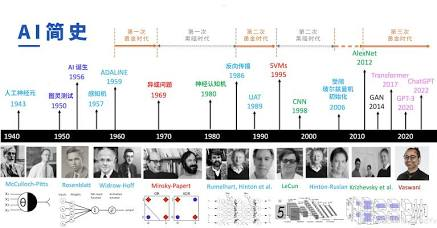

## 机器学习的发展历史

机器学习的演进大致经历了以下五个主要阶段：

萌芽期：感知机与神经网络的诞生

1950s - 1960s

- **1950年**：图灵提出“图灵测试”。
    
- **1957年**：Frank Rosenblatt 提出**感知机（Perceptron）**，成为单层神经网络的起点。
    
- **1969年**：Minsky 与 Papert 证明感知机无法解决异或（XOR）问题，AI进入第一次“寒冬”。
    

复苏与理论奠基：BP算法与符号主义

1970s - 1980s

- **1986年**：Rumelhart、Hinton 等人推广**反向传播算法（BP）**，解决了多层神经网络的训练难题。
    
- 专家系统（Expert Systems）盛行，但因缺乏自适应能力和高昂维护成本，AI陷入第二次寒冬。
    

黄金时代：统计学习统治时期

1990s - 2000s

- 强调严密的数学理论与统计建模，**支持向量机（SVM）**、**决策树**、**随机森林**等经典统计学习算法相继提出。
    
- SVM 在小样本和高维数据处理上表现优异，压制了当时的深度神经网络。
    

爆发期：深度学习崛起

2010s

- **算力（GPU）**、**海量数据（Big Data）** 与算法改进（ReLU、Dropout）三者汇聚。
    
- **2012年**：AlexNet 在 ImageNet 大赛中以巨大优势夺冠，开启深度学习浪潮。
    
- **2014-2017年**：GAN（生成对抗网络）、AlphaGo、Transformer 架构陆续问世。
    

大模型时代：生成式AI与通用人工智能（AGI）突破

2020s 至今

- 基于 Transformer 的大规模预训练语言模型（如 GPT 系列、Claude）及扩散模型（Diffusion Models）走向主流。
    
- 机器学习从“分类/回归”任务，跨越到“内容生成（AIGC）”与“多模态理解”。
## 机器学习的核心分支与代表算法
## 深度学习与统计学习：继承与超越
- **统计学习（Statistical Learning）**：
    
    - **特点**：强调**可解释性**、**数学证明**和**假设条件**（比如假设数据独立同分布 i.i.d.）。
        
    - **代表**：线性回归、逻辑回归、SVM、朴素贝叶斯、高斯混合模型等。通常被称为“传统机器学习”或“统计机器学习”。
        
- **深度学习（Deep Learning）**：
    
    - **特点**：基于多层神经网络，依靠**海量数据和巨大算力**进行端到端表征学习，数学可解释性相对较弱（黑盒模型）。
        
    - **代表**：CNN、Transformer、Diffusion Model 等。
## 两者关联
- **深度学习是统计学习的发展与延伸**：深度学习本质上依然建立在统计学习的理论框架之上（如最小二乘法、最大似然估计、交叉熵损失、交叉验证等）。
    
- **特征提取的变革**：传统统计学习高度依赖“人工特征工程”（Feature Engineering）；深度学习通过多层非线性变换实现了**端到端的自动化特征学习**（Representation Learning）。
    
- **数学视角**：深度学习可以看作是一个“参数量极其庞大的高维非线性统计函数拟合器”。
### 深度学习细分

深度学习是基于多层神经网络的机器学习子集，贯穿了上述各种学习范式：

- **卷积神经网络（CNN）**：图像处理经典模型（ResNet, EfficientNet）。
    
- **循环神经网络（RNN / LSTM）**：传统序列数据处理（语音、时间序列）。
    
- **Transformer 架构**：大语言模型（LLM）与多模态模型的核心底座（自注意力机制）。
    
- **生成模型**：GAN、VAE、Diffusion Models（Stable Diffusion, Midjourney 的技术核心）。
PS：**LoRA（Low-Rank Adaptation，低秩适应）** 属于 **深度学习中的一种“高效微调技术（Parameter-Efficient Fine-Tuning, PEFT）”**。
## 四大范式
根据**学习范式**和**数据标记方式**的不同，机器学习主要划分为以下四大核心分支：

|**学习范式**|**核心特点**|**适用场景**|**代表算法**|
|---|---|---|---|
|**监督学习**|输入含标签数据，学习 $X \to Y$ 映射|预测、分类、回归|线性回归、逻辑回归、SVM、决策树、XGBoost、KNN|
|**无监督学习**|输入无标签数据，寻找潜在结构/规律|聚类、降维、密度估计|K-Means、PCA、t-SNE、DBSCAN、高斯混合模型（GMM）|
|**半监督/自监督学习**|结合少量有标签与大量无标签数据，或利用数据自身结构预测|标签获取成本高的场景、预训练大模型|Label Propagation、自编码器（AE）、Contrastive Learning、Masked Autoencoders（MAE）|
|**强化学习**|智能体在环境中交互，通过奖励/惩罚优化策略|游戏AI、机器人控制、自动驾驶、RLHF|Q-Learning、DQN、PPO、Actor-Critic|
## 四大范式下：传统统计学习 vs 深度学习

在不同的学习范式下，传统统计学习和深度学习的核心区别主要体现在**特征提取方式**、**数据需求**与**模型表达能力**上：

| **学习范式**                                       | **传统统计学习实现**                                                                  | **深度学习实现**                                                                              | **核心区别 / 深度学习的优势**                                            |
| ---------------------------------------------- | ----------------------------------------------------------------------------- | --------------------------------------------------------------------------------------- | ------------------------------------------------------------- |
| **监督学习**      _(Supervised)_       | **代表：逻辑回归、SVM、XGBoost**      根据人工提取的特征计算分类边界或回归拟合线。               | **代表：CNN、Transformer**      直接输入原始数据（像素/文本），网络自动学习特征并输出类别。                  | **告别手工特征工程**：深度学习能从高维非结构化数据（图像、音频、文本）中自动提取抽象特征。               |
| **无监督学习**      _(Unsupervised)_    | **代表：K-Means、PCA、GMM**      利用距离度量或协方差矩阵进行降维与聚类。                  | **代表：自编码器 (AE)、变分自编码器 (VAE)**      利用神经网络将高维数据压缩（编码）到低维隐空间，再重建（解码）出来。       | **非线性流形表达**：PCA 只能做线性降维，而深度自编码器可以捕捉极度复杂的非线性数据分布。              |
| **自监督学习**      _(Self-Supervised)_ | **代表：Word2Vec (Skip-gram)**      利用浅层概率模型预测上下文词汇。                 | **代表：BERT、GPT、MAE (Masked Autoencoders)**      掩码预测（遮住部分文本/图像去预测缺失部分）或对比学习。 | **大模型的基础**：利用神经网络吞噬海量无标签文本/图像，先构建通用“认知能力”，再微调到具体任务。           |
| **强化学习**      _(Reinforcement)_    | **代表：表格型 Q-Learning、SARSA**      维护一个表格存储每个“状态-动作”对的价值 $Q(s, a)$。 | **代表：DQN、PPO**      用深度神经网络代替表格，输入状态（如游戏画面），预测每个动作的价值。                      | **突破“维度灾难”**：传统 RL 无法处理无穷多的状态（如高维视频画面），深度神经网络让 RL 能直接看着屏幕做决策。 |
## 总结

1. **范式**定义了“问题和数据的格式”（有没有标签、是不是顺序决策）。
    
2. **传统统计学习**像“精确的手工工具”，在小数据集、结构化表格数据（如 Excel 表格分析）上性能极高、可解释性强、计算资源消耗低。
    
3. **深度学习**像“通用的大型挖掘机”**，需要海量数据和算力驱动，但能够处理人类无法手动提特征的**复杂非结构化数据（图片、语言、视频、分子结构）。

## 什么是判别式 vs 生成式？

从数学与概率论的角度来看，两者的核心区别在于它们试图学习什么：

- **判别式模型（Discriminative Models）**：
    
    - **目标**：学习**条件概率分布 $P(Y\vert{}X)$**，即“给定数据 $X$，它是标签 $Y$ 的概率是多少”。
        
    - **本质**：只关注**决策边界（Decision Boundary）**。它不关心数据 $X$ 本身长什么样，只关心怎么把不同类别区分开。
        
- **生成式模型（Generative Models）**：
    
    - **目标**：学习**联合概率分布 $P(X, Y)$** 或 **边缘概率分布 $P(X)$**。
        
    - **本质**：去理解**数据的底层产生机制与分布特征**。因为它懂得了数据 $X$ 的内在结构，所以它不仅能做分类，还能**凭空“画”出全新的数据 $X$**。
        

## 生成式模型对应分类

生成式模型是**横跨在不同的学习范式中**（主要集中在**无监督/自监督学习**，但也可以延伸至**监督学习**）。
### 1. 无监督 / 自监督学习（生成式模型的大本营 🏰）

这是生成式模型最核心、最繁荣的位置。

|**学习范式**|**属于“生成式模型”代表算法**|**它们在生成什么？（P(X) 或 P(X,Y)）**|
|---|---|---|
|**传统无监督**|**GMM（高斯混合模型）**、朴素贝叶斯（分类但属生成式）、隐马尔可夫模型（HMM）|拟合数据的概率密度函数，推断数据是由哪些高斯分布混合生成的。|
|**深度无监督 / 自监督**|**VAE（变分自编码器）**      **GAN（生成对抗网络）**      **Diffusion Models（扩散模型）**|拟合图像/音频的复杂高维分布，直接采样生成**全新的图片、声音**。|
|**深度自监督（大模型）**|**GPT 系列（自回归语言模型）**      **BERT（掩码语言模型）**|学习自然语言的概率分布 $P(\text{下一个词} \vert{} \text{上文})$，生成**连续的文本段落**。|

> ⚠️ **特例辨析（AE 与 PCA）**：
> 
> - 传统的 **PCA** 和基础的 **自编码器（AE）** 通常只被视为**降维/表征学习工具**，一般不直接算作严格的“生成式模型”（因为它们无法直接进行随机采样生成新样本）。
>     
> - 但 **变分自编码器（VAE）** 引入了概率隐空间，是标准的生成式模型。
>     

### 2. 监督学习（大部分是判别式，但也有生成式）

监督学习中 **90% 以上都是判别式模型**，因为它的目标就是预测 $Y$。

- **判别式（主流）**：
    
    - **传统**：线性回归、逻辑回归、SVM、决策树、XGBoost、KNN。
        
    - **深度**：CNN（如 ResNet 分类）、Transformer Encoder（如 BERT 分类）。
        
- **生成式（少见但存在）**：
    
    - **传统**：**朴素贝叶斯（Naive Bayes）**、**线性判别分析（LDA）**。它们虽然用来做分类，但内部是通过计算 $P(X\vert{}Y)P(Y)$（先建模数据生成，再推导标签）来实现的，属于生成式模型。
        
    - **深度**：**cGAN（条件 GAN）**、**ControlNet**。给定标签或条件 $Y$（如“画一只猫”），生成对应的图片 $X$。
        

### 3. 强化学习（与判别/生成是两个维度）

强化学习关注的是 **“状态 (State) $\to$ 动作 (Action) $\to$ 奖励 (Reward)”** 的策略决策。

- 传统的 **DQN、PPO** 等主要学习 $Q(s,a)$ 值函数或策略函数 $\pi(a\vert{}s)$，更偏向“根据环境做判断/决策”（类似判别式）。
    
- 但现代 RL 中也衍生出了 **基于模型的强化学习（Model-Based RL）**，其中会用到生成模型去“模拟/预测”下一个环境状态 $P(s_{t+1}\vert{}s_t, a_t)$（这部分属于生成式）。

## 算法框架具体映射解析

1. **范式与算法（如 SVM、Random Forest、ResNet、Transformer） $\to$ 【模型框架】**
    
    - 之前梳理的各种算法，本质上都是在讨论“用什么样的数据结构和数学公式（模型）去建模数据”。
        
    - 比如：SVM 是在寻找“最大间隔超平面”，Transformer 是在做“自注意力特征抽取”，这些都属于**模型的设计（Architecture）**。
        
2. **学习方式与损失函数（如 监督/无监督/强化学习、反向传播 BP、梯度下降） $\to$ 【训练框架的理论内核】**
    
    - 之前讨论的“如何从数据中学习 $X \to Y$”、“如何更新权重 $W$”、“如何定义 Loss”，这是**训练框架要执行的底层逻辑**。
        
    - **训练框架（如 PyTorch）** 简单来说就是把这些“梯度下降、反向传播、损失函数”写成了高效的 C++/CUDA 代码，帮你在 GPU 上自动运行。
        
3. **那我们还没深入讨论的是什么？ $\to$ 【推理框架与工程部署】**
    
    - 推理框架并不涉及模型是怎么设计出来的，也不涉及模型是怎么训练出来的。它只管“怎么让训练好的模型跑得飞快、占显存极小”。
    - vLLM, TensorRT-LLM, ONNX Runtime, 量化 (AWQ/INT4)
