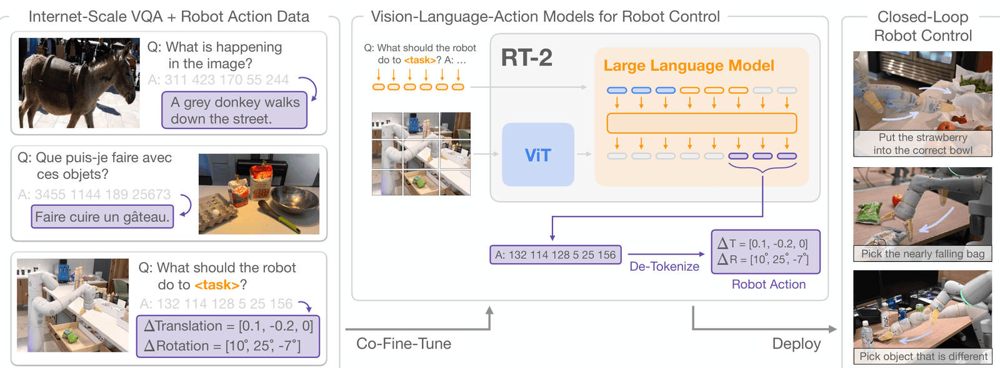

## 🤖 RT-2 算法理解：动作即 Token，把互联网知识灌进机器人

> **TL;DR** — RT-2 turns robot control into a *language modeling* problem: it takes a pretrained vision-language model (PaLI-X / PaLM-E), re-expresses robot actions as text tokens, and co-fine-tunes the model on a mixture of web data and robot trajectories. The result is a single model that can both answer visual questions **and** directly output low-level robot commands — transferring semantic knowledge from the web to physical control.

这篇文章是 VLA（Vision-Language-Action，视觉-语言-动作）系列的第一篇硬核拆解。读完你能回答三个问题：

1. RT-2 凭什么被称为 VLA 的"开山里程碑"？
2. 机器人的动作（6 自由度 + 夹爪）是怎么变成"文字"被大模型生成的？
3. 为什么联合微调（co-fine-tuning）比单纯微调机器人数据更好？

> 📌 **English Keyphrase**：*Vision-Language-Action (VLA) model* —— 视觉-语言-动作模型，即"看懂图像、听懂语言、直接输出动作"的端到端模型。

---

## 一、一句话定位：RT-2 到底解决了什么问题

传统机器人控制有一个绕不开的死结：

> **数据太少，泛化太难。**

要训练一个机械臂学会抓杯子，你得在真实环境里成千上万次地"演示"抓杯子；换成抓碗，又要重新来一遍。机器人数据（robot trajectory）的采集又贵又慢——RT-2 论文背后的 RT-1 数据，用了 **13 台机器人、花了 17 个月、在办公厨房环境里**才攒出来。

但另一边，互联网上有海量的图文数据，已经训练出了"见多识广"的视觉-语言模型（VLM），比如能看图问答、能描述图片。**RT-2 的核心想法朴素到让人拍大腿：**

> 既然 VLM 已经"认识"杯子、碗、恐龙玩具，能不能让它直接"动手"控制机器人？

于是 RT-2 干了一件关键的事：**把机器人的动作编码成文本 token，塞进一个现成的 VLM 里联合微调。** 这样，模型一边在互联网图文数据上保持"认知能力"，一边在机器人轨迹数据上学"怎么动"，最终得到一个既能回答问题、又能直接输出动作的 **VLA 模型**。

> 📌 **English Keyphrase**：*co-fine-tune* —— 联合微调，即"把机器人数据和互联网数据混在一起、同时训练"。

---

## 二、背景：从 RT-1 到 RT-2，为什么需要"互联网知识"

RT-2 是 Google DeepMind 的 **Robotic Transformer 系列**第二作。要理解它，得先知道 RT-1 干了什么、卡在哪。

### 2.1 RT-1 干了什么

RT-1（Robotic Transformer 1，2022）做了一个重要的工程统一：

- 把机器人控制建模成一个**行为克隆（Behavior Cloning）**问题：输入当前图像 + 历史动作，输出下一步动作。
- 用 Transformer 架构建模动作序列，把"看 + 动"放进同一个网络里端到端训练。

一句话：**RT-1 证明了机器人控制可以被当成一个可规模化的监督学习问题。** 这是工程上的重要一步。

### 2.2 RT-1 的天花板

但 RT-1 的能力被它的**训练数据**死死锁住了：

- 它只见过办公厨房里的那批物体和场景。
- 换一个它没见过的物体、或者一个它没听过的指令组合，成功率就大幅跳水。

本质原因：**RT-1 是从零训练的小模型（约 35M 参数），它没有"世界知识"，只有"动作技能"。** 它就像一个只会背题的学生——刷过的题会做，换道新题就懵。

### 2.3 RT-2 的核心洞察

RT-2 的论文标题直接点题：

> *"Transfer Web Knowledge to Robotic Control"* —— 把互联网知识迁移到机器人控制。

关键洞察：**机器人缺的不是"更会动"，而是"更懂世界"。** 而"懂世界"这件事，互联网上预训练好的大 VLM 已经做得不错了。于是问题变成：

> 能不能在不破坏 VLM 已有语义能力的前提下，给它接上一个"动作输出接口"？

答案就是下面第三节的核心方法。

> 📌 **English Keyphrase**：*emergent semantic reasoning* —— 涌现的语义推理，即模型在没被专门训练过的语义任务上"自然冒出来"的能力。

---

## 三、核心方法（重点）：把动作变成语言

这是整篇论文最精彩、也最容易误读的部分。很多人把 RT-2 一句话概括为"把动作也当 token"，但这句话不够——**真正的难点在于"怎么 token 化""用哪个模型""怎么训练才不遗忘"。** 下面逐层拆开。

### 3.0 总体思路：一个模型，两种输出

RT-2 的底座是一个现成的 VLM（PaLI-X 或 PaLM-E）。这类模型的输入是"图像 + 文本"，输出是"一串 token"——正常情况下，这串 token 拼起来就是自然语言。

RT-2 的妙处是：**让这串 token 有时是"文字"，有时是"动作"。** 具体流程如下：

```
[机器人相机图像]  +  [任务指令 "pick up the extinct animal"]
                 │
                 ▼
        ┌─────────────────────┐
        │  VLM (PaLI-X / PaLM-E) │
        │  以 VQA 格式输入 prompt │
        └─────────────────────┘
                 │  自回归逐 token 生成
                 ▼
     "1 128 91 241 5 101 127"   ← 一串"动作 token"
                 │
                 ▼
        de-tokenize（反离散化）
                 │
                 ▼
    [6-DoF 位移 + 旋转 + 夹爪 + 终止信号]
                 │
                 ▼
            机械臂执行
```

推理时的输入 prompt 是一个标准的视觉问答（VQA）句式：

```
Q: what action should the robot take to [task instruction]? A:
```

模型被"骗"着去回答这个问题，但吐出来的不是英文单词，而是一串**表示动作的数字**。

### 3.1 动作 token 化：机器人的"词汇表"

这是 RT-2 的第一个关键技术点。**动作是一个连续量（比如位移 0.01 米、旋转 3 度），而语言模型只能输出离散 token，怎么办？**

RT-2 直接沿用了 RT-1 的**离散化方案**：

- 机器人动作空间有 **8 个量**：
  - 末端执行器的 6 自由度：3 个平移增量 `Δpos_x, Δpos_y, Δpos_z` + 3 个旋转增量 `Δrot_x, Δrot_y, Δrot_z`
  - 夹爪开合程度 `gripper_extension`（1 维）
  - 一个离散的**终止信号** `terminate`（表示"这一轮动作到此结束"）

- 其中 **7 个连续量**（6 自由度 + 夹爪），每一个都被**均匀量化成 256 个 bin**（即 0 ~ 255 的整数）。

离散化公式（我按均匀量化的标准写法还原）：

$$
\text{bin}(a) = \text{round}\left( \frac{a - a_{\min}}{a_{\max} - a_{\min}} \times 255 \right)
$$

- 再加上 1 个离散的终止信号，最终**一次动作被编码成 8 个整数 token**，用空格拼成字符串，例如：

```
1 128 91 241 5 101 127
```

这一串数字就是模型要"说"的一句话。VLM 用**和生成文字完全一样的 next-token prediction（下一 token 预测）目标**来学习它，**不需要对网络结构做任何改动**。

> 🧠 **我当初的误区**：一开始以为"动作 token"是让模型输出自然语言描述，比如 `"move arm to the left"`，再由下游程序解析。其实不是——它输出的是**离散 bin 的整数**，直接对应连续动作的量化值。这个区别非常关键，因为整数 token 天然落在 VLM 的词表里，才能无缝接进 next-token prediction。

### 3.2 两个 backbone：PaLI-X 与 PaLM-E 的差异

RT-2 用了两个不同的 VLM 底座，它们对"动作 token"的处理方式不同，是个很值得品的细节：

| 对比项 | **PaLI-X** | **PaLM-E** |
|---|---|---|
| 规模 | 55B（RT-2-PaLI-X-55B） | 12B（RT-2-PaLM-E-12B） |
| 数字 token | 词表里 0~999 每个整数**本来就有独立 token** | 词表里**没有**现成的数字 token |
| 动作 token 做法 | 动作 bin `i` 直接复用整数 `i` 的 token | 用**符号调优（symbol tuning）**：拿词表里最不常用的 256 个 token，**覆盖**成动作词表 |

这里的 **symbol tuning（Wei et al., 2023）** 是个很有意思的技巧：既然 PaLM-E 没有"数字 0~255"这些 token，那就"征用"一些几乎用不到的低频 token，重新定义它们的含义为"动作 bin"。这相当于给模型**强行新增了 256 个"动作专用字"**。

> 🧠 **为什么这个细节重要**：它说明 RT-2 的"动作即 token"不是一个万能的魔法，而是**要配合具体 backbone 的词表结构来落地**。PaLI-X 数字 token 现成，直接用；PaLM-E 就得绕个弯。

### 3.3 Co-fine-tuning：为什么不能只微调机器人数据

这是 RT-2 的第二个关键技术点，也是论文标题里 *"Transfer Web Knowledge"* 的真正实现方式。

直觉上，我们可能会想："把 VLM 拿过来，用机器人数据微调一下不就行了？" 但 RT-2 的答案是：**不能只微调机器人数据，要把互联网数据也一起混进来**——这就是 **co-fine-tuning（联合微调）**。

具体做法：

- 训练时，每个 batch 是**两类数据的混合**：
  1. **机器人轨迹数据**（图像 + 指令 + 动作 token）——教模型"怎么动"；
  2. **互联网 VLM 数据**（VQA、图像描述、图文交错等）——帮模型"别遗忘"原有的世界知识。

- 机器人数据会被**上采样加权**，在 batch 里占主导。论文里的配比大约是：
  - RT-2-PaLM-E-12B：机器人数据占比 **~66%**
  - RT-2-PaLI-X-55B：机器人数据占比 **50%**

为什么一定要混着训练？核心原因有两个：

1. **防灾难性遗忘（Catastrophic Forgetting）**：如果只用机器人数据微调，大模型会"过拟合"到那点厨房数据上，把互联网上学到的海量语义知识洗掉。混入原始 VLM 数据，等于不断"复习"，让模型在学会动作的同时，保住"认识世界"的能力。
2. **让语义和动作在同一个输出空间里对齐**：同一个模型既要输出文字、又要输出动作 token，只有两类数据**同时**喂进去，模型才能学会"什么时候该说人话、什么时候该说动作"。

论文明确给出结论：**无论模型大小，co-fine-tuning 的泛化效果都优于单纯的机器人数据微调（plain fine-tuning）。**

> 🧠 **我当初的误区**：把 co-fine-tuning 理解成"顺便多做点任务"。其实它的本质是**用互联网数据当"锚"，防止模型在机器人数据上遗忘语义能力**——这是 VLA 能"既懂世界又能动手"的关键工程细节。

### 3.4 推理时的输出约束：只允许生成"合法动作"

还有一个容易忽略但很重要的技巧，发生在**推理阶段**。

一个普通 VLM 的词表可能有几十万个 token，理论上它"说"什么词都行。但机器人只认识那 **256 个动作 token**，如果模型生成一个乱七八糟的 token，动作就无法解析。

RT-2 的解决办法：**在解码时做约束（decode-time masking / constrained decoding）**——

- 当输入是"机器人动作任务"时，限制模型**只能从 256 个动作 token 里采样**，保证每次生成的字符串都能被反离散化成一个合法动作。
- 当输入是普通 VQA / 图像描述时，仍然允许全词表，**同一套权重保留完整的 VLM 能力**。

这样同一个模型就实现了"两用"：干机器人活时严格受限，回答问题时自由发挥。

### 3.5 为什么这招真的有效：语义迁移的本质

最后问一个"科研向"的问题：**为什么把动作变成 token、再 co-fine-tune，就能让机器人理解它从没见过的语义？**

我的理解是，RT-2 的收益不来自"新增了动作技能"，而来自**把大模型已有的语义理解"接"进了动作选择过程**。可以这样拆：

- 机械臂的动作**技能库**（怎么平移、怎么旋转、怎么夹取）来自 RT-1 的机器人轨迹数据，这部分和以前没本质区别。
- 但**"选哪个动作"**这件事，现在由一个见多识广的 VLM 来决定。当它看到"捡起那只已经灭绝的动物"时，VLM 的语义知识告诉它："灭绝的动物 ≈ 恐龙 → 那个恐龙玩具"，于是它把动作指向了正确的物体。

也就是说：**RT-2 解决的不是"机器人更会动"，而是"机器人在新指令上更会做选择"。** 这也是为什么论文的收益集中体现在"未见过的语义任务"上，而不是"更精准的抓取"上。

> 📌 **English Keyphrase**：*semantic transfer to control* —— 语义到控制的迁移，指"理解能力变强 → 动作选择更合理"，而非"运动技能变强"。

---

## 四、实验：三大能力与结果

RT-2 的评估重点是**模型在"没见过"的任务上的表现**，主要体现为三大能力：

| 能力 | 含义 | 典型例子 |
|---|---|---|
| **语义泛化** (Semantic generalization) | 没见过的物体/场景/指令组合 | 把"香蕉"换到没训练过的位置也能抓 |
| **符号理解** (Symbolic understanding) | 理解抽象、类别化的描述 | "捡起那只**已经灭绝的动物**" → 恐龙玩具 |
| **链式推理** (Chain-of-Thought reasoning) | 多步语义推理后再行动 | "**累的人**最适合喝什么？" → 推理出能量饮料 → 拿起来 |

其中**链式推理**特别值得写一笔：RT-2 的训练数据里混入了带 CoT（思维链）标注的 VQA 数据，于是模型在机器人任务上也能"先想再动"。论文里的两个经典案例：

1. **临时锤子**：问"哪个东西可以临时当锤子用？"→ 模型推理出"石头"→ 拿石头。
2. **累的人**：问"一个累的人最适合喝什么？"→ 模型推理出"能量饮料"→ 拿能量饮料。

在**未见任务（emergent tasks）**上，RT-2 的成绩相比 RT-1 有了质的飞跃——论文中 RT-2-PaLI-X-55B 的成功率约 **62%**，而 RT-1 约 **32%**，**接近翻倍**。

> ⚠️ 注意：这个"62% vs 32%"是论文里特定 emergent 任务集上的数字，别把它当成"所有任务都翻倍"。读论文时一定要看清评估的**任务分布**。

---

## 五、局限性与批判性思考

作为科研笔记，光夸不行，得把边界也记清楚：

1. **动作精度有限**：256 个 bin 的量化本身就有精度损失，RT-2 不适合精细操作（拧螺丝、精密装配这种就别指望了）。
2. **可解释性差**：端到端大模型输出动作，出了问题很难追溯到"为什么它做了这个动作"。
3. **推理延迟**：55B 的大模型做闭环控制，实时性是个大问题；论文里主要验证的是"能做成"，离"工业级实时"还远。
4. **数据与算力门槛高**：13 台机器人 17 个月的数据 + 55B 模型微调，个人和小团队几乎无法复现原版。
5. **安全性未充分验证**：把物理动作交给一个黑盒大模型，鲁棒性和安全边界仍是开放问题。

> 🧠 **我的思考**：RT-2 回答了一个"能不能"的问题（能，互联网知识能迁移到控制），但留下了一串"好不好、多快、多安全"的问题。这正好是后续 OpenVLA、RT-X、以及现在一堆"更小更快更安全" VLA 工作的出发点。这也是我接下来科研想深入的方向之一：**VLA 的 Scaling Law 到底在哪里？是不是模型越大、机器人越强？**

---

## 六、学习踩坑与复现建议

这一节是纯"过来人"经验，写给自己也写给同路人。

### 6.1 三个高频误区

1. **误以为 RT-2 训练了一个"新模型"** —— 错，它是**复用**预训练 VLM 再联合微调。理解这一点，才能理解它为何"又快又强"。
2. **误以为动作 token 是自然语言描述** —— 错，是**离散 bin 的整数**（0~255）。两者完全不是一回事。
3. **误以为 co-fine-tuning 就是"多任务学习"** —— 不完整，它的核心价值是**防遗忘**，用互联网数据当"锚"。

### 6.2 想复现 / 动手实验怎么办

原版 RT-2 几乎不可能复现（数据 + 算力门槛）。给一个务实的替代路径：

```
RT-1 论文（理解动作 token 化）
    │
    ▼
RT-2 论文（理解语义迁移 + co-fine-tuning）
    │
    ▼
OpenVLA（开源 VLA，代码完整，可跑）
    │
    ▼
LeRobot / 自己的小实验（先跑通，再改）
```

- **OpenVLA**（openvla/openvla）是目前最主流、可跑的开源 VLA，架构思路延续 RT-2 的动作 token 化路线，还支持用 **LeRobot** 这类开源框架在仿真（如 MuJoCo）里训练，是入门 VLA 实操的最佳起点。
- 建议先别急着改模型，**先跑通"看一张图 → 输出动作 token → 反离散化 → 仿真里动一下"的最小闭环**，这一关过了，对 RT-2 的理解会立刻立体起来。

---

## 七、总结与展望

用三句话收尾：

1. **RT-2 的核心贡献**：把动作编码成文本 token，复用预训练 VLM 联合微调，实现了"互联网语义知识 → 机器人控制"的迁移。
2. **它证明的事**：机器人泛化能力的关键，可能不是"更多的机器人数据"，而是"更好地利用互联网数据"。
3. **它留下的问题**：精度、实时性、可解释性、安全性——这些是后续 VLA 工作的主战场。

> **English Closing**：*The journey from RT-1 to RT-2 suggests that the key to generalizable robotics may not be "more robot data" — but "better use of web data."*

下一篇预告：我会顺着这条线拆 **OpenVLA**（开源 VLA 的实现细节），以及它在 LeRobot 框架里怎么跑起来。

---

## 参考文献

- RT-2 论文：[Vision-Language-Action Models Transfer Web Knowledge to Robotic Control (arXiv:2307.15818)](https://arxiv.org/abs/2307.15818)
- 项目官网：[robotics-transformer2.github.io](https://robotics-transformer2.github.io/)
- DeepMind 官方博客：[RT-2: New model translates vision and language into action](https://deepmind.google/blog/rt-2-new-model-translates-vision-and-language-into-action/)
- RT-1 官网：[robotics-transformer1.github.io](https://robotics-transformer1.github.io/)
- OpenVLA 仓库：[openvla/openvla (GitHub)](https://github.com/openvla/openvla)
- Datawhale《动手学具身智能》RT-2 章节（中文辅助理解）
