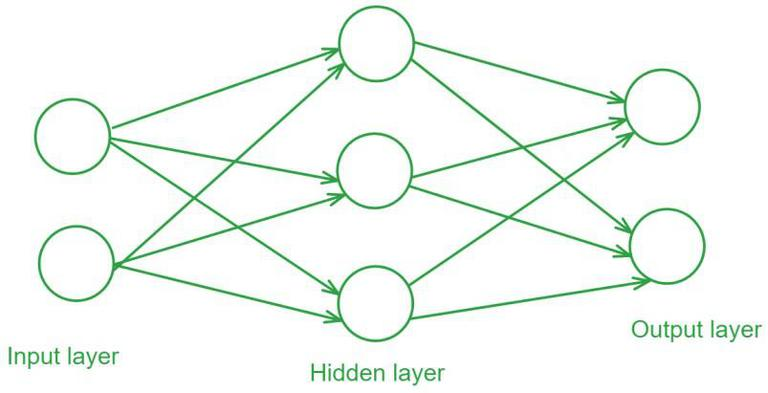
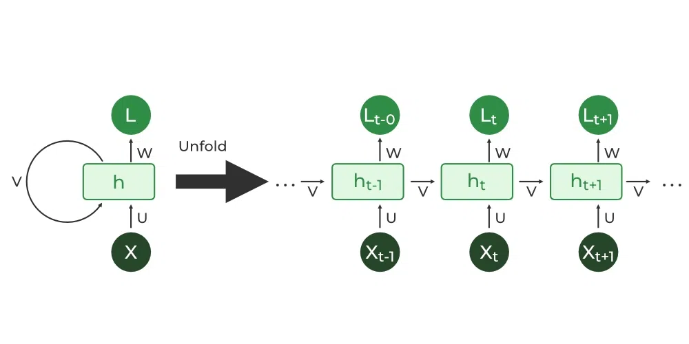
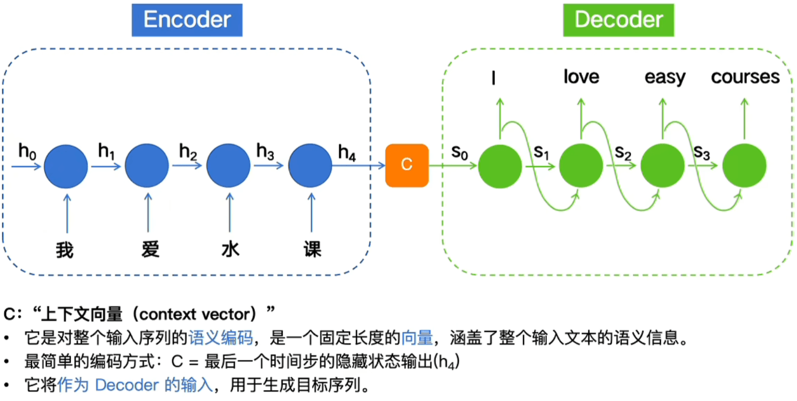
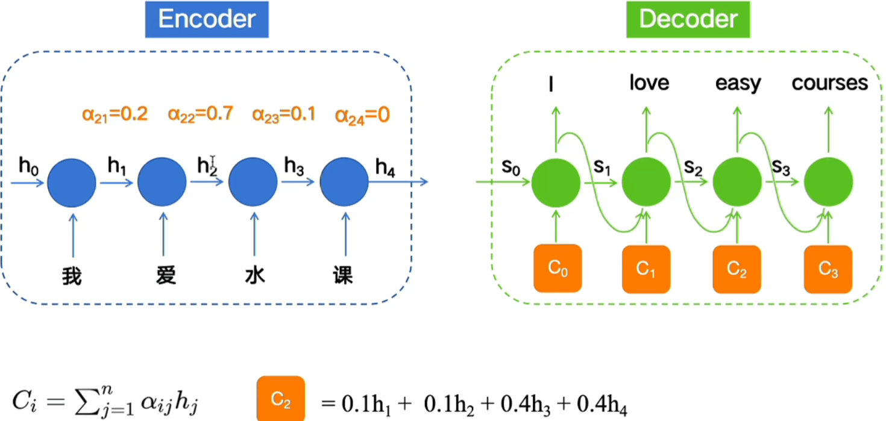
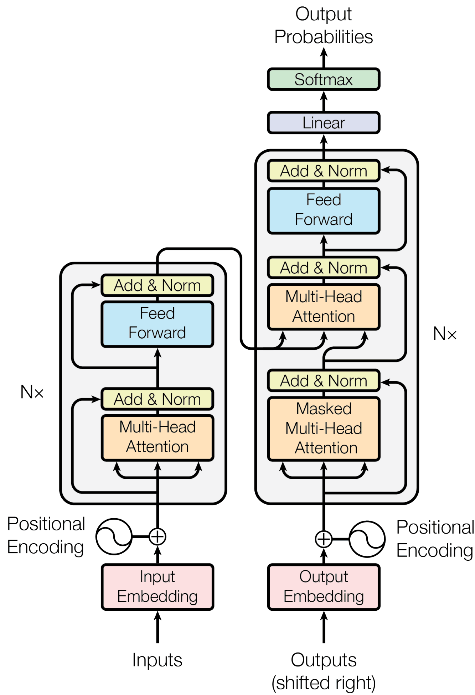
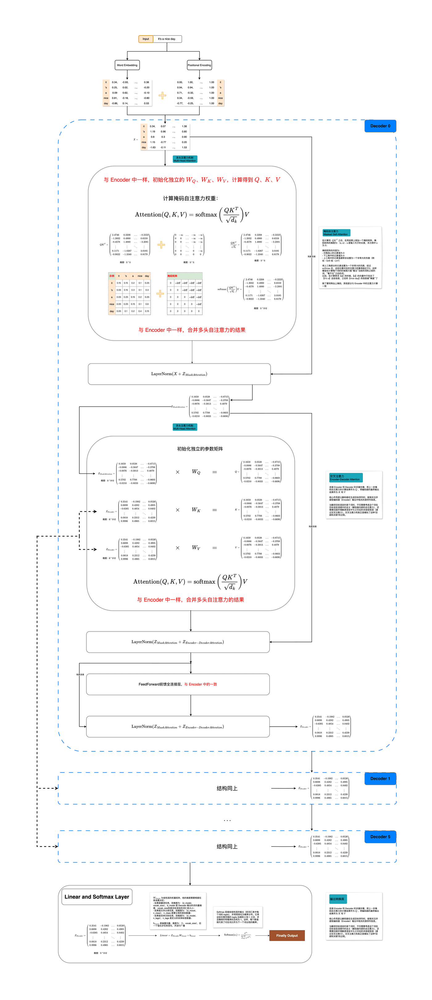
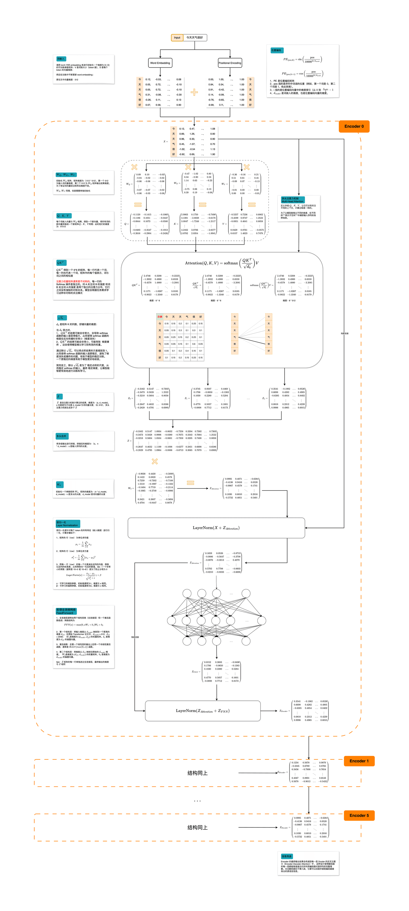
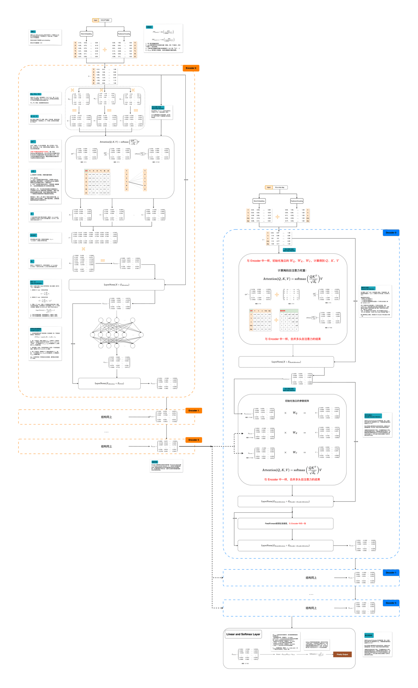
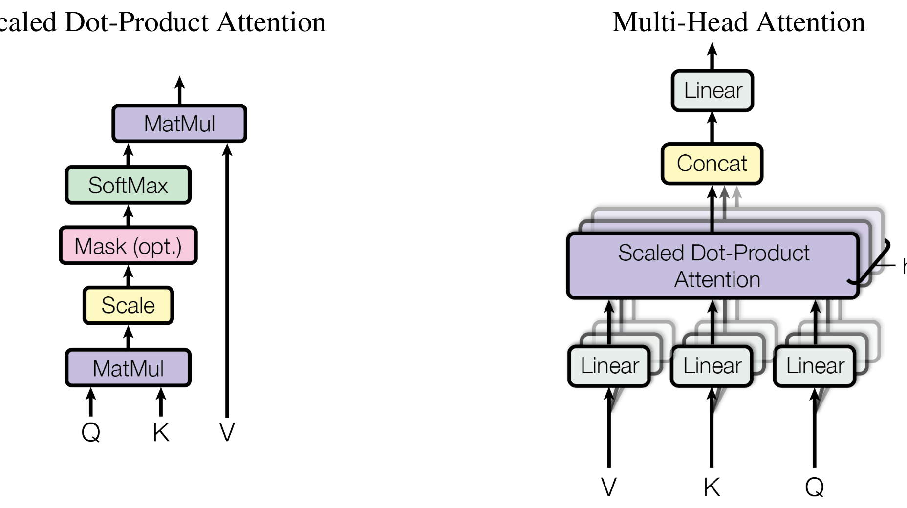

## 以序列转导任务为核心
## 一、 核心痛点：文字是“离散的”，计算机只懂“数字”

无论是前馈网络、RNN 还是 Transformer，处理语义的第一步都是**词嵌入（Word Embedding）**：

把每一个词变成一串有语义的连续数字（向量）。比如：

- `“猫”` $\to [0.2, -0.5, 0.8]$
    
- `“狗”` $\to [0.21, -0.48, 0.79]$ （语义接近，向量在空间的距离也接近）
    

有了向量后，怎么处理一句话（一串向量）呢？

## 二、 第一代方案：前馈神经网络（FFN / MLP）是怎么处理语义的？

前馈神经网络是最简单的“单向”结构。处理一句话时，它通常采用两种死板的方式：

```
方式 A（拼接 Concatenation）：
["我", "爱", "机器人"] ──► [ 矢量1 | 矢量2 | 矢量3 ] ──► [ FFN ] ──► 输出

方式 B（平均 Mean Pooling）：
["我", "爱", "机器人"] ──► (矢量1 + 矢量2 + 矢量3) / 3 ──► [ FFN ] ──► 输出
```

### 致命缺陷：

1. **无法处理变长句子**：拼接方式要求输入的句子长度必须固定（比如固定 5 个词）。如果来了一个 10 个词的句子，网络结构的矩阵维度直接崩溃。
    
2. **丢失语序信息**：平均方式把所有词混在一起，“我不爱你”和“你不爱我”算出来的平均向量完全一样，语义完全搞混。
    
3. **没有真正的“上下文”概念**：前馈网络只能把一整句话当成一个静态的“死板图片”来看。
    

## 三、 第二代方案：RNN（循环神经网络）是如何处理语义的？

为了解决前馈网络的缺陷，研究人员发明了 **RNN（Recurrent Neural Network）**。

RNN 的核心思想极其优雅：**“像人类阅读一样，从左到右，逐字阅读，并带着记忆读下一个词。”**

### 1. RNN 的工作流程（以处理 `“我 爱 机器人”` 为例）：


RNN 内部有一个**隐状态向量（Hidden State, $h$）**，这就是它的“短期记忆”。

```
第 1 步：读入 “我”
[ 词向量 "我" ] ──┐
                 ├──► [ RNN 单元 ] ──► 记忆 h₁ (包含 “我” 的信息)
[ 初始记忆 h₀ ] ──┘

第 2 步：读入 “爱”
[ 词向量 "爱" ] ──┐
                 ├──► [ RNN 单元 ] ──► 记忆 h₂ (包含 “我 爱” 的信息)
[ 上一步记忆 h₁] ─┘

第 3 步：读入 “机器人”
[ 词向量"机器人"] ─┐
                 ├──► [ RNN 单元 ] ──► 记忆 h₃ (包含完整句子的信息)
[ 上一步记忆 h₂] ─┘
```
### 2. RNN编码器-解码器结构：
解决输入输出维数不统一


### 3. RNN 的巨大进步：

- **能处理任意长度的句子**：不管句子有多长，RNN 只需要像传送带一样，一个词一个词往里喂就行。
- **保留了严格的语序**：先读“我”再读“爱”，和先读“爱”再读“我”，最终产生的记忆 $h$ 是完全不同的。
### 4. RNN 的注意力机制：


引入注意力机制为了解决**遗忘性**和**重要性**问题。
## 三、RNN 的两大致命痛点

RNN 统治了 NLP 领域很多年，但随着数据量激增，人们发现了它**无法克服的两座大山**：

### 1. 痛点一：无法并行计算（速度极慢）

注意到了吗？RNN 计算 $h_3$ 必须依赖 $h_2$，计算 $h_2$ 必须依赖 $h_1$。

**它必须像串行流水线一样，一个词一个词地算。**

在 GPU 拥有上千个计算核心的时代，RNN 无法利用 GPU 的并行计算能力。面对成千上万GB 的网页文本，RNN 训练一个大模型可能需要几年！

### 2. 痛点二：长距离遗忘（记忆力太差）

当句子非常长时（比如一段 200 字的文章），RNN 在读到第 200 个词时，第 1 个词的信息经过了 200 次矩阵连续相乘，**信息已经被稀释或冲淡掉了**（学术上叫**梯度消失/爆炸**）。

即使后来发明了改良版的 **LSTM** 和 **GRU**（加了“记忆门控机制”），也只能缓解，无法彻底解决长文本依赖问题。

## 四、Transformer的架构

即使在RNN 中引入CNN 也会出现难以捕捉远距离依赖的问题，但是transformer可以有三大优势：
**其一为每层的总计算复杂度。其二为可并行计算量，以所需最小顺序操作数量衡量。其三为网络中长期依赖之间的路径长度。**

这是Transformer的模型架构图。

接下来是详细讲解的流程图。


***先是编码器的。***


***这是解码器的。***

***最后是整体的。***

接下来，来解释一些细节问题。
## 1.为什么要多头模型
单头模型一般是512* 512的qkv矩阵，为了减少计算量和希望让每个矩阵都有子语义（*即单头的最后会加权平均减少分辨率，多头可以解决*），一般分为8个512* 64去分别计算kvq的权重矩阵，最后加成512* 512 在经过线性层变成最后的矩阵。
```
                                 输入词向量 X (如 512 维)
                                           │
         ┌───────────┬───────────┬─────────┴─────────┬───────────┐
         ▼           ▼           ▼                   ▼           ▼
      [ Head 1 ]  [ Head 2 ]  [ Head 3 ]   ...    [ Head 7 ]  [ Head 8 ]
      (64 维)     (64 维)     (64 维)             (64 维)     (64 维)
         │           │           │                   │           │
   只关注指代关系  只关注语法结构 只关注实体搭配       只关注情感语义...
         │           │           │                   │           │
         └───────────┴───────────┬───────────────────┴───────────┘
                                 ▼
                     拼接 (Concat) + 线性变换 (Wᴼ)
                                 │
                            恢复高分辨率输出
```
## 2.**Scaled Dot-Product Attention（缩放点积注意力）**
$$\text{Attention}(Q, K, V) = \text{softmax}\left(\frac{QK^T}{\sqrt{d_k}}\right)V$$
这里的 $Q$（Query/查询）、$K$（Key/键）、$V$（Value/值）是三个矩阵。为了直观理解，你可以把它想象成“在图书馆（或百度）搜索信息”的过程：

1. **$QK^T$（点积 Dot-Product）：计算相关性（匹配度）**
    
    - **现实映射**：$Q$ 是你在搜索框里输入的“关键词”；$K$ 是图书馆里每一本书封面上的“标签”。
        
    - **数学操作**：让 $Q$ 和 $K$ 的转置相乘（也就是算两个向量的内积）。点积的结果越大，说明 Query 和 Key 越匹配，即**这两个词在语义上越相关**。
        
2. **$\frac{1}{\sqrt{d_k}}$（缩放 Scaled）：防止梯度消失**
    
    - **这是名字里“Scaled（缩放）”的来源**。$d_k$ 是 $K$ 向量的维度（比如 64 维）。
        
    - **为什么必须除以它？** 当维度 $d_k$ 很大时，$Q$ 和 $K$ 的点积结果数值会变得非常大。数值太大送给后面的 Softmax 函数，会把整个函数的输出推向极端（变成极端的 0 和 1），导致在反向传播时**梯度几乎为 0（梯度消失）**，模型就彻底学不动了。
        
    - **作用**：除以 $\sqrt{d_k}$ 就像是一个“数值稳定器”，把结果拉回到合理的分布区间。
        
3. **$\text{softmax}(\dots)$：归一化转化为注意力权重**
    
    - **数学操作**：把算出来的匹配度变成 $0 \sim 1$ 之间的概率分布，且所有权重加起来等于 1（比如 0.7, 0.2, 0.1）。
        
    - **作用**：决定了当前词需要对句子里的其他词分配多少百分比的“注意力”。
        
4. **$\times V$（乘以前馈值）：加权提取信息**
    
    - **现实映射**：$V$ 是书本里的“真实内容”。
        
    - **数学操作**：用前面算出的百分比权重，去乘以对应的 $V$ 矩阵，然后求和。
        
    - **结果**：如果某个词的权重是 0.9，那最终的结果里就会大量包含该词的 $V$ 信息；如果是 0.01，它的信息几乎就被忽略了。

## 3.其他的核心的**通用基础设施技术**
### 1. 逐位置前馈网络（Position-wise Feed-Forward Networks, FFN）

$$\text{FFN}(x) = \max(0, xW_1 + b_1)W_2 + b_2$$

- **干了什么**：它是一个包含两层线性变换、中间夹着一个 **ReLU 激活函数**（后续的大模型很多改用了 GELU 或 SwiGLU）的经典多层感知机（MLP）。
    
- **核心作用**：
    
    - **非线性表征（增加模型容量）**：Self-Attention 本质上是在做**词与词之间的线性加权组合**。如果不加非线性激活函数，叠加再多层也只是线性变换。FFN 提供了关键的非线性能力。
        
    - **维度扩增与特征消化**：第一层通常把输入维度扩张 4 倍（如从 $d_{\text{model}}=512$ 升至 $d_{ff}=2048$），让信息在更宽的空间里充分升维、扭曲、非线性投影，第二层再还原回 512 维。
        
    - **逐位置（Position-wise）独立计算**：它对序列中每一个词的向量**独立地**应用相同的变换，不破坏词与词之间的相对关联。
        

### 2. 嵌入与概率输出（Embeddings and Softmax）

- **干了什么**：
    
    1. **输入端（Input/Output Embeddings）**：将离散的 Token ID（如 `“猫”` 的 ID 为 102）映射为一个高维的连续向量（如 512 维）。
        
    2. **输出端（Softmax）**：将解码器最终输出的向量，通过线性变换投影到词表大小（Vocab Size），再经过 Softmax 函数转为生成下一个词的预测概率分布。
        
- **论文中的巧妙设计（共享权重）**：
    
    - 论文中**将输入 Embedding、输出 Embedding 以及最终线性变换的权重矩阵进行共享（Weight Tying）**，极大地节省了参数量。
        
    - 为了平衡权重共享带来的数值数量级差异，论文在将输入乘以 Embedding 后，额外乘以了 **$\sqrt{d_{\text{model}}}$ 进行放大**。
        

### 3. 位置编码（Positional Encoding, PE）

$$\begin{aligned} PE_{(pos, 2i)} &= \sin\left(\frac{pos}{10000^{2i/d_{\text{model}}}}\right) \\ PE_{(pos, 2i+1)} &= \cos\left(\frac{pos}{10000^{2i/d_{\text{model}}}}\right) \end{aligned}$$

- **干了什么**：利用正弦（$\sin$）和余弦（$\cos$）不同频率的波形组合，为序列中的每一个绝对位置（$pos$）生成一个专属的位置特征向量，并直接与词向量相加：$X_{\text{final}} = X_{\text{embedding}} + PE$。
    
- **核心作用**：
    
    - **补回语序信息**：Self-Attention 是**并行且无序的**（打乱句子中词的顺序，注意力算出来的数值完全一样）。加上 PE 后，模型才能区分 `“我爱你”` 和 `“你爱我”`。
        
    - **外推相对位置关系**：根据三角函数的和差化积公式，任意固定偏移量 $k$ 的位置编码 $PE_{(pos+k)}$ 可以表示为 $PE_{(pos)}$ 的线性组合。这意味着**模型不仅能识别绝对位置，还能天然学会计算词与词之间的相对距离**，甚至具备推断比训练时更长句子的能力（可扩展性）。
        

### 4. 优化器与预热学习率（Optimizer & Warmup Learning Rate）

$$\text{lrate} = d_{\text{model}}^{-0.5} \cdot \min\left(\text{step\_num}^{-0.5}, \text{step\_num} \cdot \text{warmup\_steps}^{-1.5}\right)$$

- **干了什么**：采用了带有特定超参数设置的 **Adam 优化器**（$\beta_1 = 0.9, \beta_2 = 0.98, \varepsilon = 10^{-9}$），并配合一个先升后降（Warmup）的动态学习率调整策略。
    
- **核心作用（解决训练不稳定）**：
    
    - **前 `warmup_steps`（如前 4000 步）**：学习率随着训练步数线性**增加**。因为训练刚开始时，模型参数全是随机初始化的，梯度方向极度不稳定，较小的学习率可以防止模型在早期被错误的梯度“带偏”或梯度爆炸。
        
    - Warmup 结束之后：学习率按步数的平方根反比（$\text{step\_num}^{-0.5}$）**逐渐衰减**。模型参数逐渐趋于稳定，微调学习率有助于模型最终精准收敛到最优解。
