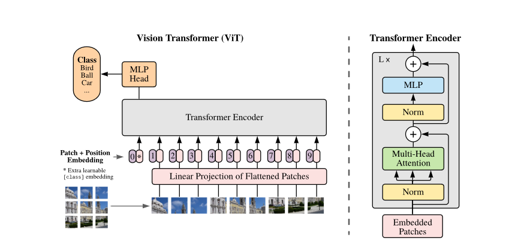

## 📝 Vision Transformer (ViT) 学习笔记

## 0. 前言

在计算机视觉领域，卷积神经网络 (Convolutional Neural Network, CNN) 长期以来一直是处理图像任务的主流架构。然而，随着 Transformer 在自然语言处理领域的巨大成功，研究人员开始探索将这种基于自注意力机制的架构应用于视觉任务。Vision Transformer (ViT) 是这一探索的重要里程碑，它首次证明了纯 Transformer 架构在图像分类任务上可以超越最先进的 CNN 模型。本文将详细介绍 ViT 的技术原理，并使用 PyTorch 从零开始构建 ViT 模型用于图像分类任务。

## 1. ViT 技术原理

### 1.1 核心思想

Vision Transformer (ViT) 的核心思想是将图像分割成固定大小的小块 (patch)，将这些 patch 线性嵌入后加上位置编码，然后像自然语言处理 (Natural Language Processing, NLP) 中的词元 (token) 一样 将这些 patch 序列输入标准的 Transformer 编码器中进行处理。

### 1.2 使用 Transformer 处理图像数据

Transformer 非常擅长处理时间序列数据，图像在某种程度上也可以视为时间序列。例如，将图像分解成大小为 16×16 的小块，如果我们按顺序将这些图像块依次输入模型，那么这些块也具有序列格式。这与卷积神经网络非常相似，在卷积神经网络 (CNN) 中，我们也将图像视为多个小块，并在块上应用卷积核（即创建一个卷积核并在图像上移动）。Transformer 会在此基础上，增加一个基于全连接层的嵌入 (embedding) 层，这使得每个块的大小不再是 16×16，而是该图像部分的密集表示，此外，还需要添加位置嵌入 (positional embedding)。

这些模型也可以仅包含编码器。例如，可以在每个操作的开头添加一个额外的词元，以创建整个图像的表示。在分类过程中，我们可以使用该词元将整个图像分类为给定的类别。架构的其余部分与 Transformer 编码器块相同。ViT 架构的主要思想是分块并在图像块上应用位置嵌入。

## 2. ViT 关键组件

ViT 的成功依赖于几个精心设计的核心组件，这些组件共同实现了将 Transformer 架构有效应用于图像数据的创新方法。接下来，我们将深入剖析每个关键组件的设计原理和实现细节。

### 2.1 图像分块 (Image Patching)

#### 【原理】

Transformer 原本是为序列数据设计的，而图像是 2D 结构，图像分块 (Image Patching) 是将 2D 图像转换为 1D 序列的最直接方法，每个块 (patch) 相当于 NLP 中的一个 token。假设输入图像尺寸为 $H \times W \times C$ (高度 × 宽度 × 通道)，patch 大小为 $P \times P$ (通常 $16 \times 16$)，那么分块数量为：

$$
N = \frac{H \times W}{P^2}
$$

较大的 patch 会丢失局部细节但计算效率高，较小的 patch 保留更多细节但增加序列长度。

#### 【补全与强化】

**实现方式对比：**

1. **展平 + 线性投影**：先把 2D 的 Patch 拉直成 1D，再用 `nn.Linear` 变换。
    
2. **卷积层高效分块**：直接使用 2D 卷积一步到位。 可以通过使用卷积实现高效分块：

    ``` python
    self.proj = nn.Conv2d(
        in_channels=in_channels, 
        out_channels=embed_dim, 
        kernel_size=patch_size, 
        stride=patch_size
    )
    ```
    
    - **为什么卷积能做到？** 当卷积核大小 K=P 且步长 S=P 时，卷积核刚好无重叠地滑过图像，数学点积运算与线性投影**完全等价**，但 GPU 计算并行度更高。
### 2.2 Patch 嵌入 (Patch Embedding)

#### 【原理】
Patch 嵌入 (Patch Embedding) 将每个 patch 展平并通过线性投影映射到 D 维空间，类似于 NLP 中的词嵌入，包括展平 patch（P×P×C→P2C 维向量）和线性投影（P2C→D，通常 D=768）。
在 PyTorch 中可以使用以下代码实现：

``` python
# 方式 A：手动展平 + Linear
x = x.flatten(2).transpose(1, 2)  # [B, N, P²C]
self.proj = nn.Linear(P^2 * C, D)

# 方式 B：直接使用卷积层实现
x = self.proj(x)  # 输入 [B, C, H, W] -> 输出 [B, D, H/P, W/P]
x = x.flatten(2).transpose(1, 2)  # 转换为 Transformer 标准格式 [B, N, D]
```

#### 【补全与强化：数据形状演算 (以 ViT-Base 为例)】

- 输入图像：$x \in [B, 3, 224, 224]$
    
- 经过卷积：$\text{Conv2d}(3, 768, K=16, S=16) \rightarrow [B, 768, 14, 14]$
    
- 空间展平：`flatten(2)` $\rightarrow [B, 768, 196]$ （其中 $N = 14 \times 14 = 196$）
    
- 维度转置：`transpose(1, 2)` $\rightarrow [B, 196, 768]$ （得到了 196 个 $768$ 维的 Token）
    

### 2.3 位置编码 (Position Embedding)

#### 【原理】

Transformer 本身是排列不变的，因此必须注入空间位置信息，不同于 Transformer 的固定编码，ViT 使用可学习的位置编码 (Position Embedding)，形状为 (N+1)×D (N 个 patch + 1 个分类 token)。
在 PyTorch 中可以使用以下代码实现：

``` python
self.pos_embed = nn.Parameter(torch.zeros(1, N + 1, D))
nn.init.trunc_normal_(self.pos_embed, std=0.02)
```
#### 【补全与强化】

- **作用机制**：直接与 Patch 序列进行**逐元素相加（Element-wise Addition）**，即：
    
    ``` python
    x = x + self.pos_embed  # [B, N+1, D] + [1, N+1, D] -> [B, N+1, D]
    ```
    
- **特点**：不需要人工设计正弦余弦公式，模型在训练过程中通过反向传播自动学习出最佳的位置几何关系。
    
### 2.4 分类 token (Class Token)

#### 【原理】
分类 token (Class Token) 类似 BERT 的 `[CLS]` token，用于分类任务，作为整个图像的表征，通过自注意力聚合全局信息。

在 PyTorch 中可以使用以下代码添加分类 token：

``` python
self.cls_token = nn.Parameter(torch.zeros(1, 1, D))
nn.init.trunc_normal_(self.cls_token, std=0.02)

# 前向传播时的拼接操作：
cls_tokens = self.cls_token.expand(B, -1, -1)  # 扩展为与 Batch 同等大小: [B, 1, D]
x = torch.cat((cls_tokens, x), dim=1)           # 拼接在序列最前面: [B, 1 + N, D]
```

#### 【补全与强化】

- **执行顺序（关键）**：`[CLS]` Token 是在**进入 Transformer 编码器之前**拼接上去的，拼接后序列长度从 N 变成 N+1，随后再与 `pos_embed` 相加。
    
- **信息抽取**：数据经过 Transformer 编码器多层自注意力机制的交互后，直接提取第 `0` 号位置的向量 `x[:, 0]` 输入最后的 MLP / 线性分类头，完成图像分类。
    

## 3. 完整 Patch Embedding 模块整合代码

结合上述 2.1 - 2.4 节的所有步骤，一个完整的 ViT 输入处理模块代码如下：

``` python
import torch
import torch.nn as nn

class ViTPatchEmbedding(nn.Module):
    def __init__(self, img_size=224, patch_size=16, in_chans=3, embed_dim=768):
        super().__init__()
        self.img_size = img_size
        self.patch_size = patch_size
        self.n_patches = (img_size // patch_size) * (img_size // patch_size)
        
        # 2.1 & 2.2 卷积高效分块与嵌入映射
        self.proj = nn.Conv2d(in_chans, embed_dim, kernel_size=patch_size, stride=patch_size)
        
        # 2.4 可学习的分类 Token
        self.cls_token = nn.Parameter(torch.zeros(1, 1, embed_dim))
        
        # 2.3 可学习的位置编码 (1个 CLS + N个 Patch)
        self.pos_embed = nn.Parameter(torch.zeros(1, 1 + self.n_patches, embed_dim))
        
        # 参数截断正态分布初始化
        nn.init.trunc_normal_(self.pos_embed, std=0.02)
        nn.init.trunc_normal_(self.cls_token, std=0.02)

    def forward(self, x):
        B = x.shape[0]
        
        # 1. 卷积投影 + 格式转换 [B, C, H, W] -> [B, N, D]
        x = self.proj(x).flatten(2).transpose(1, 2)
        
        # 2. 拼接分类 Token -> [B, N+1, D]
        cls_tokens = self.cls_token.expand(B, -1, -1)
        x = torch.cat((cls_tokens, x), dim=1)
        
        # 3. 叠加位置编码 -> [B, N+1, D]
        x = x + self.pos_embed
        return x
```
