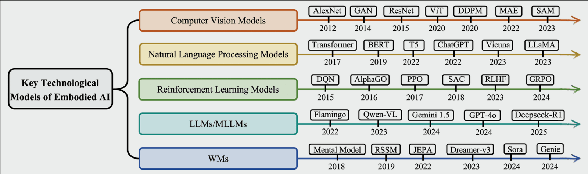
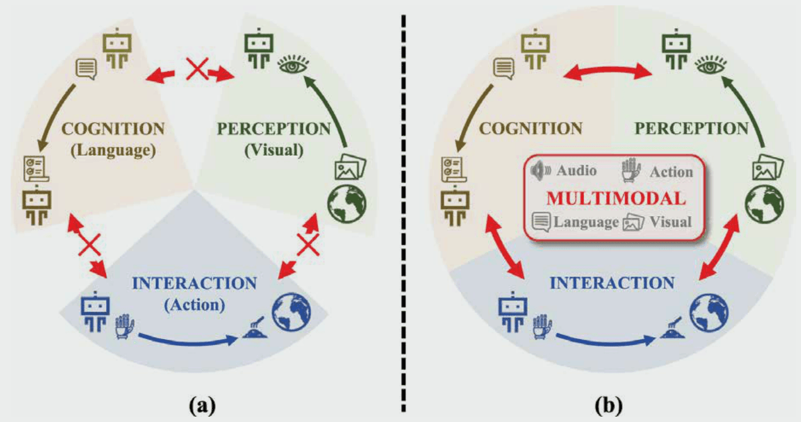
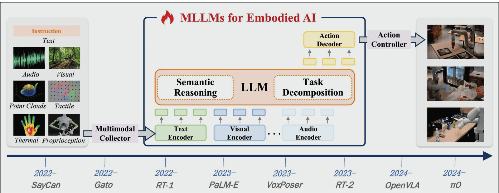
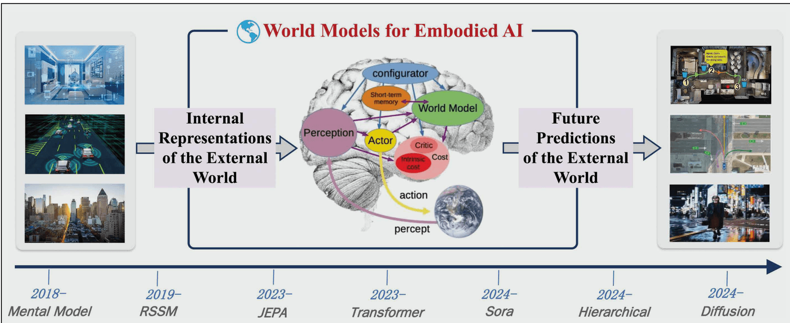
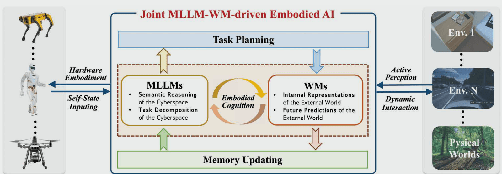
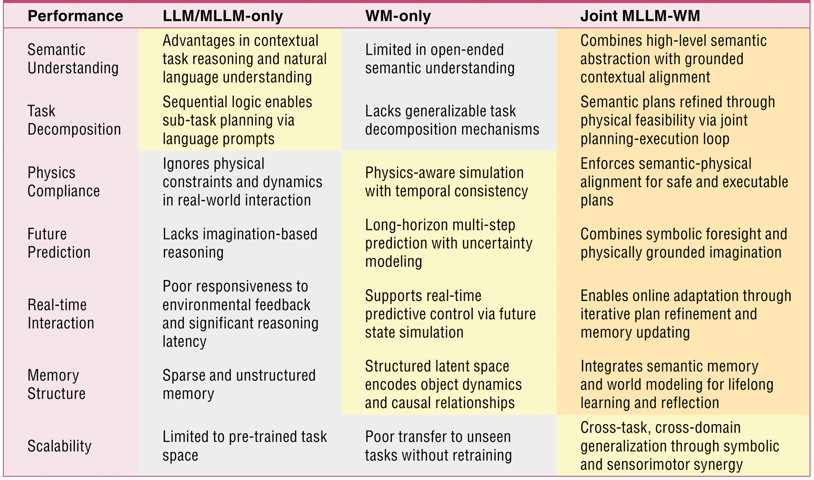

## 具身智能完整知识架构（单智体 + 多集群双主线融合）
## 一、发展历史以及未来展望

*Key technological models of embodied AI*
### 阶段 1：理论奠基与早期传统具身智能（1950s–2010s）
#### 1. 理论起源（思想根基）
1950 年图提出具身图灵测试，确立智能依托物理交互；80 年代具身认知理论成型，证明感知 - 认知 - 行动耦合是智能核心；Harnad 提出符号接地难题，指出纯符号 AI 无法理解物理世界。
同时，多智能体雏形同步诞生：分布式机器人、集群无人机早期理论被提出，但受限于算力，仅停留在理论仿真，无实体落地。
#### 2. 工程落地：行为机器人时代
- Brooks 分层包容架构：传感器 - 反应单机器人闭环，扫地机、单移动底盘落地；
- Cog 人形机器人：单机器人模仿学习、简单人机交互；
- 单智能体局限：感知 / 认知 / 交互三大模块割裂、单模态；
- 多智能体局限：仅集中式路径规划（Grid-MAP 初代网格算法），异构机器人协同完全无法实现，无统一通信机制。
#### 3. 核心局限
1. 单智能体：人工规则驱动、无自然语言理解、无环境预测；
2. 多智能体额外短板：全局集中计算算力爆炸，局部观测缺失，机器人间无信息互通，仅适用于简单静态网格场景，无法适配动态真实环境。
### 阶段 2：单模态向多模态转型，深度学习赋能传统具身（2010–2022）

#### 1. 技术变革：深度学习打通单模块
计算机视觉、NLP、强化学习（DQN/PPO）分别优化**主动感知、具身认知、动态交互**三大模块。
- **感知层**：ORB-SLAM、3D 场景理解成熟，单机器人 RGB-D / 点云多模态起步；多智能体出现协同 SLAM，但融合算法简陋。
- **认知层**：小型 NLP + 传统 RL 实现单机器人简单任务拆解；多智能体仅具备简单全局规划，无分层任务分配能力。
- **交互层**
    单机器人：强化学习实现抓取、导航，模仿学习 IL 成为主流；
    新增**多智能协同决策分支**（表格内置分类）：CTDE 集中训练分布式执行 MARL 框架（QMIX、MADDPG）问世，支持少量同构机器人协同，但异构机器人、异步交互难以处理。
#### 2. 范式升级：多模态具身诞生
单模态缺陷暴露，学界融合视觉 / 语言 / 触觉搭建单机器人感知 - 认知 - 交互闭环；多智能体领域初步实现多传感器跨机器人共享，但模态对齐差、通信延迟问题突出。
#### 3. 核心痛点（承上启下，同时覆盖单 / 多智能体）
1. 单智能体共性痛点
    模块割裂、无统一大模型底座；语义 - 物理鸿沟；无世界模型、无法预判动作后果；
2. 多智能体新增特有痛点
    （1）联合动作空间指数级膨胀，训练成本极高；
    （2）Dec-POMDP 局部观测问题，每个机器人仅能获取局部环境信息；
    （3）多智能体非平稳性：其他机器人同步学习，环境策略持续变化；
    （4）异构机器人（机械臂 / 无人机 / 无人车）观测、动作空间不统一，无法协同；
    （5）无高层语义能力，无法用自然语言完成集群任务分配。
> 上述单 / 多智能体双重痛点，共同催生 LLM/MLLM、世界模型两大技术路线，同时推动集群具身智能成为独立研究方向。
### 阶段 3：LLM/MLLM 驱动具身智能（2022–2024，语义能力爆发期）
分为**单智能体 MLLM**、**多智能体大模型集群**两条并行路线
#### 3.1 纯 LLM 单智能体路线（SayCan）
LLM 负责高层任务拆解，短板：脱离感知、无视物理约束。
#### 3.2 MLLM/VLA 单智能体路线（RT-2、PaLM-E、Octo）

端到端多模态融合，零 / 少样本操控；缺陷：无显式物理建模，缺少环境推演。
#### 3.3 LLM 驱动多智能集群（同期并行发展）
##### 核心能力
利用 LLM 全局语义推理，完成集群任务拆解、机器人能力匹配、任务分区分配；机器人间通过自然语言通信协商，解决传统 MARL 无高层理解的缺陷。代表：SMART-LLM、COHERENT、LLaMAC。
##### 固有缺陷
1. 无统一共享环境表征，每个机器人独立感知，信息冗余；
2. LLM 不具备物理动力学知识，分配的协同动作易发生碰撞、运动冲突；
3. 异构机器人模态不统一，语言指令难以适配不同硬件执行器；
4. 无法仿真集群交互后果，只能静态分配任务，无法动态调整协作策略。
### 阶段 4：世界模型（WM）独立驱动具身（2018–2025，并行路线）
#### 1. 单智能世界模型两大核心能力

环境隐空间表征、长时序动作预测（Dreamer、JEPA、Transformer-WM）；缺陷：无语言语义，无法接收人类复杂指令。
#### 2. 多智能协同世界模型（同期衍生方向）
##### 核心能力
构建全局共享环境动力学模型，仿真多机器人同步交互、群体运动轨迹；提前预判集群碰撞、路径冲突，大幅降低真机集群试错成本。代表：GAWM、COMBO。
##### 独立使用致命缺陷
1. 无 LLM 高层语义，无法完成集群任务拆解与分工；
2. 无法理解人类自然语言下达的集群协同指令；
3. 机器人动态增减、开放环境下全局世界模型更新开销巨大。
### 阶段 5：下一代核心范式 ——MLLM + 世界模型融合架构（单 / 多智能通用）
#### 5.1 单智能体融合互补逻辑

|MLLM 单独|世界模型单独|融合协同增益|
|---|---|---|
|强语义任务拆解，无视物理|精通物理仿真，无高层理解|MLLM 生成计划，WM 校验物理可行性，双向迭代修正|

#### 5.2 多智能集群融合拓展逻辑（新增集群维度）

| 纯 LLM 集群             | 纯多智能世界模型               | MLLM+WM 集群融合                                                  |
| -------------------- | ---------------------- | ------------------------------------------------------------- |
| 擅长任务分配、语言通信，不懂群体物理约束 | 擅长仿真机器人交互、规避冲突，无任务规划能力 | MLLM 负责全局集群分工、人机语言交互；共享多智能世界模型仿真全体机器人协同轨迹，动态调整子任务，适配动态增减机器人团队 |

#### 5.3 统一完整闭环工作流（兼容单 / 多智能体）
1. 所有机器人多模态感知数据统一汇总，分别送入集群 MLLM 与共享世界模型；
2. MLLM 解析人类全局指令，拆解并行 / 串行子任务，分配至对应异构机器人；
3. 共享多智能世界模型仿真全体机器人协同运动，检测碰撞、资源冲突、任务时序矛盾；
4. WM 将冲突修正方案回传给 MLLM，重新调整集群分工与机器人轨迹；
5. 各机器人下发修正后目标轨迹，由底层控制器执行；
6. 集群交互产生新环境变化，同步更新全局世界模型与所有机器人记忆库，实现集群终身自主进化。
#### 5.4 融合架构统一现存挑战（含单 + 多智能特有问题）
1. 通用挑战：MLLM 与 WM 推理时延不匹配、语义 - 物理错位、海量记忆存储成本高；
2. 多智能集群专属挑战：
    （1）大规模机器人并行推理算力开销爆炸；
    （2）异构机器人感知 / 动作空间对齐困难；
    （3）开放环境下团队成员动态变化，共享世界模型实时更新难度大；
    （4）多机器人通信延迟、观测噪声导致仿真与现实存在集群虚实鸿沟；
    （5）多智能体信用分配困难，难以界定单个机器人任务贡献。

*Qualitative comparison of MLLM-only, WM-only, and joint MLLM-WM*
### 六、论文完整未来研究展望（七大核心方向，整合集群具身）
#### （一）通用自主单具身智能（基础底座）
无人工干预下，单机器人在开放环境长期自主运行；自适应多模态感知、因果推理、轻量化 MLLM-WM 融合推理。
#### （二）具身智能软硬件协同（单 / 集群通用）
轻量化模型、专用边缘加速器、ROS2 集群分布式调度，降低单 / 多机器人算力与功耗成本。
#### （三）集群多智能体具身智能（新增独立核心方向）
1. 多智能共享协同世界模型，分布式感知融合，全局环境统一表征；
2. 异构机器人分层协同框架，适配机械臂 / 无人机 / 无人车混合集群；
3. LLM 驱动群体协商、动态任务分配，支持机器人实时加入 / 退出团队；
4. 集群专用仿真基准（SMARTS、MAP-THOR、CARIC）与真机集群验证；
    落地场景：仓储机器人集群、无人机搜救编队、多机械臂协同装配、城市自动驾驶车流。
#### （四）可解释、可信具身 AI（单 / 集群通用）
单机器人行为可追溯；集群协同决策、分工逻辑可解释；高风险场景（救援、工业集群）安全约束与标准化验证体系。
#### （五）终身持续学习
单机器人持续更新环境知识；集群实现群体经验共享、跨机器人知识迁移，避免灾难性遗忘。
#### （六）人在回路协同学习
单机器人：少量人类反馈优化操作；集群：人类作为团队管理者 / 协作个体，自然语言调整集群任务、干预机器人分工。
#### （七）道德、安全与价值对齐
单机器人规避危险操作；多智能集群杜绝资源抢占、冲突行为，人机协同符合人类伦理安全标准。
## 2. 工作架构（单智能基础 + 多集群拓展）
## 一、整体两大主流架构路线

### 路线 1：传统模块化流水线（2010 年前，单 / 多智能早期）
1. 单机器人：传感器→SLAM→人工规划→底层控制
2. 多机器人拓展：多机独立感知→集中式全局规划→各机独立执行
    共同痛点：模块割裂、无语义、无物理预判；集群版本算力爆炸、局部观测缺失。
### 路线 2：MLLM + 世界模型融合端到端架构（2022 至今，单 / 集群通用）
1. 单智能基础链路：多模态感知 ⇌ 大脑 MLLM ⇌ 单智能世界模型 ⇌ 小脑控制 ⇌ 物理环境
2. 多智能集群拓展链路：全体机器人分布式感知汇总 ⇌ 集群 MLLM 大脑 ⇌ 共享多智能世界模型 ⇌ 各机器人独立小脑控制器 ⇌ 共享物理环境
    统一特点：双向循环、语义 + 物理双重约束，支持单机器人自主与多机器人集群协同。
## 二、六层完整分层工作架构（含集群拓展）
### 第 1 层：硬件本体层（单 / 集群硬件底座）
1. 单机器人硬件：RGB-D、LiDAR、机械臂、Jetson 边缘算力；
2. 集群拓展：异构硬件混合集群（无人机 / 移动底盘 / 机械臂）、分布式边缘计算节点、机器人通信组网模块；
    驱动统一适配 ROS2 分布式集群框架。
### 第 2 层：主动感知输入层（Table1，分布式感知拓展）
单机器人：SLAM、3D 场景理解、主动探索；
集群拓展：多机器人协同 SLAM、跨机器人特征融合、局部观测信息互通，统一汇总至多模态特征池，同步送入集群 MLLM 与共享世界模型。
### 第 3 层：大脑高层具身认知层（Table2，集群大模型拓展）
单智能：任务自规划、记忆反思、MLLM 单机器人推理；
集群拓展：集群 LLM/MLLM 新增三大模块
1. 全局任务拆解：将人类集群指令拆分为并行子任务；
2. 异构机器人能力匹配：根据各机器人硬件分配对应工作；
3. 多智能自然语言通信：机器人间互相求助、交换观测信息。
### 第 4 层：世界模型 WM 推演层（单 / 多双分支）
1. 单智能 WM：建模单个物体、局部环境动力学；
2. 多智能共享 WM：全局统一环境表征，建模所有机器人运动交互、物体与机器人耦合动力学，批量仿真全体机器人协同轨迹，预判碰撞、时序冲突。
### 第 5 层：小脑动态交互控制层（Table3，含多智能协同决策）
单机器人：底层力矩控制、模仿学习动作生成；
集群拓展：多智能协同决策分支，分为
1. 分布式动作输出：各机器人独立执行本地轨迹；
2. 协同约束修正：根据共享 WM 仿真结果，实时微调所有机器人运动，避免群体冲突；
    代表算法：MAPPO、HetGPPO、COMAT。
### 第 6 层：环境闭环与终身数据迭代层（集群共享迭代）
单机器人：自身交互数据更新本地记忆；
集群拓展：所有机器人交互数据全局共享，统一更新**共享多智能世界模型**与集群 MLLM 知识库，实现群体经验互通、跨机器人知识迁移；配套集群仿真数据集（Megaverse、Bi-DexHands）用于批量训练。
## 三、单机器人 / 多集群统一协同工作流（示例指令：三台机器人协同整理仓库）
1. 三台机器人分布式采集货架、货物 RGB-D / 点云感知数据，汇总至全局特征池；
2. 集群 MLLM 大脑解析 “三台机器人分区整理货架” 指令，分配 1 号搬运、2 号分拣、3 号堆叠；
3. 共享多智能世界模型仿真三台机器人同步运动，预判 1、2 号机器人通道交汇碰撞；
4. WM 反馈冲突，集群 MLLM 重新调整分区路径与工作时序；
5. 修正后轨迹下发三台机器人各自小脑控制器，高频平滑执行；
6. 完成整理后，三台机器人新增环境、货物交互数据全局同步，更新共享世界模型与集群记忆，完成集群学习闭环。
## 四、架构对比（新增多智能集群维度）

| 维度   | 传统单机器人模块化 | 传统集中式多机器人架构 | MLLM+WM 单智能融合            | MLLM+WM 集群融合架构                   |
| ---- | --------- | ----------- | ------------------------ | -------------------------------- |
| 推理分层 | 无大脑小脑     | 集中全局规划，无分层  | MLLM 大脑 + WM 物理校验 + 小脑控制 | 集群 MLLM 全局大脑 + 共享世界模型 + 各机器人独立小脑 |
| 语义能力 | 仅简单规则     | 无自然语言理解     | 开放域单任务语义                 | 全局集群指令拆解、机器人语言协商                 |
| 物理预判 | 无单环境仿真    | 无法仿真群体交互    | 单动作物理校验                  | 批量仿真全体机器人协同轨迹，规避集群冲突             |
| 模块耦合 | 完全割裂      | 中心节点算力瓶颈    | 端到端双向闭环                  | 分布式感知 + 全局统一推演，兼顾算力与协同           |
| 泛化性  | 固定场景失效    | 仅同构小规模机器人   | 单机器人零 / 少样本              | 支持异构、动态增减机器人团队                   |
| 自主进化 | 无记忆迭代     | 无群体经验共享     | 单机终身学习                   | 集群经验互通，跨机器人知识迁移                  |

## 五、架构与论文章节完整映射

1. 硬件层 + 感知层：论文 II 主动感知 Table1（含多智能协同感知拓展）
2. 大脑认知层：论文 III MLLM 具身 Table2（新增集群大模型任务分配）
3. 世界模型层：论文 IV 单 / 多智能世界模型
4. 小脑交互层：论文 VI 动态交互 Table3（多智能协同决策分支）
5. MLLM+WM 融合核心：论文 V（单智能）+ 第四章集群具身综述（多智能拓展）
6. 未来方向：论文第七大方向「集群多智能体具身智能」
## 3. 搭建具身 AI 全链路实现流程（NVIDIA 流程兼容单 / 集群）
## 整体三阶段流水线：预训练→后训练仿真微调→实时推理部署
### 阶段 1：Pre-training 预训练（单 / 集群数据统一供给）
1. 互联网通用多模态数据：学习基础视觉、语言常识；
2. 真机采集数据
    单机：机械臂、底盘交互轨迹；
    集群：异构机器人协同操作、编队真机数据集；
3. 仿真 + 世界模型合成数据
    单机：单物体、单场景仿真样本；
    集群：数字孪生大规模仓储 / 车流 / 无人机场景，共享多智能世界模型生成海量集群协同合成数据，解决真机集群采集成本极高问题。
### 阶段 2：Post-training 仿真专项微调（单 / 集群双路线）
1. 合成数据扩充：单机随机物体扰动；集群随机机器人数量、位置、任务变更；
2. 强化学习 RL
    单机：单机械臂、导航策略优化；
    集群：MARL 多智能强化学习，CTDE 框架训练协同策略；
3. 模仿学习 IL
    单机：人类单设备操作演示；
    集群：人类操控多台机器人完成协同任务的演示数据。
### 阶段 3：Inferencing 实时推理部署
1. 单机推理：CV+LLM+VLA 实现单机器人感知规划控制；
2. 集群分布式推理：
    各机器人本地边缘端运行轻量化感知 / 小脑控制模块；
    云端 / 中心算力部署集群 MLLM + 共享多智能世界模型，下发全局协同规划；
    通信模块完成机器人间观测、指令实时交互，实现分布式集群端到端推理。
