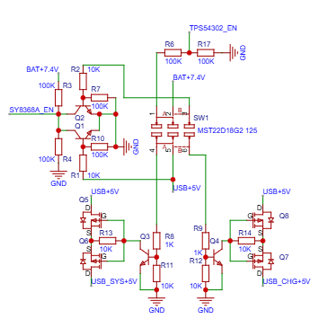
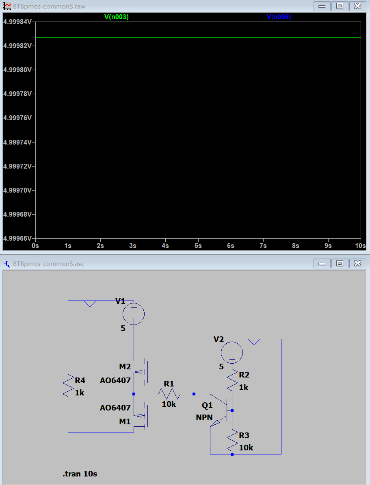
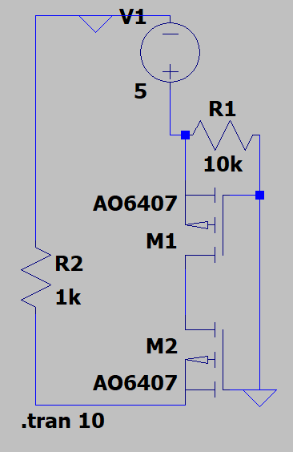

# 背对背 PMOS 电源切换电路：共 D 与共 S 接法仿真

## 1. 设计背景

最近在研究一个大电流电源切换电路。由于负载电流较大，直接使用普通的小信号开关并不合适，因此考虑使用 MOSFET 作为功率开关，实现不同电源之间的切换。

在方案选择上，背对背（Back-to-Back，BTB）MOSFET 是一个值得研究的方向。通过合理安排两颗 MOSFET 的连接方式，可以阻断不希望出现的反向电流，从而实现**电源切换与防倒灌**。此外，还可以使用 NPN 三极管或另一颗 NMOS 作为控制级，用较小的控制电流来控制较大的负载电流。

目前还没有找到合适的 NMOS 驱动方案，因此先从 PMOS 方案入手。虽然 PMOS 的成本可能更高一些，但其外围控制电路相对简单，在负载电流要求不高的场景下，仍然具有一定的实用性。

## 2. USB 供电切换电路

下图是整个电源切换电路的下半部分，主要用于实现 USB 供电切换。

这个部分的核心思路是利用 MOSFET 控制电源通路，在满足供电需求的同时，尽量避免电源之间发生反向灌电。具体的驱动方式还需要结合 MOSFET 的连接拓扑进一步分析。

## 3. 使用 LTspice 进行仿真

为了验证不同连接方式的可行性，我使用 LTspice 对背对背 MOSFET 电路进行了仿真。

这里也提醒一下：**建议使用 LTspice 独立搭建和验证电路，不要完全依赖嘉立创 EDA 的仿真插件。** 在我的使用过程中，该插件遇到了一些问题，因此暂时选择 LTspice 进行分析。

### 3.1 共 D 接法

首先测试的是共 D（共漏极）接法。这种连接方式比较直观，电路结构也比较简洁。仿真中采用了常见的 AO3401 型号进行验证。

图中：

- `V(n003)`：经过第一颗 MOSFET 后的节点电压。
- `V(n005)`：经过第二颗 MOSFET 后的节点电压。

从仿真结果来看，两处节点电压的压降较小。在 10 s 的仿真时间内，电路运行后整体波动趋于稳定，暂时没有观察到明显的异常。

这说明当前仿真条件下，共 D 接法能够满足预期的基本导通表现。不过，实际应用中的损耗、开关瞬态以及反向阻断能力，还需要结合具体器件参数和不同工作状态继续验证。

### 3.2 共 S 接法

接下来测试的是网上比较常见的共 S（共源极）接法。

从目前的仿真结果来看，共 S 接法同样能够正常工作，基本导通表现没有明显问题。

因此，两种连接方式在当前仿真条件下都具备一定的可行性。接下来真正需要解决的，是如何设计合适的控制级，让电路能够可靠地实现电源切换，同时避免控制端对电源通路造成额外影响。

## 4. 当前遇到的问题

虽然两种拓扑在仿真中都能够正常导通，但在进一步考虑 NMOS 控制方案时，仍然存在一些问题。

### 4.1 共 S 接法的问题

目前，共 S 接法在搭配 NMOS 控制时遇到的主要问题是：**S 端容易与 GND 形成直接连接**。

这可能导致电源电压经由相关通路导入地平面，引起地平面扰动，进而影响其他电路的正常工作。

因此，共 S 方案不仅需要考虑 MOSFET 本身能否正常导通，还需要重点检查控制级的接法，以及不同工作状态下源极、栅极和地之间的电位关系。

### 4.2 共 D 接法的问题

相比之下，共 D 接法的基本仿真表现没有明显问题，但目前还没有找到合适的 NMOS 控制方案。

后续需要进一步研究如何利用额外的 NMOS 实现电子开关控制，同时保证两颗功率 MOSFET 能够按照预期工作，并兼顾反向阻断、电压裕量和控制逻辑。

## 5. 后续研究方向

接下来主要围绕以下几个方向继续验证：

1. **完善 NMOS 控制方案**：研究共 D、共 S 两种接法下，如何使用额外的 NMOS 实现可靠的栅极控制。
2. **检查不同工作状态**：分别验证正常供电、切换过程、断电以及可能出现的反向电压情况。
3. **评估实际器件参数**：结合导通电阻、栅极驱动电压、耐压和实际负载电流，评估电路的损耗与可靠性。
4. **验证实际电路表现**：在仿真通过后，再根据实际器件和 PCB 布局检查开关瞬态、地平面扰动及电源之间的相互影响。

目前，共 D 和共 S 两种拓扑的初步仿真都已完成，但 NMOS 控制级还需要继续完善。后续会优先解决控制电路与功率通路之间的连接问题，再进一步确定最终方案。

<!--
  小抄：
  - 图片放这个文件夹里，用相对路径：
  - 公式：行内 $V_\alpha$，独占一行 $$ ... $$
  - 待办：- [ ] 没做   - [x] 做了（/plan/ 和首页便签读的是 To-Do 那篇文章）
  - 封面：frontmatter 里加 cover: ./图1.png
  - 草稿：draft: true（build 时会被排除）
  - 时间：date 已经是北京时间并带 +08:00，改时间也请保留后缀
-->
