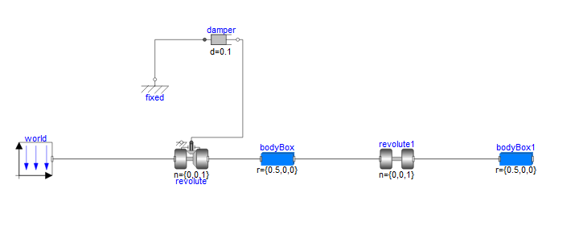
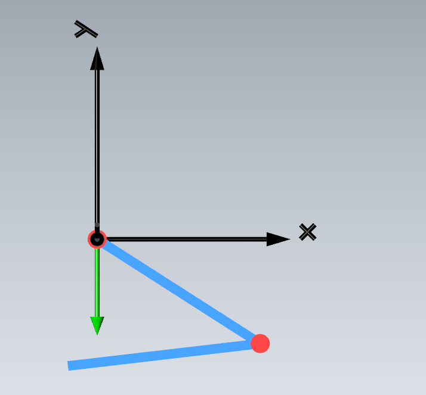
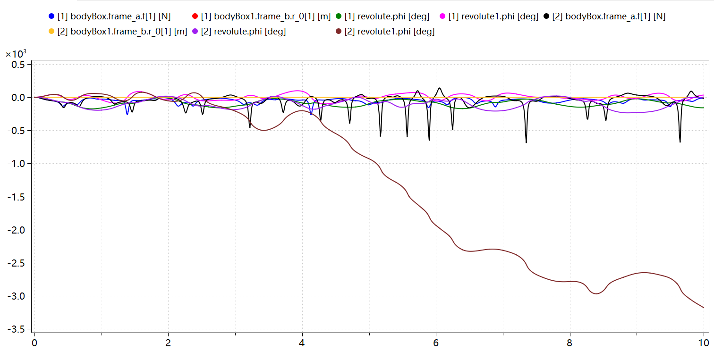
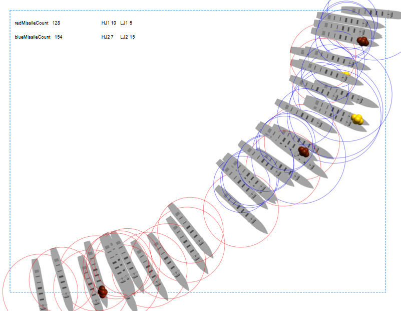

美好的周六，我居然做了一天的跨学院选修课的实验课。这个系统仿真虽然有点好玩，但是阴间时间呀。还是不太会的Java语言。

上午双臂摆的MWORKS.Sysplorer建模相对简单，以图形为主。

先来个图例摆放再连接，easy！

再编辑参数，选择积分方式，输出结果。动画和数组值的折线图。完美！！！

下午来到**痛苦的AnyLogic**

真的是面向对象的Java思想配图形化建模，很有意思，但有点复杂了对于我这种小白。
又是智能体，又是参数变量。智能体也有自己的状态图和行动图。搞了半天大部分都要穿插Java语法，爽死了[doge]。

最后尽力了就这样了。写不太来他的随机移动算法，我是随机生成点在让他移动但是这个范围限制和他似乎有冲突。然后就是开火算法我认真写了也是bug多，很迷。
好了不说了 哈哈哈，下次学simulink，想玩玩LQR控制算法。~~好吧，我摊牌，暂时没有时间，只是幻想。~~
