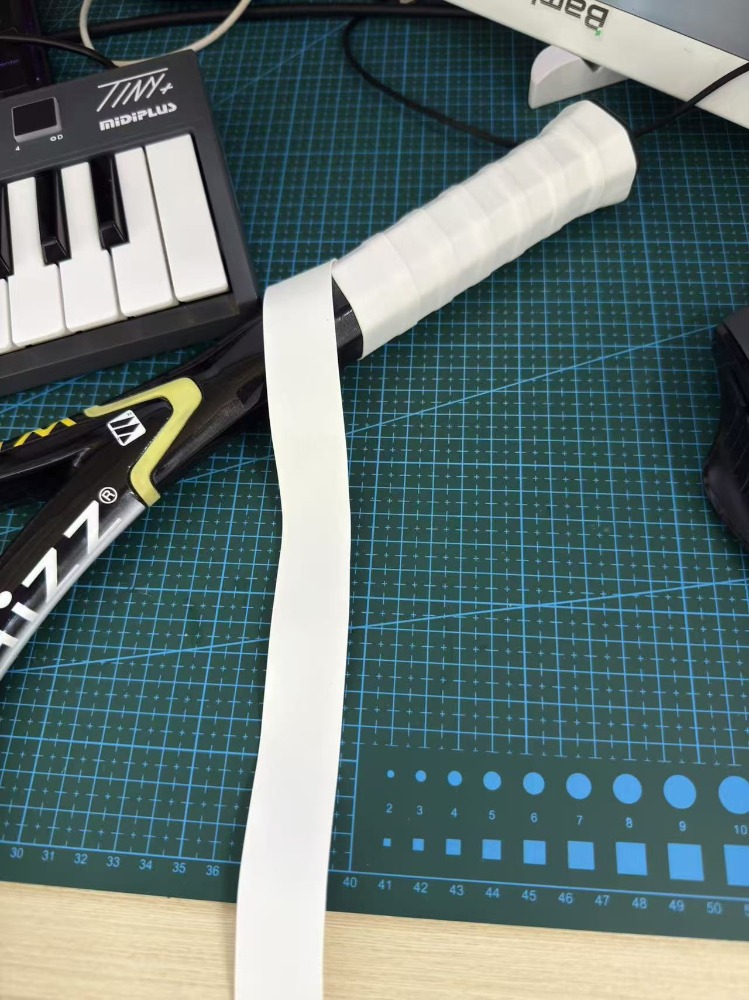

**最近听歌有感觉了，也是遇到很幸运的事情了，所以买了一个二手的midiplus的tiny+**

实测下来除了没有半重锤和确实窄了一点其他挺好的。使用Pianoteq 9音源慢慢开始学了！

**顺便缠个手胶，我马上要去打网球了**

<!--
  小抄：
  - 图片放这个文件夹里，用相对路径：
  - 公式：行内 $V_\alpha$，独占一行 $$ ... $$
  - 待办：- [ ] 没做   - [x] 做了（/plan/ 和首页便签读的是 To-Do 那篇文章）
  - 封面：frontmatter 里加 cover: ./图1.png
  - 草稿：draft: true（build 时会被排除）
  - 时间：date 已经是北京时间并带 +08:00，改时间也请保留后缀
-->
