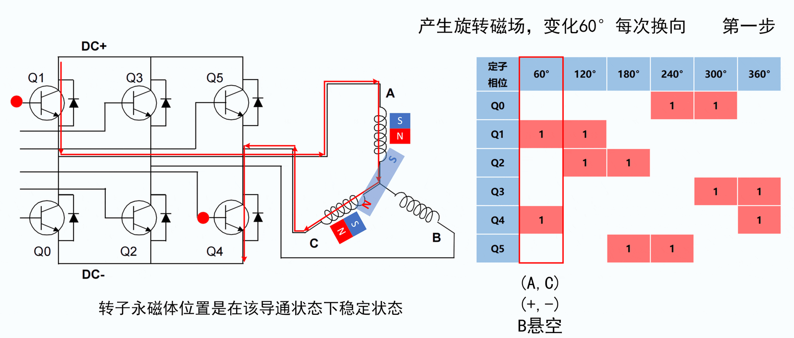
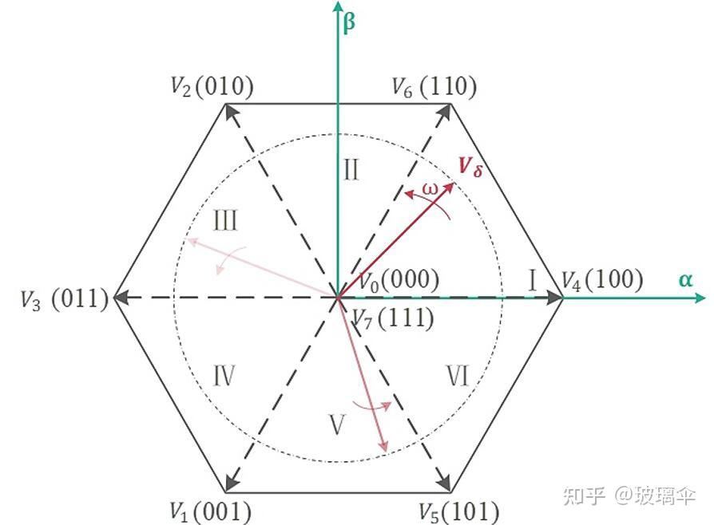
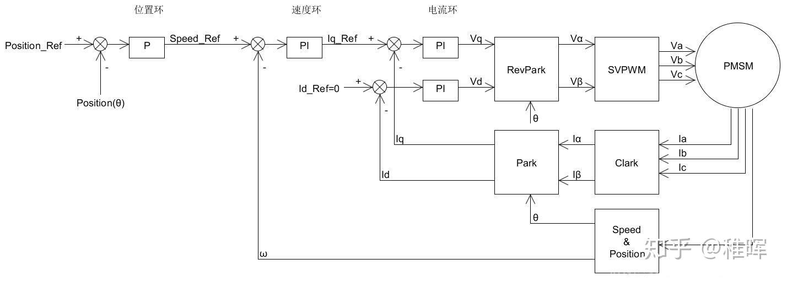
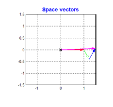
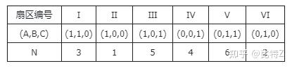
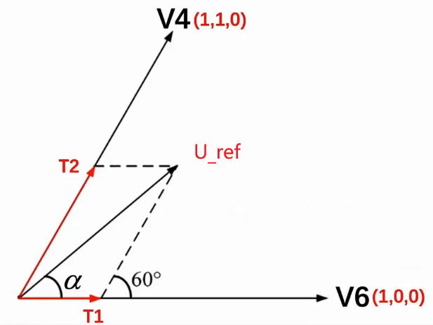
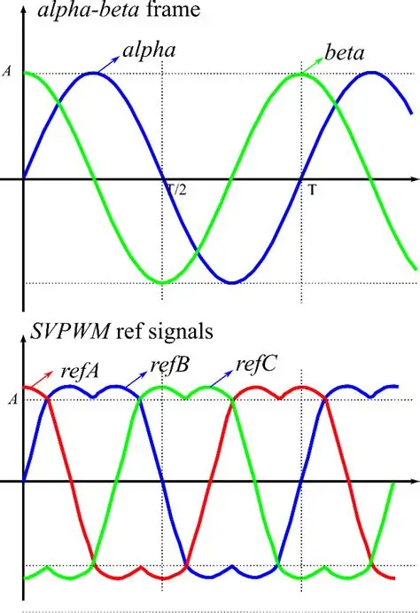
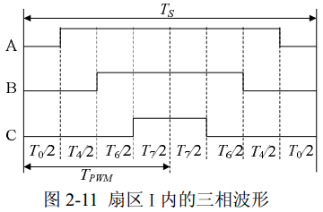
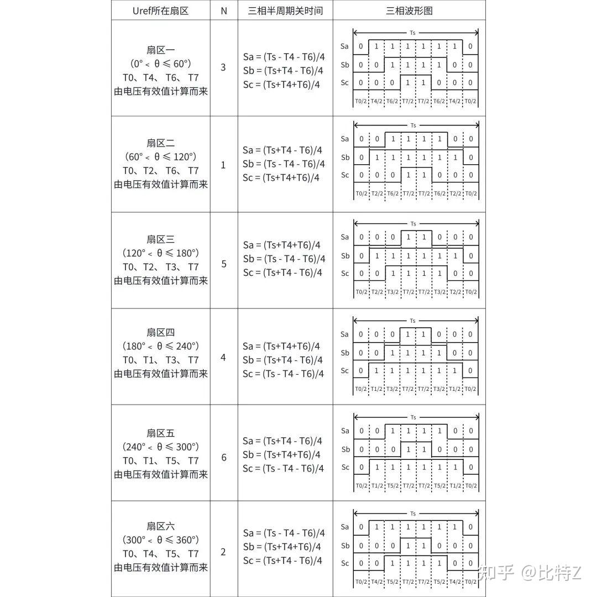
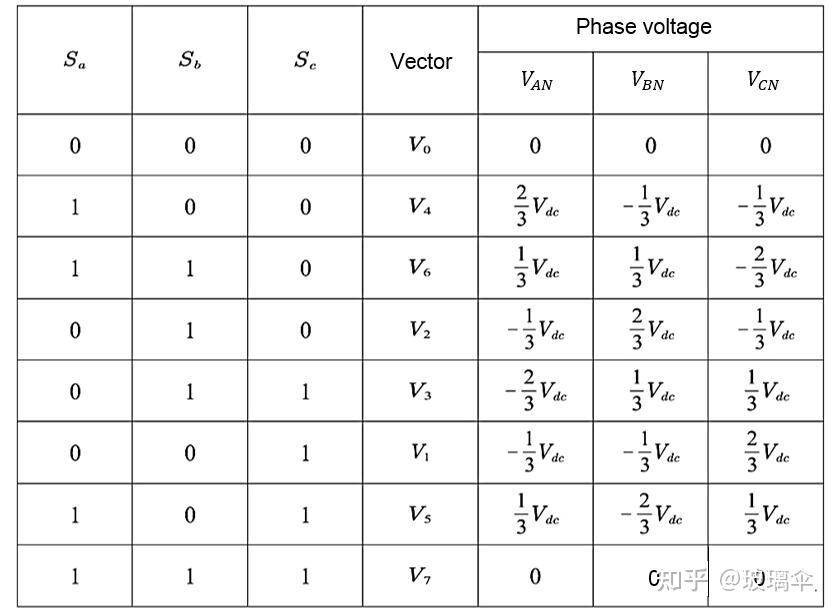

## 一、 六步换向（方波控制）的本质
六步换向是最基础的无刷直流电机（BLDC）控制方式。它的核心是通过硬件或软件逻辑直接控制 6 个 MOS 管的开关切换。
- **导通特点：** 在任意时刻，6 个 MOS 管中**只有 2 个导通**（一上一下），第三相处于断开悬空状态（两相导通方式）。
- **磁场轨迹：** 电角度每转过 60° 切换一次 MOS 管的导通组合，全圈共 6 步。其定子合成磁场在空间中是以 60° 为步长**跳跃式旋转**的，轨迹为一个粗糙的**正六边形**。
## 二、 FOC + SPWM 流程梳理
#### 1. 详细数学与物理推导描述
系统的输入是转子坐标系（同步旋转坐标系）下的期望目标电流  $i_d^*$ （控制励磁/磁场）和  $i_q^*$（控制转矩/出力），以及当前的实时电角度  $\theta$ 。
1. **电流采样与坐标变换（输入反馈）：**
    通过电流传感器直接测得（或利用基尔霍夫电流定律 $i_a + i_b + i_c = 0$ 测两相重构出三相）定子实际电流 $i_a, i_b, i_c$。
    利用**前向克拉克（Clarke）变换**（以等幅值变换为例，系数为 $\frac{2}{3}$）将三相静止坐标系转换到两相静止坐标系：   
	
	$$\begin{bmatrix} i_\alpha \\ i_\beta \end{bmatrix} = \frac{2}{3} \begin{bmatrix} 1 & -\frac{1}{2} & -\frac{1}{2} \\ 0 & \frac{\sqrt{3}}{2} & -\frac{\sqrt{3}}{2} \end{bmatrix} \begin{bmatrix} i_a \\ i_b \\ i_c \end{bmatrix}$$
	
    
    随后利用**前向帕克（Park）变换**，配合电角度 $\theta$，将两相静止坐标系投影到转子磁场定向的旋转坐标系，得到实际反馈电流 $i_d, i_q$：
    
    $$\begin{bmatrix} i_d \\ i_q \end{bmatrix} = \begin{bmatrix} \cos\theta & \sin\theta \\ -\sin\theta & \cos\theta \end{bmatrix} \begin{bmatrix} i_\alpha \\ i_\beta \end{bmatrix}$$
    
2. **误差调节（PID/PI控制器）：**
    将目标电流与实际电流作差得到误差。**PI 调节器利用动态闭环机制，自动将电流误差转化为对应的驱动电压信号 $u_d, u_q$**。
3. **逆变换与电压重构（输出调制）：**
    得到 $u_d, u_q$ 后，通过**逆帕克（Inverse Park）变换**回到两相静止坐标系：
    
    $$\begin{bmatrix} u_\alpha \\ u_\beta \end{bmatrix} = \begin{bmatrix} \cos\theta & -\sin\theta \\ \sin\theta & \cos\theta \end{bmatrix} \begin{bmatrix} u_d \\ u_q \end{bmatrix}$$
    
    再通过**逆克拉克（Inverse Clarke）变换**（等幅值系数为 1）重构出三相定子端线上的正弦目标电压 $u_a, u_b, u_c$：
    
    $$\begin{bmatrix} u_a \\ u_b \\ u_c \end{bmatrix} = \begin{bmatrix} 1 & 0 \\ -\frac{1}{2} & \frac{\sqrt{3}}{2} \\ -\frac{1}{2} & -\frac{\sqrt{3}}{2} \end{bmatrix} \begin{bmatrix} u_\alpha \\ u_\beta \end{bmatrix}$$
    
4. **SPWM 硬件执行：**
    SPWM（正弦脉宽调制）作为底层的纯“执行工具”，将这三相彼此相差 120° 的正弦目标电压 $u_a, u_b, u_c$ 分别与高频三角载波进行比较，独立生成三相逆变桥臂（6个MOS管）的高频斩波脉冲（此时三相桥臂在任意时刻均全开工作）。通过线圈电感的低通滤波效应，在物理上**自然地合成**出一个在空间平滑旋转的圆形磁场向量，从而驱动电机丝滑运转。
#### 2. 箭头流程图

$$\begin{array}{c} \text{输入目标 } i_d^*, i_q^* \text{ 与电角度 } \theta \\ \downarrow \\ \text{采集实际电流 } i_{abc} \xrightarrow{\text{Clarke}} i_{\alpha\beta} \xrightarrow{\text{Park}} \text{实际 } i_{dq} \\ \downarrow \\ \text{做差: } \text{Error}_{d,q} = i_{d,q}^* - i_{d,q} \\ \downarrow \\ \mathbf{PI\text{ 调节器}} \implies \text{输出目标电压 } u_d, u_q \\ \downarrow \\ \text{目标电压 } u_{dq} \xrightarrow{\text{反 Park}} u_{\alpha\beta} \xrightarrow{\text{反 Clarke}} \text{三相正弦电压 } u_{abc} \\ \downarrow \\ \mathbf{SPWM\text{ 斩波}} \implies \text{驱动6个MOS管(三相全开)} \\ \downarrow \\ \text{线圈物理合成圆形旋转磁场} \implies \text{电机平稳旋转} \end{array}$$

### 三、 关键注意事项与算法优化

#### 1. 一般的电压形式

虽然变换的数学形式在电压和电流上是完全通用的（矩阵相同），但它们在物理本质上满足电机的电压状态方程：

$$u_d = R \cdot i_d + L_d \frac{d i_d}{dt} - \omega_e L_q i_q$$

$$u_q = R \cdot i_q + L_q \frac{d i_q}{dt} + \omega_e L_d i_d + \omega_e \psi_f$$

定子线圈不仅有电阻和电感，还有由于转子旋转带来的**反电动势（$\omega_e \psi_f$）**。因此，必须施加动态变化的电压，才能将期望的正弦电流顺利“压”进线圈中。
#### 2. 电压形式下的电流闭环是由 PID 实现的
在代码实现中，我们不需要根据上面的物理方程去死算复杂的电压。**电流闭环的实质是：输入是电流差，输出是目标电压。**

$$u_d = K_p \cdot (i_d^* - i_d) + K_i \int (i_d^* - i_d) \, dt$$

$$u_q = K_p \cdot (i_q^* - i_q) + K_i \int (i_q^* - i_q) \, dt$$

只要实际电流与目标电流有偏差，PID（PI）调节器就会自动增加或减少输出电压 $u_d, u_q$，直到误差为 0。
#### 3. 等幅值系数是可选的，可由 PID 调节完全取代
在逆克拉克变换中，是否严格使用“等幅值系数（如 1）”或“等功率系数”在工程上是可选的。因为 PID 控制器具有极强的鲁棒性，任何由于数学变换带来的固定系数放大或缩小，**其增益都会天然地被 PID 的参数 $K_p, K_i$ 自动吸收和补偿**。即使系数有偏差，也仅仅影响最终调参时 $K_p, K_i$ 的绝对大小，并不影响闭环控制的稳定性和最终的正弦输出。
#### 4. 融合克拉克与帕克的公式形式（工程终极优化）
在 SPWM 控制中，为了精简代码、节省 MCU 的算力，通常不需要在中间计算出 $u_\alpha$ 和 $u_\beta$。我们可以将**逆帕克变换**和**逆克拉克变换**两个矩阵在数学上直接相乘合并，直接推导出从旋转坐标系 $u_d, u_q$ 到三相静止电压 $u_a, u_b, u_c$ 的终极映射公式：

$$
\begin{cases}
u_a = u_d \cos\theta - u_q \sin\theta \\ u_b = u_d \cos\left(\theta - \frac{2\pi}{3}\right) - u_q \sin\left(\theta - \frac{2\pi}{3}\right) \\ u_c = u_d \cos\left(\theta + \frac{2\pi}{3}\right) - u_q \sin\left(\theta + \frac{2\pi}{3}\right) 
\end{cases}
$$


> **总结提示：** 运用此融合公式，在代码中只需要通过 $u_d, u_q$ 和当前角度 $\theta$，即可**一步直接计算出三相正弦波的调制基准**，彻底省去了中间的两相静止坐标系（$\alpha-\beta$ 轴）和关于“等幅值/等功率”系数的纠结。
### 四、 关于$id$的取值
#### 1. 永磁同步电机（PMSM）：为什么一般目标 $i_d = 0$？
在永磁电机中，转子本身就是一块大磁铁。
- **磁场来源：** 电机旋转所需要的**励磁磁场**，已经由转子上的永磁铁完全承包了。
- **$d$ 轴的定义：** 直轴（$d$ 轴）的方向是和转子永磁铁的磁场方向完全重合的。
- **控制策略：** 既然磁铁已经提供了足够的磁场，定子线圈就不需要再额外产生磁场去帮它了。如果我们往 $d$ 轴注入电流（$i_d > 0$），不仅不会产生扭矩，反而会和磁铁的磁场对抗，导致线圈发热。
- **结果：** 我们的目标是把所有电流都用来产生扭矩。扭矩是由交轴（$q$ 轴）电流 $i_q$ 产生的。所以我们把目标电流设为 $i_d^* = 0$。

 >**既然目标 $i_d^* = 0$，通过 PI 调节器闭环后，输出的稳态目标电压 $u_d$ 也就自然接近于 0（或者非常小，仅用于克服微弱的电感耦合和电阻压降）。**

_(注：只有在电机转速极高、反电动势超过母线电压时，我们才会主动让 $i_d < 0$，这叫“弱磁控制”，目的是人为削弱磁铁磁场，让电机转得更快。或者**无感foc的获取电角度就需要高频注入，id需要有值。**)_
#### 2. 感应电机（异步电机）：为什么 $d$ 轴必须有指令？
感应电机（比如交流异步电机）的转子非常光秃秃，里面**没有磁铁**，通常是鼠笼式的铝条或铜条。
- **磁场来源：** 它的转子自己没有磁场。根据“电磁感应”原理，必须先由定子线圈通电，产生一个磁场，这个磁场在转子棒上感应出电流，转子电流再产生磁场。
- **控制策略：** 既然磁场得靠定子线圈来建立，我们就必须人为地给它分配一部分电流专门用来“励磁”。
- **结果：** 在 FOC 控制感应电机时，系统会把定子电流拆成两部分：
    - **$i_d$（励磁电流）：** 必须给一个大于 0 的恒定指令（$i_d^* > 0$），用来在电机内部“激磁”，把转子变成一块“电磁铁”。
    - **$i_q$（转矩电流）：** 用来控制力矩大小。

> **因为 $i_d^*$ 必须保持一个比较大的确定值，PI 调节器为了把这个励磁电流压进线圈，输出的目标电压 $u_d$ 就必须是一个明显的、大于 0 的值。**
#### 3. 优化之前的公式
现在，你可以把你发现的这个物理规律，代入到我们上一问推导的**合并公式**里了：

$$
\begin{cases}
u_a = u_d \cos\theta - u_q \sin\theta \\ u_b = u_d \cos\left(\theta - \frac{2\pi}{3}\right) - u_q \sin\left(\theta - \frac{2\pi}{3}\right) \\ u_c = u_d \cos\left(\theta + \frac{2\pi}{3}\right) - u_q \sin\left(\theta + \frac{2\pi}{3}\right) 
\end{cases}
$$

- **如果是永磁电机（常规工况）：** 因为 $i_d=0 \implies u_d \approx 0$。
    公式直接简化为：$u_a = -u_q \sin\theta$。你看，三相输出电压的幅值直接被 $u_q$（扭矩）一个人决定了。
- **如果是感应电机：**
    $u_d$ 不能省。公式必须老老实实把 $u_d \cos\theta$ 和 $-u_q \sin\theta$ 拼在一起。此时，三相电压的幅值和相位，是由**励磁电压 $u_d$** 和 **转矩电压 $u_q$** 共同合成出来的。
## 三、 FOC + SVPWM 讲解
在磁场定向控制（FOC）中，**空间矢量脉宽调制（SVPWM）** 位于控制链路的最后一环。它负责将两相静止坐标系下的二维电压参考矢量 $\vec{V}_{ref}$（即 $V_\alpha, V_\beta$），转换为逆变器 6 个 MOS 管的开关导通时间（占空比信号）。其核心思想是在二维复平面上，利用离散的基本电压矢量在时间上的加权平均，去凑出圆滑旋转的空间电压矢量圆（即求最大电压圆，这样保证每处都有最大力矩）。
## 一、基本实现流程
### 规定基本电压矢量的映射（构建六边形基础）
三相逆变桥有 3 个上下桥臂。我们用 $(A, B, C)$ 状态表示，上管开为 `1`，下管开为 `0`。总共有 $2^3 = 8$ 种组合。把这 8 种状态通过标准的克拉克变换（等幅值系数 $\frac{2}{3}$）投影到 $\alpha-\beta$ 平面上：
- **6 个有效矢量（非零矢量）：** 它们的幅值均为 $\frac{2}{3}V_{dc}$，空间上彼此相差 60°，刚好构成了空间六边形的 6 个顶点。
    - $V_1(1,0,0)$ $\to 0^\circ$ 轴（$\alpha$ 轴正方向）
    - $V_2(1,1,0)$ $\to 60^\circ$ 轴
    - $V_3(0,1,0)$ $\to 120^\circ$ 轴
    - $V_4(0,1,1)$ $\to 180^\circ$ 轴
    - $V_5(0,0,1)$ $\to 240^\circ$ 轴
    - $V_6(1,0,1)$ $\to 300^\circ$ 轴
- **2 个零矢量：** $V_0(0,0,0)$ 和 $V_7(1,1,1)$。由于三相全关或全开，它们在平面上的幅值为 0，位于**六边形的中心点**。
这 6 个顶点把复平面均匀分成了 **6 个扇区（Sector 1 ~ Sector 6）**。



### 第一步：输入值 ($V_\alpha, V_\beta$) 是生成$|\vec{V}_{ref}|$ 
**幅值输入转化：** 目标矢量的物理模长直接通过直角坐标勾股定理算出来(一般$|\vec{V}_{ref}|$小于0.577$U_{dc}$)：
$$|\vec{V}_{ref}| = \sqrt{V_\alpha^2 + V_\beta^2} \quad \text{}$$
算出了 $|\vec{V}_{ref}|$，公式里的调制系数 $m = \sqrt{3} \frac{|\vec{V}_{ref}|}{V_{dc}}$ 也就有了确定的输入值。



### 第二步：扇区判断
反帕克变换吐出来的输入是目标电压 $V_\alpha$ 和 $V_\beta$。我们首先要根据 $V_\alpha, V_\beta$ 计算出当前的目标矢量 $V_{ref}$ 落在 6 个扇区中的哪一个。可以用**三路状态值加权法**判断N值来看，也可以用反三角函数算出角度$\theta$（$\theta = \text{atan2}(V_\beta, V_\alpha) \quad \text{}$）。
### 第三步：伏秒平衡原理与时间计算
根据**伏秒平衡原理（等效线性叠加）**：

$$V_{ref} \cdot T_s = V_1 \cdot T_1 + V_2 \cdot T_2 + V_0 \cdot T_0$$

可以知道求得T就可以表示合矢量了，用正弦定理或者投影矢量到 $\alpha$ 轴和 $\beta$ 轴，都可以算出$T_1$ 、$T_2$ 、$T_0 = T_7 = \frac{1}{2} (T_s - T_1 - T_2)$。
## 第四步：七段式 PWM 产生（降低MOS管损耗）
>**七段式是对称调制，五段式是非对称调制。**  
>**七段式追求波形与控制品质，五段式追求简单与低开关损耗。**

为了让 MOS 管开关次数最少（降低发热），普遍采用 **七段式 SVPWM**（也叫对称发波）。其核心原则是：**每次切换开关状态时，只能允许有一个桥臂改变状态。**
以第 I 扇区为例（参考图二），标准七段式排列顺序为：
$$V_0 \to V_4 \to V_6 \to V_7 \to V_6 \to V_4 \to V_0$$
对应开关状态为：
$$(0,0,0) \to (1,0,0) \to (1,1,0) \to (1,1,1) \to (1,1,0) \to (1,0,0) \to (0,0,0)$$
在这个结构中：
- $V_0$ 和 $V_7$ 各占零矢量时间的一半：$T_0 = T_7 = \frac{1}{2} (T_s - T_1 - T_2)$。
- 有效矢量呈中心对称分配。
算法最后会根据这个七段式波形，反算出 A、B、C 三相定时器比较寄存器的切换时间点（通常称为 $T_{a\_cmpr}, T_{b\_cmpr}, T_{c\_cmpr}$，比较复杂以后有时间再写），直接喂给 MCU 的硬件 PWM 模块。
## 💡 SVPWM 简要流程
1. **输入：** 拿到两相静止坐标系电压 Vα,Vβ。
2. **算扇区：** 用 U1,U2,U3 算出 N，直接秒懂 Vref 在哪个扇区。
3. **算时间：** 利用伏秒平衡，用 投影法或者正弦定理计算出两个相邻有效矢量的做功时间 T1,T2。
4. **发波：** 按照七段式原则，把时间匀给 8 种状态，产生对称的中央对齐 PWM 波，直接驱动硬件。
## 二、svpwm公式推导与讲解
### 理想数学模型
要得到一个恒定大小的旋转磁场，可以先来得到一个恒定大小的旋转电压矢量。可以通过互差120度，大小随着时间按正弦规律变化的3个分矢量来合成一个大小不变旋转的总矢量。$U_m$ 是**三相正弦相电压的“峰值”** 。



$$\begin{cases} U_A(t) = U_m \cos(\omega t) \\ U_B(t) = U_m \cos(\omega t - \frac{2\pi}{3}) \\ U_C(t) = U_m \cos(\omega t + \frac{2\pi}{3}) \end{cases}$$

$$U(t) = k \left[ U_A(t) + U_B(t)e^{j2\pi/3} + U_C(t)e^{j4\pi/3} \right]$$

取k=$\frac{2}{3}$：

$$U(t) = \frac{2}{3} \cdot \left[ \frac{3}{2}U_m e^{j\omega t} + 0 \right] = U_m e^{j\omega t}$$

### 1. 符号定义与前提条件

- **$\vec{V}_{ref}$ ($U_q$)**：目标电压空间矢量，在正常 FOC 稳态运行中，其幅值主要由电流环 $q$ 轴 PI 调节器的输出决定。模长范围是0~$0.577V_{dc}$
- **$V_{dc}$ (`power_supply`)**：直流母线电压（如电池电压）。
- **$T_s$**：PWM 控制周期（载波周期）。
- **$T_1, T_2$**：当前扇区内，两个相邻的有效基本电压矢量在一个 $T_s$ 内各自需要导通的作用时间。
- **$T_0$**：零矢量（$V_0(0,0,0)$ 或 $V_7(1,1,1)$）的作用时间，满足 $T_s = T_1 + T_2 + T_0$。
- **$\alpha$**：目标矢量相对于当前扇区起始边界的**相对夹角**（范围 $0^\circ \le \alpha < 60^\circ$）。
- **前提条件：克拉克（Clarke）等幅值变换**
    采用等幅值系数 $k=\frac{2}{3}$，这意味着三相正弦电压在物理平面上合成的空间电压矢量箭头，其**物理实际模长**刚好等于单相正弦电压的**峰值**，数学证明如下：
	$$\sqrt{V_\alpha^2 + V_\beta^2} = \frac{2}{3}\sqrt{u_a^2 + u_b^2 + u_c^2} \quad \text{（其中 } u_a, u_b, u_c \text{ 为三相相电压瞬时值）} \quad$$
### 2. 扇区判断
反帕克变换吐出来的输入是目标电压 $V_\alpha$ 和 $V_\beta$。我们首先要根据 $V_\alpha, V_\beta$ 计算出当前的目标矢量 $V_{ref}$ 落在 6 个扇区中的哪一个。
在算法推导中，工程师总结出了一个极其精妙的**三路状态值加权法**。定义三个中间变量：

$$U_1 = V_\beta$$

$$U_2 = \frac{\sqrt{3}}{2}V_\alpha - \frac{1}{2}V_\beta$$

$$U_3 = -\frac{\sqrt{3}}{2}V_\alpha - \frac{1}{2}V_\beta$$

如果 $U_1 > 0$，记变量 $A = 1$，否则 $A = 0$。
如果 $U_2 > 0$，记变量 $B = 1$，否则 $B = 0$。
如果 $U_3 > 0$，记变量 $C = 1$，否则 $C = 0$。
最后算一个总加权值：$N = 4C + 2B + A$。
通过数学一一映射，**$N$ 的值直接决定了扇区**：

| **N 的计算值**  | **1**  | **2**  | **3** | **4**  | **5**   | **6** |
| ----------- | ------ | ------ | ----- | ------ | ------- | ----- |
| **所在的实际扇区** | **II** | **VI** | **I** | **IV** | **III** | **V** |


### 3. 基于几何正弦定理的矢量时间推导
根据**伏秒平衡原则**，在微小的控制周期 $T_s$ 内，离散电压矢量的冲量线性叠加等效于目标矢量：

$$\vec{V}_{ref} \cdot T_s = \vec{V}_A \cdot T_1 + \vec{V}_B \cdot T_2 + \vec{V}_0 \cdot T_0 \quad$$



以 **第 I 扇区** ($0^\circ \le \theta < 60^\circ$) 为例，该扇区由基本有效矢量 $V_6(1,0,0)$ 和 $V_4(1,1,0)$ 围成：
将 $\vec{V}_{ref}$、$\vec{V}_4$、$\vec{V}_6$ 放入平行四边形中，构建几何三角形。已知三相逆变器拓扑中，星形接法线圈串并联分压导致 6 个基本非零矢量的绝对物理模长均为 $\frac{2}{3}V_{dc}$。$T_1$对应$T_6$，$T_2$对应$T_4$
对该合成三角形应用 **正弦定理**：

$$\frac{T_1 / T_s \cdot |\vec{V}_6|}{\sin(60^\circ - \alpha)} = \frac{T_2 / T_s \cdot |\vec{V}_4|}{\sin\alpha} = \frac{|\vec{V}_{ref}|}{\sin 120^\circ}$$

已知 $|\vec{V}_4| = |\vec{V}_6| = \frac{2}{3}V_{dc}$，且 $\sin 120^\circ = \frac{\sqrt{3}}{2}$。将长度代入并移项(一般$T_s$=1，看成一个pwm周期)：

$$\begin{cases} T_2 = m T_s \sin\alpha \\ T_1 = m T_s \sin(60^\circ - \alpha) \end{cases}$$

其中m为SVPWM的调制系数（即调制比）：

$$m = \sqrt{3} \frac{|\vec{V}_{ref}|}{V_{dc}}$$

而零矢量分配的时间为：

$$T_0 = T_7 = \frac{1}{2}(T - T_1 - T_2)$$

#### 推广至六个扇区
**相对角度映射法：**

 1. **扇区标志判断**：(向下取整)
	 
	 $$\theta = \text{atan2}(V_\beta, V_\alpha) \quad \text{}$$
	$$K = \left\lfloor \frac{\theta}{\pi/3} \right\rfloor + 1, \quad K \in \{1,2,3,4,5,6\} \quad \text{}$$
	
 1. **空间角度归一（映射至基准扇区）**：
	利用平移，将 360° 空间内任意非零矢量变换为相对于所在扇区起始边界的**相对夹角 $\alpha$**： 
 
	$$\alpha = \theta - (K - 1)\frac{\pi}{3}, \quad 0 \le \alpha < \frac{\pi}{3} \quad \text{}$$
 2. **全扇区通用时间解算公式**：
	 一旦完成了上述 $\alpha$ 的几何映射，全空间 6 个扇区的矢量时间解算完全退化为统一形式，**内部无需引入扇区常数 $K$**：
 
	 $$\begin{cases} T_1 = \sqrt{3} \cdot \frac{U_q}{U_{dc}} \cdot \sin(60^\circ - \alpha) \\ T_2 = \sqrt{3} \cdot \frac{U_q}{U_{dc}} \cdot \sin(\alpha) \end{cases}$$
  
 
**$X, Y, Z$ 投影法：**

 3. **投影到$\alpha$ 轴和 $\beta$ 轴（规避三角函数）**
	以第 I 扇区为例。从反帕克变换出来的直接输入是 $V_\alpha$ 和 $V_\beta$。
	把前面用正弦定理推导出的 $T_1$ 和 $T_2$ 公式展开：
	
	$$T_1 = \sqrt{3} \frac{T_s}{V_{dc}} |\vec{V}_{ref}| \sin(60^\circ - \alpha)$$
	
	$$T_2 = \sqrt{3} \frac{T_s}{V_{dc}} |\vec{V}_{ref}| \sin\alpha$$
	
	利用三角函数展开公式  $\sin(60^\circ - \alpha) = \sin 60^\circ \cos \alpha - \cos 60^\circ \sin \alpha$ ，
	将 $T_1$ 展开：
	
	$$T_1 = \sqrt{3} \frac{T_s}{V_{dc}} |\vec{V}_{ref}| \left( \frac{\sqrt{3}}{2} \cos \alpha - \frac{1}{2} \sin \alpha \right)$$
	
	把括号外面的 $\sqrt{3} |\vec{V}_{ref}|$ 乘进去：
	
	$$T_1 = \frac{T_s}{V_{dc}} \left( \frac{3}{2} |\vec{V}_{ref}| \cos \alpha - \frac{\sqrt{3}}{2} |\vec{V}_{ref}| \sin \alpha \right)$$

	
	在直角坐标系中，目标矢量在 $\alpha$ 轴和 $\beta$ 轴的投影定义天然就是：
	- $V_\alpha = |\vec{V}_{ref}| \cos \alpha$
	- $V_\beta = |\vec{V}_{ref}| \sin \alpha$
	我们直接把 $V_\alpha$ 和 $V_\beta$ 代换进展开后的公式：
	
	$$T_1 = \frac{T_s}{V_{dc}} \left( \frac{3}{2} V_\alpha - \frac{\sqrt{3}}{2} V_\beta \right)$$
	
	$$T_2 = \sqrt{3} \frac{T_s}{V_{dc}} V_\beta$$
	
4. **构建中间变量$X, Y, Z$**
	为了让 6 个扇区都能共享同一套最精简的代码，把各个扇区展开后的组合形式进行 了统一归纳，提取出了三个通用的中间变量，这就是 **$X, Y, Z$**。
	在经典的 SVPWM 算法中，这三个变量的定义通常为：
	
	$$\begin{cases} X = \frac{\sqrt{3} T_s}{V_{dc}} V_\beta \\ Y = \frac{\sqrt{3} T_s}{V_{dc}} (\frac{1}{2} V_\beta + \frac{\sqrt{3}}{2} V_\alpha) \\ Z = \frac{\sqrt{3} T_s}{V_{dc}} (\frac{1}{2} V_\beta - \frac{\sqrt{3}}{2} V_\alpha) \end{cases}$$

	一旦单片机在代码一开头算出了这三个数字，**所有 6 个扇区的作用时间，都可以直接通过这三个变量的加减法、取负号直接查表获得**。
	
	 $T_1$代表任意扇区内逆时针数第一个非零电压向量持续的时间， $T_2$代表同一扇区第二个非零电压向量持续的时间。在第一个扇区，显然 $T_1$和 $T_2$分别是 $T_6$和 $T_4$。
	- **第 I 扇区**： $T_1 = -Z$， $T_2 = X$
	- **第 II 扇区**： $T_1 = Y$， $T_2 = Z$
	- **第 III 扇区**： $T_1 = -X$， $T_2 = -Y$
	- **第 IV 扇区**： $T_1 = Z$， $T_2 = -X$
	- **第 V 扇区**： $T_1 = -Y$， $T_2 = -Z$
	- **第 VI 扇区**： $T_1 = X$， $T_2 = Y$

5. **SVPWM 代码示例**
	标准的 SVPWM 模块只需要三步，全过程只有乘法和加减法：
	*计算 $X, Y, Z$*
	``` c
	float X = sqrt3 * Vbeta;
	float Y = (sqrt3 / 2.0f) * Vbeta + 1.5f * Valpha;
	float Z = (sqrt3 / 2.0f) * Vbeta - 1.5f * Valpha;
	```
	*通过正负号组合判断扇区（Sector）*
	不反正切函数 `atan2` ，根据 $X, Y, Z$ 的正负号加权出一个数字。
	``` c
	int A = (Vbeta > 0) ? 1 : 0;
	int B = (Y > 0) ? 1 : 0;
	int C = (Z > 0) ? 1 : 0;
	int Sector = A + 2 * B + 4 * C; // 算出来的Sector直接对应1~6扇区
	```
	*用 $X, Y, Z$ 查表赋值给 $T_a, T_b, T_c$*
	用一个 `switch(Sector)` 语句，实现 $X, Y, Z$ 的加减组合，时间的分配逻辑：
	``` c
	switch(Sector) {
	    case 1: // 第I扇区
	        T1 = -Z; T2 = X;
	        Ta = T1 + T2 + T0/2; // 结合公式2
	        Tb = T2 + T0/2;
	        Tc = T0/2;
	        break;
	    case 2: // 第II扇区
	        T1 = Y; T2 = Z;
	        Ta = T1 + T0/2;
	        Tb = T1 + T2 + T0/2;
	        Tc = T0/2;
	        break;
	    // ...以此类推后面的扇区
	}
	```
### 4. 电压归一化与内切圆电压极值限制


SVPWM 的**线性调制区**（即能够输出纯正、不失真圆形旋转磁场的区域）受限于正六边形的 **内切圆（边心距）**。
通过纯几何计算，该内切圆的半径即为常规 FOC 能够输出的最大不失真电压幅值 $V_{max}$：

$$V_{max} = |\vec{V}_1| \cdot \cos(30^\circ) = \frac{2}{3}V_{dc} \cdot \frac{\sqrt{3}}{2} = \frac{1}{\sqrt{3}}V_{dc} \approx 0.577 V_{dc}$$


>- **外面的正六边形：** 逆变器能输出的**极限合成电压边界**。因为有效矢量最大只有 $\frac{2}{3}V_{dc}$，把六个顶点连起来，合成矢量绝对不可能超出这个六边形。
>- **里面的内切圆：** 这个内切圆，代表了SVPWM**不失真的最大圆形电压矢量边界**。
>- **SPWM只能画小圆：** 三相 SPWM 独立输出 $\frac{1}{2}V_{dc}$ 的正弦波时，它们合成的空间电压矢量圆的半径**只能达到 $\frac{1}{2}V_{dc} = 0.5V_{dc}$**。
#### SPWM 与 SVPWM 效率对比
- **SPWM（单相独立）**：每一相独立调制，单相相电压幅值不能超过 $\frac{1}{2}V_{dc} = 0.5V_{dc}$，因此其空间合成圆的极限半径只有 **$0.5V_{dc}$**。
- **SVPWM（三相联动）**：充分利用了星形接法下三相线圈联动、中性点电位可动态偏移的物理特性，将输出天花板推到了内切圆极限 **$0.577V_{dc}$**。
- **母线利用率对比**：$\frac{0.577}{0.5} \approx 1.154$。**SVPWM 比 SPWM 的直流母线电压利用率提升了 15.4%**
#### 图像上从spwm到svpwm



**这其实是“鞍点调制（马鞍波）”的物理表现**
如果你去观察 SVPWM 在时间域上的单相实际输出电压，它已经不再是完美的正弦波了，而是**在正弦波的基础上叠加了一个3次谐波，变成了一个形状像“马鞍”的波形**。SVPWM 的单相波形（马鞍波），本质上就是：**标准的正弦波（SPWM） + 特定的三次谐波**。

正是因为这种三相联动的开关组合，在某一相快要顶到电源天花板（母线电压边缘）时，另外两相通过改变开关状态，**把电机的中性点 $N$ 的电位整体往上拉或往下推**（俗称中性点电位偏移），从而给这一相腾出了更多的电压空间。
## 4. 零矢量的“裁剪”与过调制（退化方波）

利用这个正弦定理公式算出来的叠加矢量，它的潜能边界是**正六边形**。但在 FOC 运行中，我们却看到了完美的**圆**，其核心功臣是 **零矢量 $T_0$**：

- **线性区（完美的圆）**：电流环 PI 给出的 $U_q$ 恒定在 $0.577V_{dc}$ 以内。当矢量转到 $30^\circ$ 最窄处， $T_1 + T_2 = 1$， $T_0 = 0$（刚好擦肩而过）；当转到 $0^\circ$ 顶点时，本可以使出 $\frac{2}{3}V_{dc}$ 的大力气，但公式会自动计算出约 $13.4\%$ 的零矢量时间 $T_0$，**强行把凸出去的尖角给“削平”**，从而在六边形里裁剪出纯正的正弦圆形磁场。
- **过调制区（蜕变成方波）**：当电机转速极高， $0.577V_{dc}$ 的电压已经压不进电流时，代码会解除 $U_q$ 的限幅，逼迫系统压榨六边形的 6 个角落。此时零矢量 $T_0$ 被迫清零。**当过调制达到最顶峰时，SVPWM 会彻底退化为六步换向（方波控制），母线利用率达到极限的 $\frac{2}{\pi}V_{dc} \approx 0.637V_{dc}$**。虽然波形畸变带来了噪音和震动，但由于电机线圈是巨大的电感（天然的低通滤波器），最终流过电机的电流依然能保持相对平滑。
- **终极极限（方波控制 / 六步换向）：** 当你想把直流母线电压压榨到一丝不剩、利用率达到理论最高极限（此时基波幅值提升到约 $0.637V_{dc}$，相当于完全利用了方波的傅里叶基波分量成分 $\frac{2}{\pi}V_{dc}$）时：
- 逆变器不再进行任何高频 PWM 斩波了。
- 六个 MOS 管退化到：在 60° 扇区内常开，到了时间就切换。
- **此时，空间电压矢量的轨迹彻底变成了一个“正六边形”，而每一相的电压波形，也从马鞍波彻底退化回了最原始的“方波（阶梯波）”！**

### 过调制
 **过调制会出现 $T_1 + T_2 > T_s$**。 它的直接起因确实是前级（比如电流环 PI 调节器）输出的电压指令太大，导致合成的电压矢量超出了逆变器能输出的物理极限（即超出了正六边形的边界）。
#### 💡限幅算法：动态圆周限幅
为了彻底在线性区卡死过调，一般不会单独去卡 $U_q$，而是采用“动态圆周限幅”：
1. 先把 $U_d$ 的限幅卡在内切圆半径上： $U_{d\_max} = 0.577 U_{dc}$。
2. 算完 $U_d$ 后，**动态计算留给 $U_q$ 的剩余安全空间**：
    
    $$U_{q\_max} = \sqrt{(0.577 U_{dc})^2 - U_d^2}$$
    
1. 用这个动态的 $U_{q\_max}$ 去卡电流环输出的 $U_q$。
只要你用了这套圆周限幅，输入进 SVPWM 的矢量长度就绝对不会超过内切圆， $T_1 + T_2$ 就绝对不会超过 $T_s$。
#### 实际工程中，出现了 $T_1 + T_2 > T_s$也有算法来“压缩时间”
既然限幅能解决，为什么还要研究“压缩时间”的算法？
因为在高端工业驱动（如伺服、电动汽车大油门加速）中，为了压榨出逆变器最后一滴母线电压利用率，工程师会故意放宽限幅，让矢量冲出内切圆，去探索内切圆和外接圆之间的“盲区”（即正六边形的 6 个犄角旮旯）。甚至直接进入“六阶梯波”超速状态。
一旦冲出去， $T_1 + T_2 > T_s$ 发生，单片机如果直接发波，寄存器就会溢出失真。通常采用以下两种算法来强行“压缩时间”：
**1. 等比例比例因子压缩法**
**电压的绝对幅值虽然不对，但不改变相电压的“方向（相位）”。** 
- **具体做法**：
    当代码检测到 $T_1 + T_2 > T_s$ 时，立刻计算一个**大于 1 的缩放因子 $K_{scale}$**：
    
    $$K_{scale} = \frac{T_1 + T_2}{T_s}$$
    
- **压缩执行**：
    将算出来的 $T_1$ 和 $T_2$ 强行除以这个因子，等比例缩小：
    
    $$T_{1\_new} = \frac{T_1}{K_{scale}}, \quad T_{2\_new} = \frac{T_2}{K_{scale}}$$
    
- **结果**：
    压缩后，新的时间刚好满足： $T_{1\_new} + T_{2\_new} = T_s$。
    此时，零矢量时间 $T_0$ 变为 0。目标矢量落到了正六边形的边线上运行。
**2. 最大重构法**
等比例压缩法虽然保住了方向，但它在矢量靠近六边形顶点时，对幅值的削弱有点太狠了。
最大重构法是：**宁可方向稍微偏一点点，也要让电压的幅值输出最大化，去逼近外接圆。**
- **具体做法**：
    它会直接把 $T_1$ 和 $T_2$ 中比较大的那一个时间片段保留，而把剩下的时间用 $T_s - T_{max}$ 补齐。或者采用复杂的三角几何计算，寻找一条距离原始目标矢量最近的六边形边界点进行投影。
- **结果**：
    它能输出比等比例压缩更大的基波电压，但是代价是会引入少量的低阶电流谐波（电机 noise 会变大）。
## 5. 扇区分配与中央对齐波形产生（七段式 PWM）
算出 $T_1, T_2, T_0$ 后，为了保证三相开关切换时**每次只允许一个桥臂变动**（最大化降低 MOS 管高频开关损耗），工业界统一采用**七段式对称发波**。
以第 I 扇区为例（参考图二），开关序列为：$V_0(0,0,0) \to V_4(1,0,0) \to V_6(1,1,0) \to V_7(1,1,1) \to V_6 \to V_4 \to V_0$。
将零矢量时间平均拆分到首尾和中间，三相定时器比较寄存器的实际分配时间（占空比）直接映射为：

$$\begin{cases} T_{a} = T_1 + T_2 + \frac{T_0}{2} \\ T_{b} = T_2 + \frac{T_0}{2} \\ T_{c} = \frac{T_0}{2} \end{cases}$$



在代码的最终底层，单片机在不同的扇区只需要通过简单的 `switch(sector)` 查表语句，将计算好的 $T_1, T_2, T_0$ 重新组合并叠加赋值给高级定时器的 A、B、C 三相通道，即可完成从抽象几何向量到物理三相斩波波形的终极跨越！



这个图也是对应图二的。
**$T_a, T_b, T_c$ 是全周期内的“总导通时间”；而这张表里的 $S_a, S_b, S_c$ 指的是硬件定时器在中央对齐模式下的“单边比较寄存器值（CCRx）”。**
## 一、什么是“半周期”？
图中的波形是标准的**七段式对称波形**（比如 $V_0 \to V_4 \to V_6 \to V_7 \to V_6 \to V_4 \to V_0$）。这种完美的对称性，是用单片机定时器的“中央对齐模式（向上/向下计数）”自动生成的。
在中央对齐模式下，定时器的内部计数器从 0 走到最大值（ARR），再从最大值倒退着数回 0，这才算完了一个完整的 PWM 周期 $T_s$。
因此：
- 计数器**向上数**的那一半，叫**前半周期（时间为 $\frac{T_s}{2}$）**。
- 计数器**向下数**的那一半，叫**后半周期（时间为 $\frac{T_s}{2}$）**。
由于七段式波形具有镜面对称性，**前半周期和后半周期的导通时间是严格对半平分的。**
## 二、 公式的推导与转化
我们现在用你的规范，来把你的**全周期总时间**和他的**半周期开关时间**做一次推导对齐。
### 1. 零矢量的重新翻译
首先，你之前的零矢量总时间为：$T_0 = \frac{1}{2} (T_s - T_1 - T_2)$
 $V_0$ 的总时间是 ${T_0}$， $V_7$ 的总时间也是 $T_7$。
我们把这一大堆时间，拿到**前半周期（单边）**里面去看，所有的做功时间通通都要**除以 2**。
也就是说，在前半周期里：
- $V_0$ 状态持续的时间 = $\frac{T_0}{2}$
- $V_4$ 状态持续的时间 = $\frac{T_4}{2}$
- $V_6$ 状态持续的时间 = $\frac{T_6}{2}$
- $V_7$ 状态持续的时间 = $\frac{T_7}{2}$
### 2. 推导 $S_a, S_b, S_c$ 
硬件定时器的开关逻辑是这样的：当计数器的值**小于**你设定的比较值（如 $S_a$）时，管子输出 0；当计数器的值**大于** $S_a$ 时，管子输出 1。
我们顺着时间轴，从前半周期的 0 时刻开始往后走，观察 A、B、C 三相上桥臂什么时候从 0 变成 1：
- **对于 A 相**：
    看图中的波形，A 相在前半周期里，最一开始的 $V_0$ 状态下是 0，只要一进入 $V_4$ 状态，它立刻变成了 1。
    这意味着，A 相关闭的时间，刚好等于 $V_0$ 状态在单边持续的时间。所以：
    
    $$S_a = V_0 \text{在单边的时间} = \frac{T_0}{2} = \frac{T_s - T_4 - T_6}{4}$$
    
    **这和你图中表格第一行的 $S_a$ 公式分毫不差！**
- **对于 B 相**：
    看波形，B 相在 $V_0$ 和 $V_4$ 状态下都是 0，直到进入 $V_6$ 状态才变成 1。
    这意味着，B 相在单边关闭的时间，等于 $V_0$ 和 $V_4$ 在单边的时间总和。所以：
    
    $$S_b = \frac{T_0}{2} + \frac{T_4}{2}$$
    
    我们把 $T_0 = \frac{1}{2} (T_s - T_1 - T_2)$ 带进去通分化简一下：
    
    $$S_b = \frac{T_s - T_4 - T_6}{4} + \frac{2T_4}{4} = \frac{T_s + T_4 - T_6}{4}$$
    
    **这也和图中的 $S_b$ 公式完全一致！**
- **对于 C 相**：
    看波形，C 相更慢，它在 $V_0, V_4, V_6$ 状态下全部都是 0，直到最后进入 $V_7$ 零矢量才变成 1。
    这意味着，它关闭的时间等于前三个状态在单边的时间之和。所以：
    
    $$S_c = \frac{T_0}{2} + \frac{T_4}{2} + \frac{T_6}{2}$$
    
    同样带入 $T_0$ 通分化简：
    
    $$S_c = \frac{T_s - T_4 - T_6}{4} + \frac{2T_4 + 2T_6}{4} = \frac{T_s + T_4 + T_6}{4}$$
    
    **完美对齐图中 C 相的公式！**
### 总结：
- **$T_a$（总导通时间）：** 是在全周期内，管子**总共打开（输出1）** 了多久。
- **$S_a$（半周期开关时间）：**   是在半周期内，管子**最一开始关闭（输出0）** 了多久。由于对称性，它们两者的关系是：$S_a = \frac{T_s - T_a}{2}$
在实际写单片机代码时，**这张新表更加实用。** 或者是把你的 $T_a$ 算出来后，通过 `(Ts - Ta) / 2` 转化一下。因为单片机的定时器比较寄存器（TIMx->CCRx）往往需要的就是这个从零计数开始、负责决定管子何时开启的“单边切换时间点”。
### 不同物理基准下的中性点统一


根据串联分压定理有：
$V_{AN} = 2 V_{NB}$
并联电路上我们有：
$V_{NB} = V_{NC}$
总电压降可以表示为：
$V_{dc} = V_{NB} + V_{AN}$
至此，电机三个相电压可以用图1逆变器的直流电压表示。
$V_{AN} = \frac{2}{3} V_{dc}$
$V_{NB} = V_{NC} = \frac{1}{3} V_{dc}$
$V_{BN} = V_{CN} = - \frac{1}{3} V_{dc}$
请注意，在以上三个式子中只计算了电机三个相电压的幅值，并没有考虑他们在空间中的分布。



**一、 空间矢量电压线性叠加公式**
因此，在一个周期内，三相线圈上的实际平均相电压，严格遵循时间加权线性叠加的规律（即伏秒平衡）：取$V_1$、$V_2$分别为上图$V_4$、$V_6$对应的幅

$$u_{a\_平均} = \frac{T_1}{T_s} \cdot u_{a(V_1)} + \frac{T_2}{T_s} \cdot u_{a(V_2)} + \frac{T_0}{T_s} \cdot u_{a(V_0)}$$

把各个状态下的相电压真实值带入进去，我们就能得到三相线圈相对于电机中性点 $N$ 的真实平均相电压：

$$
\begin{cases}
u_{a\_平均} = \frac{T_1}{T_s}\left(\frac{2}{3}V_{dc}\right) + \frac{T_2}{T_s}\left(\frac{1}{3}V_{dc}\right) + \frac{T_0}{T_s}(0) = \frac{V_{dc}}{T_s} \left( \frac{2}{3}T_1 + \frac{1}{3}T_2 \right) \\
u_{b\_平均} = \frac{T_1}{T_s}\left(-\frac{1}{3}V_{dc}\right) + \frac{T_2}{T_s}\left(\frac{1}{3}V_{dc}\right) + \frac{T_0}{T_s}(0) = \frac{V_{dc}}{T_s} \left( -\frac{1}{3}T_1 + \frac{1}{3}T_2 \right) \\
u_{c\_平均} = \frac{T_1}{T_s}\left(-\frac{1}{3}V_{dc}\right) + \frac{T_2}{T_s}\left(-\frac{2}{3}V_{dc}\right) + \frac{T_0}{T_s}(0) = \frac{V_{dc}}{T_s} \left( -\frac{1}{3}T_1 - \frac{2}{3}T_2 \right)
\end{cases} \quad \text{——【方程组 1】}
$$

**二、 占空比时间公式**
为了计算方便，我们假设总周期 $T_s = 1$，则 $T_1, T_2, T_0$ 直接代表时间绝对值）：

$$
\begin{cases}
T_a = T_1 + T_2 + \frac{T_0}{2} \\
T_b = T_2 + \frac{T_0}{2} \\
T_c = \frac{T_0}{2}
\end{cases}
$$

这个公式里的 $T_a, T_b, T_c$ 是三相逆变桥上桥臂的绝对导通时间。上桥臂导通时，对应的相线直接接到直流母线的正极（$V_{dc}$）；上桥臂关闭（下桥臂导通）时，对应的相线直接接到直流母线的负极（$0\text{V}$，即电源地）。所以，如果以电源负极（GND）为参考零点，这三相终点相对于电源地线（GND）的平均电压（通常称为相绝对电位 $v_{a0}, v_{b0}, v_{c0}$）就是：

$$
\begin{cases}
v_{a0} = \frac{T_a}{T_s} \cdot V_{dc} = \left( T_1 + T_2 + \frac{T_0}{2} \right) V_{dc} \\
v_{b0} = \frac{T_b}{T_s} \cdot V_{dc} = \left( T_2 + \frac{T_0}{2} \right) V_{dc} \\
v_{c0} = \frac{T_c}{T_s} \cdot V_{dc} = \left( \frac{T_0}{2} \right) V_{dc}
\end{cases} \quad \text{——【方程组 2】}
$$

**三、 两个公式的联系**
现在，我们手里有两套电压：【方程组 1】：电机线圈内部感受到的、相对于电机内部中性点 $N$ 的相电压 $u_{a\_平均}, u_{b\_平均}, u_{c\_平均}$。【方程组 2】：单片机控制硬件、相对于电源负极（GND） 的绝对相电位 $v_{a0}, v_{b0}, v_{c0}$。它们之间的桥梁就是电机中性点 $N$ 相对于电源负极（GND）的电位 $v_{N0}$。根据电路原理，任何一相的绝对电位减去中性点电位，就等于线圈的相电压：
$u_{a\_平均} = v_{a0} - v_{N0}$
$u_{b\_平均} = v_{b0} - v_{N0}$
$u_{c\_平均} = v_{c0} - v_{N0}$
因为三相平衡系统满足 $u_{a\_平均} + u_{b\_平均} + u_{c\_平均} = 0$，所以把上面三个式子相加，就能秒算出中性点的电位：

$$(v_{a0} - v_{N0}) + (v_{b0} - v_{N0}) + (v_{c0} - v_{N0}) = 0 \implies v_{N0} = \frac{v_{a0} + v_{b0} + v_{c0}}{3}$$

把由占空比决定的【方程组 2】代入中性点计算式：

$$v_{N0} = \frac{\left( T_1 + T_2 + \frac{T_0}{2} \right) V_{dc} + \left( T_2 + \frac{T_0}{2} \right) V_{dc} + \left( \frac{T_0}{2} \right) V_{dc}}{3}$$

把分子合并一下（注意：由于 $T_1 + T_2 + T_0 = 1$）：

$$v_{N0} = \frac{T_1 + 2T_2 + \frac{3}{2}T_0}{3} V_{dc} = \left( \frac{1}{3}T_1 + \frac{2}{3}T_2 + \frac{1}{2}T_0 \right) V_{dc}$$

现在，我们用 A 相的绝对电位 $v_{a0}$ 减去这个中性点电位 $v_{N0}$：

$$
\begin{aligned}
u_{a\_平均} &= v_{a0} - v_{N0} \\
&= \left( T_1 + T_2 + \frac{T_0}{2} \right) V_{dc} - \left( \frac{1}{3}T_1 + \frac{2}{3}T_2 + \frac{1}{2}T_0 \right) V_{dc} \\
&= \left[ \left(1 - \frac{1}{3}\right)T_1 + \left(1 - \frac{2}{3}\right)T_2 + \left(\frac{1}{2} - \frac{1}{2}\right)T_0 \right] V_{dc} \\
&= \left( \frac{2}{3}T_1 + \frac{1}{3}T_2 \right) V_{dc}
\end{aligned}
$$

用第二个公式（占空比波形时间）推导出来的 A 相线圈电压是 $\left( \frac{2}{3}T_1 + \frac{1}{3}T_2 \right) V_{dc}$。而这，刚好与我们用第一个公式（空间矢量电压线性叠加）推导出来的【方程组 1】里的 $u_{a\_平均}$ 表达式完全一致，分毫不差！同理，你去减 B 相和 C 相：

$$u_{b\_平均} = v_{b0} - v_{N0} = \left( -\frac{1}{3}T_1 + \frac{1}{3}T_2 \right) V_{dc}$$

$$u_{c\_平均} = v_{c0} - v_{N0} = \left( -\frac{1}{3}T_1 - \frac{2}{3}T_2 \right) V_{dc}$$

它们也和第一个空间叠加公式算出来的结果完全自洽。
**总结：**
公式一（空间电压叠加） 站在电机的视角，看的是线圈两端的“净相电压”（以中性点 $N$ 为参考）。公式二（占空比时间分配） 站在逆变器 MOS 管的视角，看的是对母线电源正负极的“开关切换时间”（以电源负极 GND 为参考）。通过电机中性点电位 $v_{N0} = \left( \frac{1}{3}T_1 + \frac{2}{3}T_2 + \frac{1}{2}T_0 \right) V_{dc}$ 的桥梁转换，逆变器在时间上做出的非对称占空比切换（公式二），在电机的感性线圈里经过时间积分后，物理等效出来的平均冲量，刚好和空间电压矢量的线性叠加（公式一）完美对齐。


