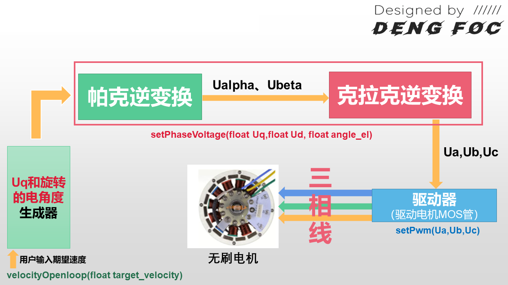
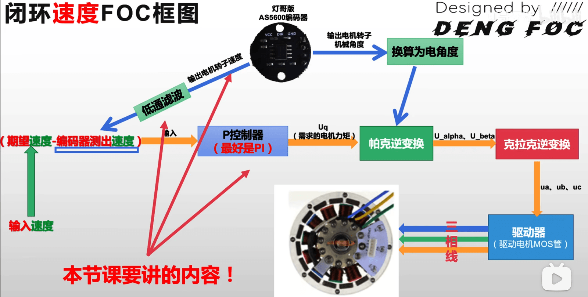
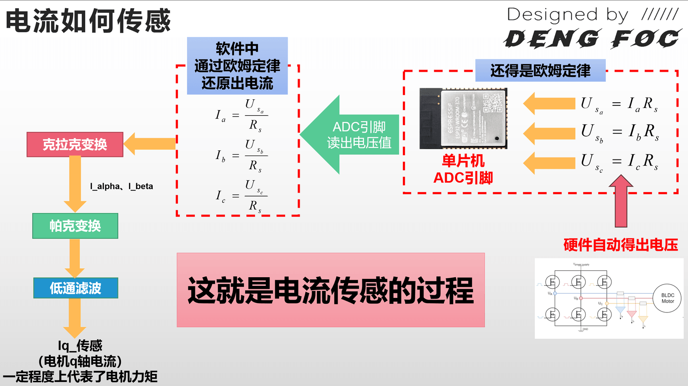
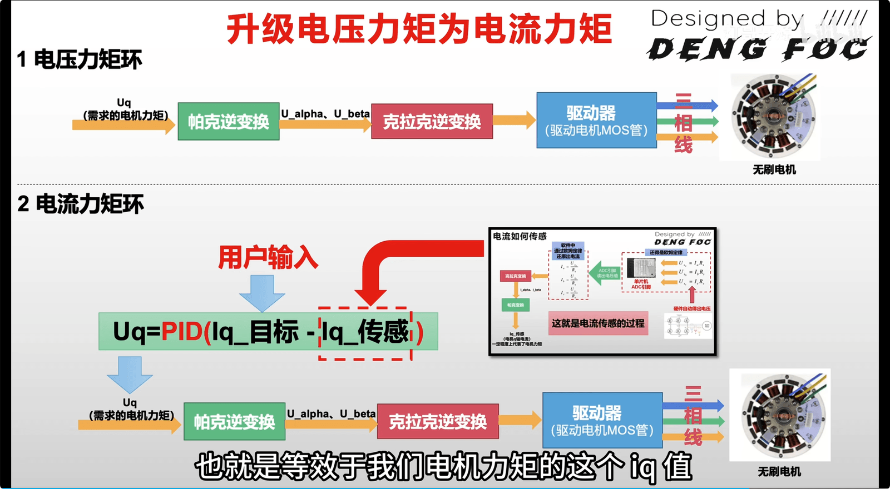

## 📘 FOC 前置知识笔记：BLDC 与 PMSM 的终极对比

在进入复杂的 FOC 速度/位置闭环控制之前，必须搞清楚 **电机本身（硬件结构）** 与 **驱动方式（控制算法）** 的区别与联系。

---
## 一、 电机硬件维度的对比 (BLDC vs PMSM)

虽然 BLDC（无刷直流电机）和 PMSM（永磁同步电机）在物理外形上长得几乎一模一样（都由定子线圈和永磁体转子组成），但它们的**内部绕线交叠方式**不同，导致了最本质的物理特性差异：

| 对比维度       | BLDC (无刷直流电机)                  | PMSM (永磁同步电机)                 |
| :--------- | :----------------------------- | :---------------------------- |
| **定子绕线方式** | **集中绕组** (线圈集中绕在定子齿上)          | **分布绕组** (线圈均匀交叠分布在多个齿上)      |
| **磁场分布形态** | **方波 / 梯形波** 磁场                | **正弦波** 磁场                    |
| **反电动势波形** | **梯形波** (Trapezoidal Back-EMF) | **正弦波** (Sinusoidal Back-EMF) |
| **设计技术初衷** | 天生为了配合 **六步换向（方波）** 驱动         | 天生为了配合 **FOC（正弦波）** 驱动        |

---
## 二、 控制方法维度的对比 (六步换向 vs FOC)

控制方法决定了驱动板（MOS管）如何给电机的三相线（A、B、C）供电。这是两种完全不同的代际控制思想：
### 1. BLDC 传统驱动：六步换向（方波控制）
* **核心动作**：任意时刻只有 **两相导通，一相断开**（悬空）。随着转子转动，磁场像手表的秒针一样，每隔 $60^\circ$ 电角度生硬地跳跃一次。
* **物理隐患**：由于电流在换向时突变（硬切换），在切换瞬间会产生明显的**转矩脉动（一顿一顿的冲击）**和高频电磁啸叫。
* **低速瓶颈**：由于是一卡一卡地跳跃，在极低速（如 1 RPM）时电机会**剧烈抖动**，根本无法实现精准的运行和定位。
### 2. 高级驱动：FOC（磁场定向控制 / 正弦波控制）
* **核心动作**：任意时刻 **三相线同时导通**（对应 `DengFOC` 源码中的 `setPwm(Ua, Ub, Uc)`）。通过数学变换连续、平滑地改变三相电压的比例，在电机内部合成一个**完美圆形、连续旋转**的磁场。
* **控制思想（解耦）**：利用克拉克与帕克变换，将混乱的三相电流解耦成：
  * $I_d$（励磁电流：用来吸住转子，无用功，FOC中通常控制其为 0）
  * $I_q$（转矩电流：用来推转子，直接决定力矩大小）
  FOC 算法会让 $I_q$ 产生的磁场**永远与转子磁场保持 $90^\circ$ 垂直相切**。好比骑在驴背上的人，手里的胡萝卜永远保持在驴正前方相同的距离，电机运行极度丝滑。
* **运行优势**：高效率、低发热、运行**绝对静音**。在低速下甚至能以 0.1 RPM 极其平稳地蠕动，并死死锁定在任意机械角度。
---
## 三、 核心认知澄清：硬件与算法的“跨界通用”

**“电机可以跨界，算法全凭驱动”**。在实际工程中，硬件和控制算法并不是死死绑定的。对于单片机和驱动板的 MOS 管来说，它们看到的都只是**三根需要灌入 PWM 电压的铜线**。
1. **用 FOC 算法驱动 BLDC 电机（常见升级方案）**：
   即使 BLDC 天生反电动势是梯形波，当你用 `DengFOC` 算法强行喂给它正弦波电流时，BLDC 电机同样能获得**脱胎换骨的丝滑感、极其静音的低速表现以及强大的位置闭环刚度**。
   * *行业现状：市面上高级的机械臂关节、云台电机，虽然电机本体常被称为 BLDC，但底层运行的全是 FOC 闭环算法。*
1. **用六步换向驱动 PMSM 电机（降级方案）**：
   把正弦波电机当普通无刷电机来硬性换向，电机能转，但由于波形不匹配，电机会产生比平时大得多的噪音、剧烈震动，效率大幅度降低。
---
## 一、开环控制



## Q&A：

### 1. PWM 频率与精度的关系
**结论：设置目标电压时只看精度（分辨率），不直接看频率。**
- **精度 8 位（2^8=256）**：意味着你把 PWM 占空比分成了 256 份。无论你的频率是 3000Hz 还是 30000Hz，代码里写的 `255` 永远代表 100% 占空比（全电压输出）。
- **3000Hz 的意义**：这是开关切换的速度。频率越高，电流纹波越小，噪音越小（3000Hz 其实在人耳听觉范围内，会有明显的啸叫声，工业通常用 10k-20kHz）。
- **关系**：频率决定了你能控制的“响应速度”，精度决定了你控制的“细腻程度”。
---
### 2. 扭矩和转速有关吗？
**在开环状态下：有关，且是“此消彼长”的痛点。**
- **物理层面**：P=T×ω（功率 = 扭矩 × 角速度）。电机输入的功率有限，转速越高，能提供的扭矩通常越小。
- **开环痛点**：在开环 FOC 中，你给固定的 Uq（电压幅值）。当转速升高，电机产生的**反电动势**（Back EMF）也会升高。反电动势会抵消掉你输入的电压，导致实际电流减小。
- **结果**：转速越快，实际电流越小，扭矩就越弱。所以开环控制在高速时往往“没力气”。
---
### 3. Uq 控扭矩，电角度控转速？
**是的，但在开环里这是“强行带跑”。**
- **Uq（电压幅值）**：它决定了定子磁场的大小。磁场越大，吸力/推力越大，即扭矩越大。
- **电角度（Phase）**：在开环里，是你**强行**让定子磁场以某个速度旋转。转子因为磁力吸引，被迫跟着这个磁场跑。
- **形象比喻**：Uq 是你手里拉驴的绳子的粗细（力气），电角度的变换频率就是你跑的速度。你跑多快，驴就得跟多快。如果 Uq 太小而你跑太快，绳子断了（磁场步进），驴就丢了（电机失步抽搐）。
---
### 4. 为什么电角度要控制在 2π 内？
**这是为了数学计算的连续性和防止溢出。**
- **周期性**：电机的磁场分布是周期的。从 0 到 2π（360°）代表磁场转完了一个完整的电周期。2.1π 和 0.1π 在 sin 函数计算结果上是一模一样的。
- **数值安全**：如果你不重置，角度会无限增加。在单片机里，`float` 或 `int` 累加到最后会溢出，导致计算崩溃。所以每次超过 2π 就减去 2π。
---
### 5. 函数逻辑链条
你的理解基本正确，完整的开环逻辑链条如下：
1. **输入目标角速度**：ω (rad/s)。
2. **计算机械增量**：ΔAnglemech=ω×Δt（Δt 为代码两次循环的时间间隔）。
3. **累加电角度**：
    Angleelec=Angleelec+(ΔAnglemech×PolePairs)
4. **限制范围**：对 Angleelec 进行 2π 取模。
5. **坐标生成**：
    - 你有手动设置的 Uq（想让电机多有力）。
    - Ud 通常设为 0。
6. **坐标变换（或直接极坐标生成）**：
    - **如果是 C-P 变换派**：把 Uq,Ud,Angleelec 丢进反 Park 变换 → 反 Clarke 变换 → Ua,Ub,Uc。
    - **如果是极坐标派**：直接 Ua=Uqsin(Angleelec) 等。
7. **输出**：将 Ua,Ub,Uc 映射到 PWM 占空比上。
---
### 6. $U_q$ 到底是怎么来的？（赋值逻辑）
在代码中，这一行决定了 $U_q$：
```cpp
float Uq = voltage_power_supply / 3;
```
**客观评价：**
这里的 $U_q$ 是**人为设定的死值**。
- **为什么要除以 3？** 这是一种保守的“安全设定”。如果供电电压是 12.6V，$U_q$ 就是 4.2V。这个电压产生的电流足以让电机在没负载时转起来，又不至于因为电流过大瞬间烧掉驱动板。
- **如何手动控制扭矩？** 如果你觉得电机没力气，把 `/3` 改成 `/2.5`；如果你觉得电机发烫厉害，改成 `/5`。
- **物理意义：** 在开环状态下，$U_q$ 模拟的是磁场的“强度”。因为没有电流传感器反馈，我们只能通过控制电压来间接控制电流（$I \approx U/R$）。
---
### 7. 什么+ voltage_power_supply / 2？（中性点偏移）
你可能注意到了代码里克拉克逆变换有个奇怪的操作：
```cpp
Ua = Ualpha + voltage_power_supply / 2;
Ub = ... + voltage_power_supply / 2;
Uc = ... + voltage_power_supply / 2;
```
**为什么要加 `power_supply / 2`？**
这就是为了维持“恒等”。
- **单电源局限：** 你的电池是 12V 到 0V，没有负电压。但正弦波（$U_{\alpha}, U_{\beta}$）是有正有负的（比如 -4V 到 +4V）。
- **抬升电平：** 加上 `VCC/2`（6V）后，原本 -4V ~ +4V 的波形变成了 2V ~ 10V。这样三相占空比就永远落在 0~1 之间，电机才能工作。
- **抵消效应：** 虽然每相都加了 6V，但电机线圈受到的电压是相与相之间的**压差**（例如 $U_a - U_b$）。两边都加了 6V，减法一做，这 6V 就抵消了。这在电学上叫**“抬升中性点电压”**。
---
### 8. $U_q$ 的极限：为什么不能超过 `supply / 2`？

代码注释里提到：`最大只能设置为 Uq = voltage_power_supply / 2`。
这是由数学定义的。在克拉克变换中：
- $U_a = U_q \sin(\theta) + \text{Offset}$
- 如果你想让 $U_a$ 的最大值不超过 $V_{cc}$，最小值不低于 $0$。
- 那么 $U_q$ 的振幅（从中心往上摆动的幅度）最大只能是 $V_{cc}$ 的一半。
如果你设置 $U_q = 10V$，供电只有 $12V$，那么加上 $6V$ 的偏移后，$U_a$ 理论上要输出 $16V$，但 PWM 最高只能给到 $12V$，波形就会变成 **“削峰”的方波** ，电机运行会变得非常粗暴、发热、噪音剧增。
---
### 9.为什么 6 个 MOS 管只需要 3 路 PWM？

在主控（STM32）和 MOS 管之间，有一个芯片叫**半桥驱动芯片**（如 EG2133（灯foc）, IR2104, FD6288）。
- 这个芯片非常聪明：你给它输入 1 路 PWM，它内部会自动帮你把它变成 2 路相反（互补）的信号去驱动上桥和下桥。
- 当你给 1（高电平）时，上桥开、下桥关；当你给 0（低电平）时，上桥关、下桥开。
- 并且，它内部会自动加入**死区时间（Deadtime）**，确保上桥完全关闭后，过一丁点时间再打开下桥。
- **结果：** 软件只需要控制 3 路 PWM（A, B, C），驱动芯片自己去变出 6 路。
---

### 10.SPWM vs SVPWM 到底有什么区别？

#### 1. 数学表现与开关状态的区别
- **SPWM（正弦脉宽调制）：** 代码利用 $U_a = U_{\alpha}$, $U_b = \dots$ 算出来的是三个标准的、独立的、互差 120 度的正弦波。在任何一瞬间，三相桥臂的开关动作是各自独立的，没有互相协同。
- **SVPWM（空间矢量脉宽调制）：**
    它不孤立地看 A、B、C 某一相，而是把三相看作一个**整体的电压矢量**。它通过计算，在一周期内组合 8 种不同的开关状态（6 个有效矢量 + 2 个零矢量），让这 6 个 MOS 管协同工作，在电机线圈里合成出一个旋转的磁场矢量。
#### 2. 优劣势对比

| **维度**      | **SPWM**                                | **SVPWM**                                                  |
| ----------- | --------------------------------------- | ---------------------------------------------------------- |
| **母线电压利用率** | **低（最高 86.6%）**<br>因为正弦波的峰值受到供电电压的严格限制。 | **高（最高 100%）**<br>通过注入三次谐波，把正弦波“压扁”成了鞍形波，利用率提升了 **15.5%**。 |
| **代码计算量**   | **极小**<br>几行简单的三角函数和加减法就能直接出结果。         | **较大**<br>需要判断当前矢量在哪个扇区，然后计算两个相邻矢量的作用时间（五段式或七段式）。          |
| **发热与噪音**   | **较差**<br>谐波成分较多，在大功率或高速时，电机发热明显，转矩脉动大。 | **极好**<br>电流波形最接近完美正弦波，电机运转最顺滑、噪音最低。                       |
|             |                                         |                                                            |
### 一个需要注意的细节
在开环控制里，你是**假设**转子已经跟上了你的电角度。所以你的 `Angle_elec` 是“自嗨”的累加值。 当你进入**闭环控制**（真正的 FOC）时，`Angle_elec` 就不能自己乱加了，必须通过编码器**实测**转子的角度，然后在它的基础上加 90°（π/2）去生成磁场，这才是真正的“定向”控制。
现在的开环练习，本质上是在练习如何**生成一个旋转磁场**。

## 二、闭环控制

## 闭环位置：
## 1. 核心转变：开环 vs 闭环
- **开环**：代码强行累加虚拟角度，拖着转子走（易失步）。    
- **闭环**：编码器实测当前角度，磁场死死粘着转子联动（永不失步）。
- **$U_q$ 变化**：从固定死值变成变量，由位置差动态决定（`Uq = Kp * 误差`）。
## 2. 隐藏的“90度魔术”
- **疑问**：代码里明明传入当前实际电角度 `_electricalAngle()`，为什么没有 `+1.57(90°)` 电机也会转？
- **真相**：秘密在帕克逆变换公式本身。当主动令 $U_d = 0$ 时，化简后的公式：
    $$U_\alpha = -U_q \sin(\theta) = U_q \cos(\theta + 90^\circ)$$
    $$U_\beta = U_q \cos(\theta) = U_q \sin(\theta + 90^\circ)$$
    **数学工具在底层自动完成了超前 90° 的物理定向。** 代码切记不要重复加 90°。
## 3. $K_p$ 的物理意义与调参
- **本质**：电机每偏离目标 **1度**，代码应该追加多大的电压（力矩）去拉它。
- **表现**：太小会因为克服不了机械摩擦产生**静差**（停不准）；太大会**临界震荡**（在目标点剧烈晃荡、啸叫）。
- **调参法**：从 0 开始往大调，找到电机刚好开始晃荡的 $K_p$ 值，乘以 `0.6` 作为最终稳定值。
## 4. 两个硬件关键脚
- **3路 PWM 控制 6个 MOS**：因为驱动板上有**半桥驱动 IC**（或单片机开启了互补通道），硬件会自动生成带死区时间（Deadtime）的互补信号，防止上下桥同时导通炸板。
- **使能脚（EN/12号引脚）**：大功率全桥的“安全总开关”。上电初始化完再拉高（`HIGH`）解锁驱动；一旦发生故障（如堵转、断线），拉低可纳秒级断电保护硬件。
- **零位对齐（`zero_electric_angle`）**：芯片屁股上的编码器 0 度与电机线圈磁场 0 度物理不重合。`setup` 里必须通过强行定向吸住电机，记录初始偏差值。
## 闭环速度：


在 FOC（磁场定向控制）控制中，闭环速度控制的本质是：**利用传感器实时获取电机的转子速度，与用户的期望速度作差得到误差，通过 PID 控制器动态调整输出力矩（$U_q$ 电压），从而对抗外力负载，维持电机恒速旋转。**

---
## 一、 新增的三个部分

相比于基础的力位控制或开环控制，速度闭环控制系统在架构上新增了三个不可或缺的反馈与处理环节：
### 1. 速度计算环节（角度的时间微分）
* **框图位置**：【AS5600 编码器】 $\to$ 【输出电机转子速度】
* **原理解析**：磁性编码器（AS5600）只能直接读取当前的**机械角度**。速度是无法直接读取的，必须在代码中通过对角度进行**时间微分**（即 $\text{速度} = \frac{\Delta\text{角度}}{\Delta\text{时间}}$）计算出来。
* **底层实现** (`AS5600.cpp`)：
  ```cpp
  float Sensor_AS5600::getVelocity() {
      // 1. 计算两次执行之间精确的采样时间差 Ts（单位：秒）
      float Ts = (angle_prev_ts - vel_angle_prev_ts) * 1e-6;
      if(Ts <= 0) Ts = 1e-3f; // 微溢出异常保护

      // 2. 结合总圈数(full_rotations)与机械角度变化量，计算出真实的弧度制速度 (rad/s)
      float vel = ( (float)(full_rotations - vel_full_rotations) * _2PI + (angle_prev - vel_angle_prev) ) / Ts;    
      
      // 3. 迭代保存历史状态，供下次循环使用
      vel_angle_prev = angle_prev;
      vel_full_rotations = full_rotations;
      vel_angle_prev_ts = angle_prev_ts;
      return vel;
  }
  ```
PS：这里的 `full_rotations`（总圈数）之所以能准确记录，全靠编码器底层（通常在 `getAngle()` 或定时器中断里）持续运行的这一行“过零滤波器”代码：
  ```cpp
if(abs(d_angle) > (0.8f * 6.28318530718f)) {
    full_rotations += (d_angle > 0) ? -1 : 1;
}
  ```
- **消灭数学假象**：磁编码器的数据永远在 $[0, 2\pi]$（0~360°）之间循环。当电机倒车跨越边界（例如从 `0.01` 弧度突变成 `6.27` 弧度）时，由于数字跳变，单次差值 `d_angle` 会瞬间暴增到接近 $2\pi$。
- **快速捕捉跳变**：因为单片机循环极快，电机在几微秒内物理上绝对不可能真的转过 80% 一圈（`0.8f * _2PI`）。所以只要 `abs(d_angle)` 触发了这个阈值，就代表**编码器越界了**。
- **精准修正速度**：
    - **正向越界**：`d_angle < 0`，三目运算符返回 `1`，`full_rotations` 加 1 圈。
    - **反向越界**：`d_angle > 0`，三目运算符返回 `-1`，`full_rotations` 减 1 圈。
### 2. 速度低通滤波器（高频噪声抹平）
- **框图位置**：【低通滤波】绿条环节
- **原理解析**：由于单片机循环速度极快，采样时间 $T_s$ 极短。在极短时间内，编码器哪怕只有 1 位的信号跳变噪声，除以微小的 $T_s$ 后误差也会被线性放大成剧烈抖动的速度毛刺。因此必须引入低通滤波器，让系统平滑地“追赶”并趋近真实速度。
- **底层实现** (`DengFOC.cpp` & `lowpass_filter.cpp`)：
  ```cpp
// 1. 在 DengFOC.cpp 中静态初始化一个时间常数为 10ms (0.01) 的滤波器
LowPassFilter M0_Vel_Flt = LowPassFilter(0.01); 

float DFOC_M0_Velocity() {
  float vel_M0_ori = S0.getVelocity();              // 获取微分算出的原始多噪速度
  float vel_M0_flit = M0_Vel_Flt(DIR * vel_M0_ori);   // 送入低通滤波器进行平滑追赶
  return vel_M0_flit;                               // 返回完美趋近真实值的平滑速度
}
  ```
### 3. 速度 PID 控制器（误差纠正核心）
- **框图位置**：【P控制器（最好是PI）】蓝框环节
- **原理解析**：系统通过 `(期望速度 - 编码器测出速度)` 计算出当前的运动误差，由 PID 控制器根据误差大小和持续时间，决定给电机追加多少力矩。
- **底层实现** (`pid.cpp` & `DengFOC.cpp`)：
  ```cpp
// 在 pid.cpp 中，核心运算逻辑包含了 P、I、D 三项的累加和限幅
float PIDController::operator() (float error){
    float proportional = P * error; // P 环：当前有误差立刻出力

    // I 环（积分）：误差不消除，出力随时间不断累加
    float integral = integral_prev + I * Ts * 0.5f * (error + error_prev); 
    integral = _constrain(integral, -limit, limit); // 积分抗饱和限幅

    float derivative = D * (error - error_prev) / Ts; // D 环：阻碍速度突变

    float output = proportional + integral + derivative;
    output = _constrain(output, -limit, limit); // 输出电压限幅
    return output;
}
  ```
## 二、 改变的一个部分
除了新增的反馈闭环，系统的底层**执行端输入**发生了根本性的改变：
### 1. 从“直接控制输出电压”变为“PID 间接接管电压”
- **框图位置**：【期望速度 - 编码器测出速度】 $\to$ 【P控制器】 $\to$ **$U_q$（需求的电机力矩）**
- **架构演进解析**：
    - **过去（纯力矩模式）**：用户直接指定 $U_q$ 电压塞给帕克逆变换（`setTorque(Target, ...)`）。电机的输出是定死的，遇到外力阻挡速度归零时，系统不会自己加大力量，没有任何抵抗能力。
    - **现在（速度闭环模式）**：用户输入的控制量变成了“期望速度（Target）”**。用户不再能直接决定驱动器输出多少伏电压，$U_q$ 电压变成了由 PID 控制器根据当前的阻力和速度误差**自动计算出来的动态电压。
- **底层接口对比** (`DengFOC.cpp`)：
  ```cpp
// 过去：纯力矩模式（用户直接输入目标电压 Target）
void DFOC_M0_setTorque(float Target) {
  setTorque(Target, _electricalAngle()); // 这里的 Target 直接就是输出电压
}

// 现在：速度闭环模式（用户输入目标速度 Target，电压改由 PID 运算得出）
void DFOC_M0_setVelocity(float Target) {
  // 1. (Target - DFOC_M0_Velocity()) 算出速度误差
  // 2. 将误差喂给 DFOC_M0_VEL_PID() 函数
  // 3. PID 运算出的 output 结果，作为新的 Uq 力矩电压传给 setTorque 执行
  setTorque(DFOC_M0_VEL_PID(Target - DFOC_M0_Velocity()), _electricalAngle());   
}
  ```
## 电流闭环：

### 1. 电流采样：如何把电流“变成”数字？
- **第一步（硬件转换）**：驱动板上串联了微小的**采样电阻 $R_s$**。三相电流通过时，电阻两端自动产生微小压差（$U = I \times R$）。
- **第二步（MCU 读取）**：单片机用 **ADC 引脚**测出这个电压，在程序里除以电阻值，还原出三相电流（$I_a, I_b, I_c$）。
- **第三步（数学解耦）**：将三相电流进行**克拉克变换**与**帕克变换**，最终解算出 **$I_q$（实际转矩电流）**。这个 $I_q$ 在物理上直接代表了电机当前的真实力矩。



### 2. 架构升级：电压力矩环 vs 电流力矩环
- **电压力矩环（老版）**：代码直接给出 $U_q$ 电压。系统对电流是“瞎子”，电机高速时力矩衰减，堵转时电流暴增容易烧板。
- **电流力矩环（新版）**：用户输入的是**目标电流（$I_{q\_目标}$，即期望力矩）**。代码通过：
    $$U_q = \text{PID}\left(I_{q\_目标} - I_{q\_传感}\right)$$
    由 PID 动态计算并接管 $U_q$ 电压。负载重了自动加压，负载轻了自动减压，既能精准控力矩，又能保护硬件不超载。


### 3. 完整三环闭环的嵌套结构
在高级控制中，FOC 采用“外环输出作为内环输入”的嵌套结构，常见三种组合：
1. **力位位置闭环（位置 - 力）**：
    - 链路：`位置环` $\to$ `电流环(Iq)` $\to$ `电压级(Uq)`    
    - 特点：无速度环，位置环直接要力矩，适合直接和外力对抗的力控机械臂。
2. **复合位置闭环（位置 - 速度 - 力）**：
    - 链路：`位置环` $\to$ `速度环` $\to$ `电流环(Iq)` $\to$ `电压级(Uq)`  
    - 特点：**工业级最完整形态**。速度环作为阻尼消除晃荡，系统既准又稳。   
3. **速度闭环（速度 - 力）**：
    - 链路：`速度环` $\to$ `电流环(Iq)` $\to$ `电压级(Uq)` 
    - 特点：无位置环，用于风扇、电调等只需要稳定转速的场景。
### 💡 终极释疑：为什么改进前后用的是同一个 PID 函数？
在看代码时，你可能会疑惑：“为什么改进前和改进后，代码里调用的都是 `DFOC_M0_VEL_PID` 这个函数？难道它能自动辨别自己输出的是电压还是电流吗？”
**答案是：函数是一样的，但装在里面的“灵魂（参数）”彻底变了。**
#### 1. PID 函数本质上只是一个“纯数学放大器”
在单片机眼里，PID 函数（`PIDController::operator()`）只是一个冷酷的数学公式。它根本不知道什么是电压，什么是电流。它只做三件事：
1. 接收一个你喂给它的数字（误差）。
2. 把这个数字乘以 $P$（比例）、做积分乘 $I$、做微分乘 $D$。
3. 把三个结果加起来，吐出一个新数字（输出）。
#### 2. 参数的不同，赋予了它不同的“物理身份”
我们可以用《电压力矩和电流力矩对比》那张图的上下两部分来做对比：
##### 🔴 改进前：它的身份是“电压控制器”
- **输入**：速度误差（$rad/s$）。
- **内部参数**：$P$ 调得比较**大**（例如 `P = 1.5`）。
- **逻辑**：速度每差 $1\,rad/s$，函数就会吐出 $1.5$ 这个数字，代码把这个数字当成 **$1.5\text{V}$ 的电压 ($U_q$)** 强行灌给电机。
##### 🟢 改进后：它的身份变成了“电流（力矩）代办员”
- **输入**：依然是速度误差（$rad/s$）。
- **内部参数**：$P$ 必须调得**极小**（例如 `P = 0.05`，通常需要缩小数倍到数十倍）。
- **逻辑**：速度每差 $1\,rad/s$，函数只会吐出 $0.05$ 这么小的数字。因为由于下游**电流闭环**的引入，电机的力量响应灵敏度暴增！代码此时把 $0.05$ 当成 **$0.05\text{A}$ 的目标电流 ($I_q$)** 传给下游。下游的电流环收到这区区 $0.05\text{A}$ 的指标，就会拼命调大电压去满足它，电机瞬间就能产生极大的推力。

> ⚠️ **避坑总结（调参必看）**：
> 如果你把改进前控制电压的大参数（如 `P=1.5`）直接用在改进后的电流闭环里，速度一有偏差，函数就会高喊：“给我整出 $1.5\text{A}$ 的巨额电流！” 这会让下游电流环瞬间拉满饱和，导致电机产生极其暴躁的死力，引发**疯狂巨烈发抖、高频啸叫，甚至瞬间烧毁驱动板和 MOS 管**。
> 所以，**改结构必改参数**。引入电流环后，速度环和位置环的 PID 参数必须**先全部清零或降到极小（如 0.01）**，重新从零由小到大慢慢往上盲调！

## 题外话：
**对齐校准：** 找出电机转子的物理机械零位与定子电磁场零位之间的偏差（即电角度零位修正值）。
## 🛠️ 核心原理：电磁吸合（Lock-in Method）
无刷电机要顺畅转动，控制器必须时刻知道转子磁铁的确切位置。但是，电机刚上电时，编码器/传感器（如 `S0`）只知道一个相对的或机械的角度，并不知道**磁场的电角度零点**在哪里。
这段代码采用了**强行通电对齐法**，分为三个步骤：
### 1. 起劲（强行拉定子磁场到固定角度）
``` cpp
M0_setTorque(3, _3PI_2); // 给 3V 电压，电角度强行定在 270°（3π/2）
```
- **原理**：控制器直接向电机施加一个固定大小（3V）和固定电角度（$\frac{3\pi}{2}$）的电压矢量。定子绕组会产生一个恒定的磁场。
- **现象**：因为这个磁场是死死固定不动的，转子磁铁会被这个强大的电磁力**强行吸引并对齐**到这个特定的电角度方向。此时，电机可能会抖动一下，然后卡死在这个位置不动。
### 2. 测量与记录零位
``` cpp
delay(1000); // 等待1秒，让电机充分稳定下来，不再抖动
S0.Sensor_update(); // 更新传感器数据
S0_zero_electric_angle = S0_electricalAngle(); // 读取当前的电角度
```
- **原理**：经过 1 秒的稳定，转子已经稳稳地停在了定子对应的 $\frac{3\pi}{2}$ 电角度位置。
- **核心目的**：此时，传感器读取到的角度值 `S0_electricalAngle()`，就是**机械物理位置与电角度之间的偏差基础值**。
- 控制器会把这个读数记录为 `S0_zero_electric_angle`。在后续电机正常运转时，每次读取传感器角度，都要**减去**这个零位偏差，才能得到用于 FOC 算法的真实、准确的电角度。
### 3. 松劲（释放电机）
``` cpp
M0_setTorque(0, _3PI_2); // 电压清零，解除锁定
```
- **原理**：校准已经完成，把电压设为 0V，让电机恢复自由转动状态（松劲），避免电机长时间通电发热或烧毁。
## 💡 为什么固定在 `_3PI_2` ($270^\circ$)？
在 FOC 控制中，如果想产生最大的扭矩，定子磁场应该领先转子磁场 $90^\circ$（即 $\frac{\pi}{2}$）。
在代码的 `M0_setTorque` 内部，第一步有这样一行代码：
``` cpp
angle_el = _normalizeAngle(angle_el + _PI_2); // 将角度前移了 90° (π/2)
```
由于函数内部自动加了 $\frac{\pi}{2}$，当你在外面传入 `_3PI_2` ($270^\circ$) 时，内部实际计算 SVPWM 扇区时的角度变成了：

$$270^\circ + 90^\circ = 360^\circ = 0^\circ$$

在 SVPWM 空间矢量图中，$0^\circ$（或 $360^\circ$）正好处在 **A 轴（Phase A）的正方向**上。这意味着此时控制器在全力向 A 相通电。转子的 N 极会被强行吸引并对齐到 A 相绕组的方向。
