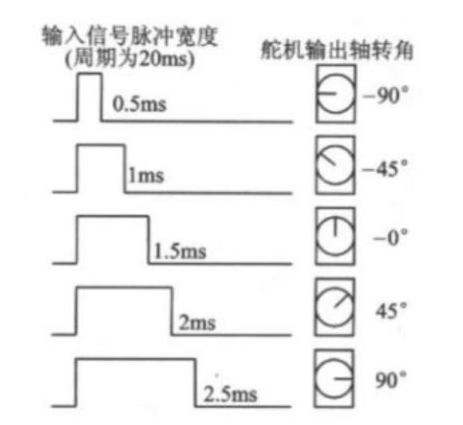
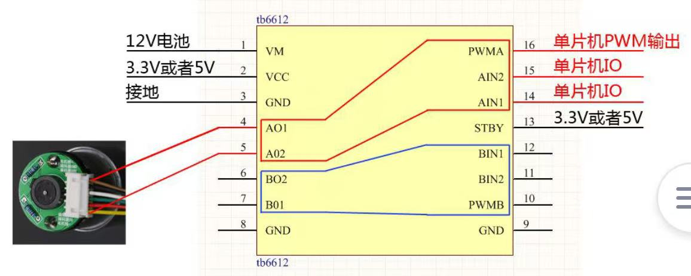

## 电控入门到入土

## 萌新开始了电控的学习……

目前开发环境：cubeIDE

obtained list：

* 点灯
* GPIO
* 中断
* 串口
* DMA
* IIC
* OLED
* 定时器
* 输入捕获
* PWM
* 编码器
* 舵机
* 电机

先转战lerobot了，之后计划：

* PID
* 上位机
* 蜂鸣器
* ADC
* rtos
…………
## stm32

| **功能**         | **常见位置**                | **用途**                      |
| -------------- | ----------------------- | --------------------------- |
| **PWM (定时器)**  | **PA0, PA1, PA8...**    | **控制舵机**（必须接在有定时器输出功能的引脚上）。 |
| **UART (串口)**  | **PA9 (TX), PA10 (RX)** | **接模块**                     |
| **ADC (模数转换)** | **PA0, PA1...**         | **测电池电压**。                  |
| **I2C (通讯)**   | **PB6, PB7...**         | 接陀螺仪（IMU）或 OLED 屏幕。         |
| **SWD (调试口)**  | **PA13, PA14**          | **烧录程序专用**                  |
### 舵机

三根线

|**颜色 (常见)**|**颜色 (老款/部分品牌)**|**名称**|**功能描述**|
|---|---|---|---|
|**红色**|**红色**|**VCC (正极)**|给舵机内部的直流电机和控制电路**供电**。通常需要 4.8V - 6V。|
|**棕色** 或 **黑色**|**黑色**|**GND (负极)**|电源地线，必须与 STM32 的 GND **共地**。|
|**橙色** 或 **白色**|**黄色** 或 **蓝色**|**PWM (信号线)**|接收来自 STM32 的 **脉冲信号**。舵机通过识别脉冲宽度来决定转动角度。|

舵机占空比

### 电机

最简单的电机只有正负极，通过电压控制速度。

电机驱动板

|**pin**|**真值1**|**真值2**|**真值3**|
|---|---|---|---|
|**AIN1**|0|1|0|
|**AIN2** |0|0|1|
|**状态** |停止|正|负|

* 编码器：检测A\B相的方波

  *四倍频提升精度*

* PID 代表三个项：**P（比例 Proportional）**、**I（积分 Integral）**、**D（微分 Derivative）**。

PID 的本质是处理 **误差（Error）**。

$$Error = 目标值 - 当前值$$

- **P (比例)：当下执行。** 误差越大，动力越大。
    
- **I (积分)：历史纠偏。** 如果一直有小误差对不准，就把它累加起来，给一个持续的推力。
    
- **D (微分)：预测未来。** 阻尼作用。如果快要撞线了，赶紧踩刹车，防止冲过头。

1. **先调 P：** 把 I 和 D 都设为 0。从小到大增加 P，直到云台开始出现**轻微的左右晃动**，然后稍微往回调小一点。
    
2. **再调 D：** 增加 D，你会发现刚才的晃动消失了，云台变得“沉稳”了，能快速停住。
    
3. **最后调 I：** 如果发现云台最后总是差那么一丁点对不准中心，稍微加一点 I，直到误差消失。

### 1. 理想状态的数学公式（连续型）

这是你在教科书上看到的原始公式，它基于时间 $t$ 的积分和导数：

$$u(t) = K_p \cdot e(t) + K_i \int_{0}^{t} e(\tau) d\tau + K_d \frac{de(t)}{dt}$$

- **$u(t)$**: 控制器的输出（比如 PWM 占空比）。
    
- **$e(t)$**: 偏差，即 $Target - Measured$（目标值 - 当前值）。
    

---

### 2. 编程使用的公式（离散型）

单片机（STM32）是数字系统，无法进行连续积分。我们每隔一段时间（采样周期 $\Delta t$）计算一次误差。

#### **方案 A：位置式 PID（最适合舵机/人脸跟踪）**

它直接计算出当前的**目标输出值**。

$$Output = K_p \cdot err(n) + K_i \sum_{i=0}^{n} err(i) + K_d \cdot [err(n) - err(n-1)]$$

- **比例项 (P)**: $K_p \times \text{当前误差}$。
    
- **积分项 (I)**: $K_i \times \text{所有历史误差的总和}$。
    
- **微分项 (D)**: $K_d \times (\text{当前误差} - \text{上一次误差})$。
    

---

#### **方案 B：增量式 PID（最适合直流电机调速）**

它计算的是**输出的改变量**（这次比上次增加或减少多少）。

$$\Delta Output = K_p [err(n) - err(n-1)] + K_i \cdot err(n) + K_d [err(n) - 2err(n-1) + err(n-2)]$$

- **优点**：不需要累加误差，计算量小，且当电脑或系统崩溃时，输出不会剧变，更安全。

噢no， 我用万用电表误连12v的vm把我c8t6和stlink都烧了 2026-3-26 1：17

耶，今天下午成功让小车的一个电机转起来了（因为没板子了，只有让，小车当受害者了），晚上已经可以用vofa通过串口读取编码器的值了！！！2026-3-27 1：54

转速：
**M法测速**（在固定时间内数脉冲）
**T法测速**（测周期）

**原理**：不数一段时间内有多少脉冲，而是测量**两个相邻脉冲之间的时间间隔**。

- **做法**：使用定时器的**输入捕获（Input Capture）**功能。每当编码器产生一个脉冲，定时器就记录下当前的计数值（时钟频率通常为 72MHz）。
    
- **优点**：在低速时极其精准。即使电机转得很慢，两个脉冲之间的时间差也能被精确到纳秒级，从而计算出极其平滑的瞬时速度。
    
- **缺点**：高速时由于两个脉冲太近，误差会增大。
    
**M/T 综合运算法**（最常用）

这是工业伺服驱动器常用的算法。它结合了 M 法（数脉冲）和 T 法（测时间）：在固定时间内数脉冲，但同时精确记录第一个脉冲和最后一个脉冲发生的时刻，从而消除量化造成的“阶梯”。

**软件算法**——低通滤波（LPF）

如果你不想改硬件配置，最简单的方法是给离散的 `encoder_counter` 加一个**一阶低通滤波器**。这会让跳变的数字变得“圆滑”，模拟出连续的效果：

奋斗到4：00终于成功完成单轮闭环了🤟 2026-3-31

**MPU6050**
欧拉角：**航向角（Yaw）**、**俯仰角（Pitch）** 和 **横滚角（Roll）**
获取这些姿态：DMP (硬件方案)、卡尔曼滤波 (算法方案)、互补滤波 (最简单方案)
描述姿态的数学工具：四元数、欧拉角

DMP可以将原始角速度数据转换为4元组数据，这正是DMP的意义所在。进而完成欧拉角的计算。

**我们为什么不用欧拉角来表示旋转而要引入四元数呢？**

一方面是因为欧拉角微分方程中包含了大量的三角运算，这给实时解算带来了一定的困难。而且当俯仰角为90度时方程式会出现神奇的“GimbalLock”（万向锁）。所以欧拉角方法只适用于水平姿态变化不大的情况，而不适用于全姿态飞行器的姿态确定。

四元数姿态解算的基本步骤：

* 初始化四元数：初始状态下，四元数设为单位四元数，即 q0=1,q1=q2=q3=0。
* 读取传感器数据：从MPU6050读取加速度计和陀螺仪的原始数据，并将陀螺仪数据转换为弧度。
* 加速度计归一化：将加速度计数据归一化，以提取重力方向。
* 计算姿态误差：通过加速度计和四元数推导出的重力方向的差异，计算姿态误差。
* 互补滤波：将姿态误差反馈到四元数更新中，结合陀螺仪数据，通过互补滤波器修正四元数。
* 四元数更新：通过微分方程更新四元数，并进行归一化处理。
* 计算欧拉角：将四元数转换为欧拉角，得到俯仰角、横滚角和偏航角。
磨了好几天发现成果一直在零飘不知道原因。准备先放一下。
