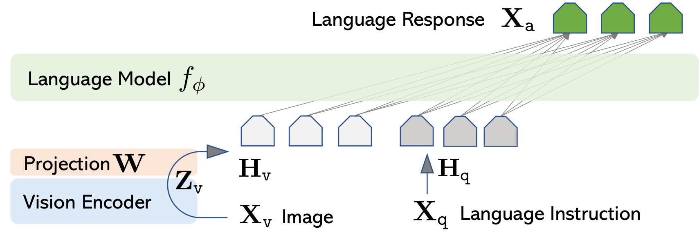

### 一、有什么用？解决了什么问题？

**1. 解决了什么痛点：**

- **传统 VQA / 描述模型的局限：** 早期的多模态模型（如 BLIP-2、Flamingo）训练成本高昂，且只能做单轮问答或简短描述，无法像 ChatGPT 那样进行复杂推理、多轮逻辑对话、代码生成或理解图中的幽默/深层意图。
    
- **数据获取瓶颈：** 高质量的多模态指令微调数据（例如“看图写代码”、“解释图中的逻辑矛盾”）极难人工标注。LLaVA 提出用纯文本的 **GPT-4 纯靠图像描述生成多模态指令数据** 的新思路，极低成本解决了数据难题。
    
**2. 实际用途：**
- **多轮看图对话：** “图里的猫在干嘛？它看起来开心吗？为什么？”
    
- **看图推理与代码生成：** 传入一张网页原型草图，让其输出 HTML/CSS 代码；或者传入一张数学几何题图片，让其按步骤推导。
    
- **图文混合指令理解：** 结合图像内容执行复杂自然语言指令。
    
### 二、架构具体怎么来的？

LLaVA 的核心思想是**尽量不破坏预训练模型的既有能力，只做语义空间的对齐**。

它的架构由三部分极简拼接而成：

1. **视觉编码器（Vision Tower）：**
    
    - 采用预训练好的 **CLIP-ViT-L/14**。
        
    - 作用：把输入的图像 $X_v$ 转化为一系列 patch 的特征向量 $Z_v$。
        
    - 关键细节：保留倒数第二层（Last layer before pooling）的特征输出，不使用 [CLS] token，保留每个 patch 的空间信息。
        
2. **连接层 / 投影层（Projection Matrix）：**
    
    - 采用 **线性变换层 $W$**（简单的 Linear Projection，在 LLaVA-1.5 中升级为两层 MLP）。
        
    - 作用：把 ViT 输出的维度（例如 1024 维）映射到 LLM 的词向量维度（例如 4096 维），得到视觉 Token $H_v$。
        
    - **公式：** $H_v = W \cdot Z_v$
        
3. **大语言模型（Language Model / LLM）：**
    
    - 采用 **LLaMA / Vicuna**。
        
    - 作用：接收拼接后的 Token 序列（视觉 Token + 文本指令 Token），直接像处理普通纯文本一样逐字生成回答。
  
  **核心流程拆解如下：**
**1. 图像特征提取与投影（左侧路径）**
- **$X_v$ (Image)：** 原始输入的图片。
- **Vision Encoder：** 图像编码器（预训练好的 CLIP ViT）。图片经过它处理后提取出视觉特征向量 **$Z_v$**。
- **Projection $W$：** 线性投影层（矩阵 $W$）。因为 $Z_v$ 的维度和 LLM 词向量维度不一致，所以通过 $W$ 进行线性变换，将视觉特征转化为 LLM 能听懂的 **视觉 Token（$H_v$）**（图中左边 3 个蓝色框）。
**2. 文本指令编码（右侧路径）**
- **$X_q$ (Language Instruction)：** 用户输入的文本问题或指令（例如：“这幅画表达了什么？”）。
- **文本嵌入：** 经过 LLM 自带的 Embedding 层，转化为 **文本 Token（$H_q$）**（图中右边 3 个灰色框）。
**3. Token 拼接与语言模型推理（上方）**
- **输入拼接：** 将 **视觉 Token（$H_v$）** 和 **文本 Token（$H_q$）** 在时间序列维度上**从左到右直接拼在一起**，形成一段包含图文信息的完整 Token 序列。
- **Language Model $f_\phi$：** 大语言模型（如 LLaMA / Vicuna）。它将整串 Token 视作普通的上下文，以自回归的方式（Next-token prediction）逐步预测并输出最终的**文本回答 $X_a$ (Language Response)**（图中上方的绿色框）。


**整体 Token 拼接格式：**

假设用户问 `"What is in the image?"`，模型收到的输入为：

`[VISUAL_TOKEN_1, VISUAL_TOKEN_2, ..., VISUAL_TOKEN_N] + "What is in the image?"`

### 三、如何实现？（训练两步法）

LLaVA 的实现核心在于**两阶段训练法（Two-stage Training）**：
#### 阶段一：多模态特征对齐预训练（Feature Alignment Pre-training）

- **目的：** 让线性层 $W$ 学会“将视觉特征翻译成 LLM 能听懂的文本Embedding”。
    
- **冻结/训练策略：**
    
    - **冻结：** 视觉编码器（ViT）、大语言模型（LLM）。
        
    - **仅训练：** 投影层 $W$。
        
- **数据：** CC3M 筛选出的 595k 个简单的 `<图像, 简短描述>` 采样对。
    
- **任务：** 简单地预测图像描述文本（Next-token prediction）。
    
#### 阶段二：端到端指令微调（End-to-End Fine-tuning）

- **目的：** 提升复杂推理、指令遵循和多轮对话能力。
    
- **冻结/训练策略：**
    
    - **冻结：** 视觉编码器（ViT）。
        
    - **训练：** 投影层 $W$ + 大语言模型（LLM）。
        
- **数据：** 使用 GPT-4 自动生成的 158k 多模态指令数据集（包含对话、详细描述、复杂推理三类）。
    
- **任务：** 自回归生成文本回答，采用标准交叉熵损失计算。
    
### 总结核心逻辑

```
[图像 Input] 
    │
    ▼
[CLIP ViT-L/14] (冻结)
    │ 得到图像 Patch 特征 (如 256x1024)
    ▼
[Linear/MLP Projection] ─── (关键对齐层，转换维度至 256x4096)
    │
    ├──────────────────────┐
    ▼                      ▼
[视觉 Token]     +     [文本 Token (Prompt)]
    │                      │
    └──────────┬───────────┘
               ▼
   [LLaMA/Vicuna 语言模型]
               │
               ▼
     [文本输出 Answer]
```

LLaVA 的突破之处在于证明了：**不需要复杂复杂的跨模态交叉注意力机制（Cross-Attention），只要特征空间对齐，直接把图像 Token 作为 Prefix 喂给 LLM，LLM 就能凭自己的语言能力理解并推理图像内容。**
