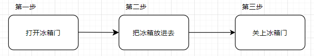
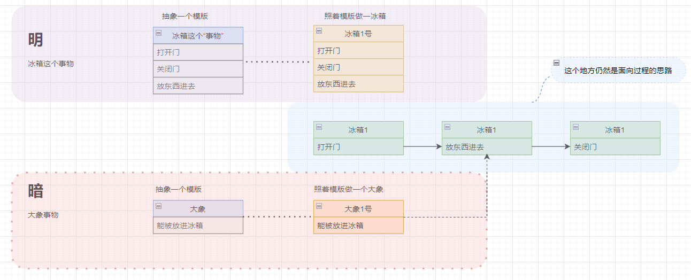

## 1. 核心概念对比
### 面向过程 (POP)
- **核心思想：** 将程序视为一系列**步骤**的集合。开发者关注的是“为了解决这个问题，我需要按顺序执行哪些操作”。
- **核心单位：** 函数（Function/Procedure）。数据与处理数据的函数是分离的。

### 面向对象 (OOP)
- **核心思想：** 将程序视为一系列**对象**的交互。开发者关注的是“这个问题涉及哪些实体（对象），它们有什么属性，能做什么行为”。
- **核心单位：** 对象（Object），它是“数据”与“行为”的封装体。

## 2. 编程语言支持情况

|**语言**|**面向过程支持**|**面向对象支持**|**说明**|
|---|---|---|---|
|**C**|原生支持|不支持|纯粹的面向过程语言。|
|**C++**|支持|原生支持|混合型语言，既能写过程式代码，也能写面向对象代码。|
|**Python**|支持|原生支持|一切皆对象，但写简单脚本时常采用过程式风格。|

## 3. 具体表现（代码视角）
## 1. 面向过程 (C 语言)
在 C 语言中，数据是**被动**的（存储在 `struct` 中），逻辑是**独立**的（函数负责处理数据）。
```c
#include <stdio.h>

// 1. 定义数据结构
struct Cat {
    char name[20];
    int age;
};

// 2. 定义函数：逻辑与数据分离，通过参数传递数据
void make_sound(struct Cat *cat) {
    printf("%s (年龄:%d) 阿米嘎蒂朵喵喵\n", cat->name, cat->age);
}

int main() {
    // 初始化数据
    struct Cat myCat = {"哈基米", 2};
    
    // 调用函数处理数据
    make_sound(&myCat);
    
    return 0;
}
```
## 2. 面向对象 (C++ 语言)
C++ 通过 `class` 将数据（成员变量）和行为（成员函数）封装在一起，形成了**对象**。
``` cpp
#include <iostream>
#include <string>

// 1. 定义类：将属性和行为封装在一起
class Cat {
public: // 公开访问权限
    std::string name;
    int age;

    // 构造函数：初始化对象
    Cat(std::string n, int a) : name(n), age(a) {}

    // 成员函数：对象自己的行为
    void make_sound() {
        std::cout << name << " (年龄:" << age << ") 阿米嘎蒂朵喵喵" << std::endl;
    }
};

int main() {
    // 实例化对象
    Cat myCat("哈基米", 2);
    
    // 调用对象自身的方法
    myCat.make_sound();
    
    return 0;
}
```
## 3. 面向对象 (Python 语言)
Python 是一切皆对象的语言，即使是简单的逻辑也往往通过类来组织。它的写法比 C++ 更简洁，但核心逻辑是一致的。
``` python
class Cat:
    # 构造函数：初始化实例属性
    def __init__(self, name, age):
        self.name = name
        self.age = age

    # 实例方法：描述对象的行为
    def make_sound(self):
        # 通过 self 访问对象内部的数据
        print(f"{self.name} (年龄:{self.age}) 阿米嘎蒂朵喵喵")

# 创建实例 (对象)
my_cat = Cat("哈基米", 2)

# 调用方法
my_cat.make_sound()
```
### 总结：表现差异点
- **数据访问方式：**
    - **C:** 你必须显式地把数据结构传递给函数（`make_sound(&myCat)`）。
    - **C++/Python:** 对象内部隐藏了数据，你只需告诉对象“去做什么”（`myCat.make_sound()`），对象会自动处理内部数据。
- **组织结构：**
    - **C:** 就像一本“操作手册”，把每一个动作（函数）列出来，数据只是被操作的对象。
    - **C++/Python:** 就像“造一个机器人”，每个机器人内部都自带了它的零件（属性）和说明书（方法）。

**核心感悟：** 面向对象通过 `this` (C++) 或 `self` (Python) 把操作权限“下放”给了对象本身。这样当你代码里有 100 只猫时，每一只猫都自带“叫”的功能，而不需要你额外写 100 次 `make_sound` 的调用逻辑。
## 4. 优缺点对比
### 面向过程
- **优点：**
    - **高性能：** 无需处理复杂的对象模型，内存开销小，执行效率极高（适合底层驱动、嵌入式）。
    - **逻辑直观：** 对于简单任务，按步骤写代码非常快。
- **缺点：**
    - **难以维护：** 当代码量巨大时，由于数据和行为分离，修改一个结构体可能导致所有相关函数都要改，代码耦合度极高。
    - **代码复用差：** 难以像“积木”一样移植功能。
### 面向对象
- **优点：**
    - **高可维护性：** 通过**封装、继承、多态**三大特性，代码模块化程度极高。
    - **易于扩展：** 新增功能只需增加类，无需动旧代码。
    - **利于团队协作：** 每个人负责不同的类，边界清晰。
- **缺点：**
    - **学习曲线陡峭：** 需要理解类、接口、设计模式等概念。
    - **性能损耗：** 对象创建和动态分发（多态）会带来微小的性能开销（在现代硬件上通常可忽略不计）。
## 总结：
- **选择面向过程：** 当你追求**极致的执行效率**，或者项目非常小、逻辑非常简单时（例如：操作系统内核、简单的硬件控制程序）。
- **选择面向对象：** 当项目具有**复杂逻辑**，需要长期维护，或者需要频繁扩展功能时（例如：大型企业软件、GUI应用、复杂游戏逻辑）。
大部分现代应用开发，其实都是**混合使用**的：利用 OOP 来构建系统的整体架构，利用 POP（函数式编程）来处理具体的逻辑细节。
